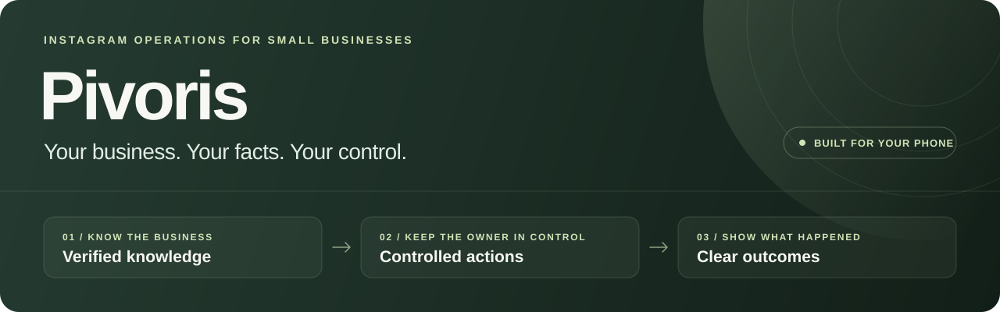
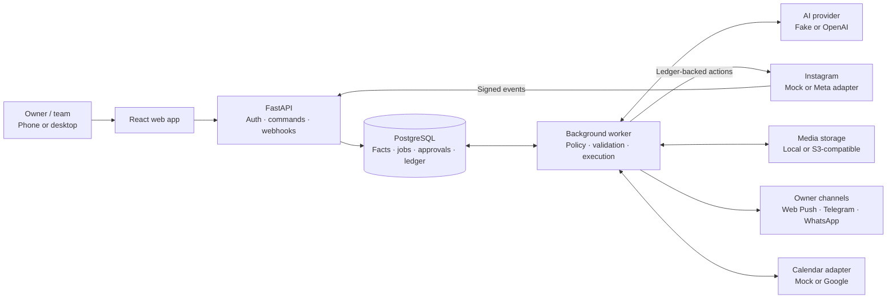

<p align="center">
  
</p>

<h1 align="center">Pivoris</h1>

<p align="center">
  <strong>An Instagram operations assistant for small businesses.</strong><br>
  Grounded customer replies, content planning, and daily oversight — built around the owner's control.
</p>

<p align="center">
  <strong>Turkish-first</strong> · <strong>Mobile-first</strong> · <strong>Credential-free local demo</strong>
</p>

<p align="center">
  <a href="#why-pivoris">Why Pivoris</a> ·
  <a href="#what-you-can-do">Features</a> ·
  <a href="#run-locally">Run locally</a> ·
  <a href="#architecture">Architecture</a> ·
  <a href="#documentation">Documentation</a>
</p>

## Why Pivoris

Running a small business already takes a full day. Instagram adds another shift: answering the same price questions, following up on enquiries, preparing posts, and keeping every reply consistent when something changes.

Pivoris brings that work into one place. It keeps verified knowledge about the business, uses it to help customers, prepares content, and gives the owner a clear view of what needs attention. Owners can work from their phones and give instructions in everyday Turkish or English.

The product is built for local businesses: cafés, salons, boutiques, fitness studios, clinics, and service businesses. Category presets adapt the setup; the underlying workflows are shared. The initial market is Türkiye, with assisted onboarding and an English experience in the same application.

> The business owner should not have to adapt to the software. The software should adapt to how the business owner works.

### A price change should change everything that depends on it

Imagine a Pilates studio changes its monthly membership from **6,000 TL to 7,000 TL**.

1. The owner writes **“Aylık üyelik artık 7.000 TL.”** Pivoris shows the proposed change and affected items for confirmation.
2. Once confirmed, the new verified price becomes the source for future assistant replies.
3. Pending replies using the old fact are invalidated and redrafted. Affected scheduled content is placed on hold for review.
4. Replies show the fact sources and verification dates. The activity log records the change, and reports count confirmed outcomes.

Knowledge, conversations, content, and reporting share the same operational record. Follow the [price-change demo](docs/operations/demo-price-change-hold.md) to explore this loop locally.

## What you can do

| Capability | What it means for the business |
|---|---|
| **Verified business knowledge** | Maintain versioned prices, hours, services, contacts, policies, and promotions. Import suggestions from pasted text, an Instagram profile, or a website, then review them before verification. |
| **Customer conversations** | Draft grounded DM replies, reuse approved answers, review fact sources, take over a thread, and route complaints or uncertain requests to a person. Voice transcription and image descriptions help review incoming media. |
| **Account Agent** | Hold multi-turn conversations with scoped customer memory, a configurable personality, and owner questions when information is missing. Set each supported action to **off**, **ask**, or **automatic**, subject to server policy and provider capabilities. |
| **Content and scheduling** | Prepare captions, upload media, render branded cards from verified facts, and approve or schedule supported feed images, Stories, carousels, and Reels. Fact changes flag dependent content for review. |
| **Bookings** | Review availability and proposed appointments through the calendar integration. Booking actions require approval in the pilot policy, and customer confirmations depend on verified provider results. |
| **Natural-language control** | Update a fact, request content, reschedule a post, pause the assistant, or ask about activity using Turkish or English commands. Changes use explicit confirmation. |
| **Owner notifications** | Review work in the web app, opt into Web Push, or link Telegram. Optional WhatsApp supports notifications and approval buttons within its supported messaging window. |
| **Reports and follow-up** | See daily activity, missed-customer reports, and a lightweight call-back list with CSV export. Optional follow-up drafts require approval and remain subject to the messaging window. |
| **Team access** | Work across isolated workspaces with owner, manager, and staff permissions, member invitations, and an inspectable activity history. |

The interface and owner commands support **Turkish and English**. Customer reply support also includes **Russian, German, and Arabic**; these are reply languages, not additional interface languages. Real-model quality across languages remains a live acceptance task.

### Current status

**Active pilot development.** Local simulated workflows and provider adapters are implemented. Real Instagram messaging, comments, publishing, Google Calendar, owner-channel delivery, and model/media quality have separate live acceptance requirements. An implemented adapter or passing mock test does not establish a verified live capability; account permissions and feature gates still apply.

The latest [review follow-up](docs/implementation/account-agent-pilot-readiness/review-fix-followup-report.md) records targeted regression results and two existing voice-path integration failures. The [pilot close-out report](docs/implementation/account-agent-pilot-readiness/s11-report.md) catalogs pending live checks. Earlier phase documents retain their historical status; use the relevant recent reports alongside the code.

## How Pivoris earns trust

**Verified facts supply business values.** Assistant-generated prices, opening hours, contact details, and other critical claims are rendered from usable, verified facts and checked by a claim validator. Imported text produces suggestions for review.

**The owner delegates; the model proposes.** Routine verified questions may be answered automatically only when the owner has granted that authority and all policy checks pass. Custom quotes, discounts, complaints, unclear requests, and media-derived replies retain approval, handoff, or blocking rules. Typed tools and deterministic checks enforce permissions outside the model.

**Approval applies to the exact action.** Approvals are tied to a version and payload, expire, and can be used only once. A changed fact, revoked permission, or paused agent can invalidate pending work. Free text never counts as approval.

**Outcomes have evidence.** Sends, publications, and calendar changes pass through an operations ledger. Uncertain results remain visible and are reconciled before a retry; an ambiguous DM is never automatically resent. Reports aggregate stored records, and simulated results carry explicit labels.

**Practice stays isolated.** The test chat uses the selected controller's proposal path and displays the decision and facts used. It creates no customer messages, approvals, bookings, customer memory, or reporting activity.

The enforcement mechanisms and regression expectations are documented in the [engineering invariants](docs/invariants.md) and [Account Agent contracts](docs/architecture/account-agent-contracts.md).

## Run locally

The default demo uses a deterministic AI provider, simulated Instagram, and local media storage. **No Meta account, API key, or paid service is required.** Dependency installation requires internet access.

### Prerequisites

| Tool | Requirement |
|---|---|
| Git | A recent version |
| Docker Desktop / Docker Compose | PostgreSQL 16; the database is exposed on port `5433` |
| [uv](https://docs.astral.sh/uv/) | Installs Python 3.12 and the backend dependencies |
| Node.js | **22.13+**; CI uses Node 22 |

### 1. Set up the demo

From the repository root, in **PowerShell**, run each command after the previous one succeeds:

```powershell
# Preserve an existing local configuration.
if (-not (Test-Path .env)) { Copy-Item .env.example .env }
docker compose up -d --wait postgres

cd backend
uv python install 3.12
uv sync --locked
uv run alembic upgrade head
uv run python -m app.cli seed

cd ../frontend
npm ci
```

On macOS or Linux, replace the first command with `test -f .env || cp .env.example .env`; the remaining commands are the same. The seed command adds fictional businesses, users, verified facts, simulated accounts, and sample history. It is safe to repeat without resetting the demo.

For a fresh configuration, these defaults enable the offline demo. If you already have a `.env`, check them before running:

```dotenv
LLM_PROVIDER=fake
INSTAGRAM_ENABLED_PROVIDERS=mock
MEDIA_STORAGE_BACKEND=local
DEMO_TOOLS_ENABLED=true
```

### 2. Start three terminals

Open each terminal at the repository root and leave these processes running:

**API**

```powershell
cd backend
uv run uvicorn app.main:create_app --factory --reload --port 8000
```

**Background worker**

```powershell
cd backend
uv run python -m app.worker
```

**Web app**

```powershell
cd frontend
npm run dev
```

Open **[localhost:5173](http://localhost:5173)**. The worker handles drafting, commands, sends, publishing, and reports; it must be running for queued work to finish.

### 3. Explore as an owner

Sign in as **`owner@demo.local`** using `DEMO_PASSWORD` from `.env` (`demo-password` in the example configuration). Choose **Gölkent Fitness & Pilates** for the Turkish demo or **Harbor Café & Bakery** for the English demo. Manager and staff demo accounts are available in the [local development guide](docs/operations/local-development.md#5-demo-data-seeded).

Start with business knowledge, then try the assistant test chat. Use **More → Developer tools** to simulate a price question, approve the draft in the inbox, and inspect the simulated send. Create a price-related post and change the price to see the hold-and-review behavior.

Seeded accounts start with the standard drafting workflow. The Account Agent is an explicit, per-account choice; see the [activation and rollback guide](docs/operations/account-agent-rollout.md) for its controls and acceptance gates.

For video uploads, install **ffmpeg and ffprobe**, or use the development-only `VIDEO_PROBER=fake` option. The [local development guide](docs/operations/local-development.md) also covers phone access, failure simulation, demo resets, and optional providers.

## Architecture

Pivoris is a **modular monolith**. The API and worker share the backend codebase, while PostgreSQL holds application state, scheduled jobs, approvals, and operation evidence.



| Layer | Stack |
|---|---|
| **Application UI** | React, TypeScript, Vite, Tailwind CSS, React Router, TanStack Query, i18next |
| **Backend** | Python 3.12, FastAPI, Pydantic, SQLAlchemy 2, psycopg 3, Alembic |
| **Persistence and jobs** | PostgreSQL 16; durable job queue with leases, deduplication, and scheduled recovery |
| **AI execution** | Bounded structured tasks plus an account-scoped agent with a typed tool broker and action delegation |
| **Provider boundaries** | Instagram, LLM, calendar, media storage, transcription, and owner channels behind adapters with local test doubles |
| **Verification** | pytest, deterministic AI evals, Vitest, Playwright, accessibility checks, and generated API-client drift checks |

The job system runs on PostgreSQL without Redis or Celery. Provider calls run outside database transactions. Workspace membership, scoped records, composite foreign keys, and row-level security enforce tenant boundaries.

### Repository map

```text
backend/             API, worker, CLI, migrations, tests, and AI evaluations
  app/agent/         Account Agent, delegation, memory/tool coordination
  app/knowledge/     Verified facts, imports, rendering, and claim validation
  app/operations/    External action ledger, executors, and reconciliation
frontend/            Authenticated business application
landing/             Separate public pilot-waitlist site
docs/                Product specification, architecture, decisions, and runbooks
shared/              Shared fixtures
docker/              Local database initialization
scripts/             Repository tooling
.github/             CI workflows and verification scripts
```

The [landing page](landing/README.md) runs separately on port `5174`. Its waitlist form needs a configured backend endpoint to submit entries.

## Development checks

Run backend checks from `backend/` with the local PostgreSQL service running:

```powershell
uv run ruff check .
uv run ruff format --check .
uv run mypy app
uv run lint-imports
uv run pytest
uv run python -m evals run --all --provider fake --strict
uv run python -m evals.account_agent
```

Run frontend checks from `frontend/`:

```powershell
npm run lint
npm run typecheck
npm test
npm run i18n:check
npm run build
```

For browser tests, install Chromium and WebKit once with `npx playwright install chromium webkit`, then run `npm run e2e`. The suite seeds and resets demo data; use a disposable local environment. Backend tests require a dedicated database whose name ends in `_test` and rebuild its schema. Full setup and test boundaries are in the [development guide](docs/operations/local-development.md#4-tests).

API contracts are committed as OpenAPI and generated TypeScript types. Endpoint changes must update both; see [regenerating the API client](docs/operations/local-development.md#regenerating-the-api-client).

## Documentation

| Start here when you want to… | Read |
|---|---|
| Understand the product and its boundaries | [Vision](docs/product/vision.md) · [MVP scope](docs/product/mvp-scope.md) · [User journeys](docs/product/user-journeys.md) |
| Browse the engineering specification | [Documentation index](docs/README.md) · [Glossary](docs/glossary.md) |
| Understand how the system works | [System overview](docs/architecture/system-overview.md) · [Component design](docs/architecture/component-design.md) · [Decision records](docs/architecture/decisions/README.md) |
| Work on the agent | [Account Agent contracts](docs/architecture/account-agent-contracts.md) · [Practice isolation](docs/architecture/agent-practice.md) · [Rollout and rollback](docs/operations/account-agent-rollout.md) |
| Run a demo or investigate a failure | [Local development](docs/operations/local-development.md) · [Environment variables](docs/operations/environment-variables.md) · [Troubleshooting](docs/operations/troubleshooting.md) |
| Explore the codebase interactively in Codex | [Understand Anything setup and commands](docs/operations/understand-anything.md) |
| Prepare an assisted pilot | [Onboarding checklist](docs/operations/pilot-onboarding-checklist.md) · [Live acceptance inventory](docs/implementation/account-agent-pilot-readiness/s11-report.md) · [Latest review follow-up](docs/implementation/account-agent-pilot-readiness/review-fix-followup-report.md) |
| Check integration assumptions and unresolved decisions | [Platform research](docs/research/platform-capabilities.md) · [Open questions](docs/research/open-questions.md) |
| Make a code change | [Agent guidance](CLAUDE.md) · [Invariants](docs/invariants.md) · [Testing strategy](docs/implementation/testing-strategy.md) |

## Project direction and license

The intended model is an **open-source core with a hosted service** offering managed infrastructure, assisted onboarding, and support. The license decision is still open and this repository currently has **no project LICENSE file**; an open-source release and external contributions remain deferred. See the [release readiness assessment](docs/legal/oss-readiness-assessment.md) for the recorded decision and next steps.
