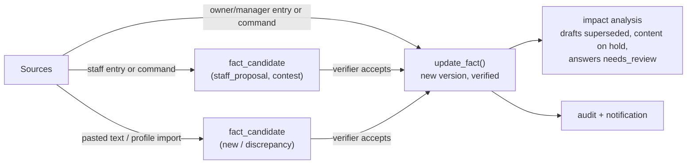

# Business Knowledge

**Purpose:** How business facts are modelled, sourced, verified, versioned, reconciled, retrieved, rendered and validated. This is the mechanism behind [INV-02](../invariants.md) ("business-critical facts are never fabricated"). Decision record: [ADR-008](decisions/ADR-008-structured-business-knowledge.md).

## 1. Concepts

- **Fact**: one typed value under a stable key in a workspace (`pricing.membership_monthly = 6.000 ₺`).
- **Version**: an immutable snapshot of a fact's value and status after each change.
- **Candidate**: a proposed value that has not been accepted. Candidates never affect replies or content.
- **Usable fact**: `verified` ∧ not `archived` ∧ within its validity window (workspace-local date) ∧ no pending `contest` candidate. **Only usable facts are given to LLM tasks or rendered.**
- **Criticality**: `critical` facts (prices, hours, contact, address, URLs, policies, promotions, booking rules) are subject to placeholder rendering and claim validation. `standard` facts (descriptions, brand voice) may be paraphrased.

## 2. Value types

| `value_type` | JSON shape (`value`) | Rendering (tr / en) | Placeholder output example |
|---|---|---|---|
| `money` | `{"amount": "6000.00", "currency": "TRY", "unit": "month" \| "session" \| "package" \| null, "conditions": {"tr": "...", "en": "..."} \| null}` | Babel `format_currency`; whole amounts without decimals; unit and conditions appended | `6.000 ₺ / ay` / `TRY 6,000 / month` |
| `weekly_hours` | `{"mon": [["07:00","23:00"]], ..., "sun": [], "exceptions": [{"date": "2026-10-29", "closed": true, "note": {...}}]}` | Grouped day ranges | `Pzt–Cum 07:00–23:00, Cmt 09:00–21:00, Paz kapalı` |
| `text` | `{"text": "..."}` | as is | |
| `localized_text` | `{"tr": "...", "en": "..."}` | language of reply; fallback default locale | |
| `phone` | `{"e164": "+905550000000", "display": "0555 000 00 00"}` | display | |
| `email` | `{"email": "..."}` | | |
| `address` | `{"lines": ["..."], "district": "Bucak", "city": "Burdur", "maps_url": "..."?}` | lines joined | |
| `url` | `{"url": "https://..."}` | | |
| `boolean` | `{"value": true}` | localised yes/no | |
| `enum` | `{"value": "share"}` with allowed values defined in the template | localised label | |
| `string_list` | `{"items": [...]}` | comma-joined | |

Validation of values is per type (Pydantic models in `knowledge/values.py`). Money amounts must be ≥ 0 with ≤ 2 decimals. The currency defaults to the workspace currency.

## 3. Key catalog and category templates

Templates live in code (`knowledge/templates/{gym,pilates_studio,common}.yaml`) and define for each key: `category`, `label{tr,en}`, `value_type`, `criticality`, `required_for` (`drafts` | `ready` | none), `description` (shown to the owner and given to extraction), and `allowed_values` for enums.

Common template (abridged):

| Key | Type | Criticality | Required for |
|---|---|---|---|
| `identity.business_name` | text | critical | drafts |
| `identity.description` | localized_text | standard | — |
| `contact.phone` / `contact.whatsapp` / `contact.email` | phone / phone / email | critical | drafts (≥ 1) |
| `location.address` | address | critical | drafts (or `location.online_only`) |
| `location.online_only` | boolean | critical | — |
| `hours.weekly` | weekly_hours | critical | drafts |
| `booking.instructions` | localized_text | critical | ready |
| `policy.price_disclosure` | enum(`share`,`do_not_share`) | critical | ready |
| `policy.price_answer_text` | localized_text | critical | ready if `do_not_share` |
| `policy.cancellation` | localized_text | critical | — |
| `brand.voice_guidelines` | localized_text | standard | — |
| `escalation.keywords` | string_list | standard | — |

Gym / Pilates additions (examples):

| Key | Type | Criticality | Required for |
|---|---|---|---|
| `service.<slug>` (e.g., `service.reformer_pilates`) | localized_text | standard | ready (≥ 1) |
| `pricing.membership_monthly` | money | critical | ready (if `share`) |
| `pricing.membership_3_months` | money | critical | — |
| `pricing.reformer_8_sessions` | money | critical | — |
| `pricing.single_session` | money | critical | — |
| `promotion.<slug>` (e.g., `promotion.trial_session`) | money or localized_text, with `valid_from`/`valid_until` | critical | — |
| `schedule.classes` | localized_text (timetable as text; times in it must still be validated, see §7) | critical | — |
| `faq.<slug>` | localized_text | standard | — |

Custom keys: `custom.<slug>` with any type; the owner chooses the label and criticality.

## 4. Lifecycle

Rules:
1. Any change to value or status creates a `fact_versions` row (full snapshot). The fact row stores the current value and `current_version`.
2. Updates use optimistic concurrency: `expected_version` must equal `current_version` (409 `FACT_VERSION_CONFLICT`).
3. Archiving a fact makes it unusable immediately (impact analysis runs as for a value change).
4. Promotions with `valid_until` in the past are unusable automatically. The daily scheduler emits `knowledge.promotion_expired` notifications. There is no data change; validity is evaluated at read time.

## 5. Sources, priority and conflict handling

**Source priority** (highest first):

| Tier | Source | Effect |
|---|---|---|
| 1 | Owner or manager (UI edit, confirmed command, accepted candidate) | Writes the fact directly as `verified`. |
| 2 | Staff (UI edit or command) | Creates a candidate with relation `contest` if it differs from a verified value, or `new` if no fact exists. |
| 3 | Pasted text, Instagram profile (P7+), website (later) | Creates a candidate with relation `new` or `discrepancy`. |
| — | LLM inference | **Never a source.** The model can only extract a value with a verbatim excerpt from tier-3 text. |

**Relation of a candidate to the current fact** (computed at creation; recomputed when the fact changes):

| Situation | Relation | Fact usable? | Owner sees |
|---|---|---|---|
| No fact for the key | `new` | (no fact) | Suggestion: "Add?" |
| Candidate equals the current value | `same` | yes | nothing (auto-superseded) |
| Tier-3 candidate differs from a verified fact | `discrepancy` | **yes** (owner is authoritative) | "Your bio says 6.000 ₺ but your verified price is 7.000 ₺. Update the bio, or accept 6.000?" |
| Tier-2 candidate differs from a verified fact | `contest` | **no**, until resolved | "Elif proposes 7.500 ₺ (current 7.000 ₺). Accept or reject?" |
| Several tier-3 candidates disagree and no verified fact exists | `new` (several) | (no fact) | Choose one or enter a value |

This implements the original requirement: "If the website says 6,000 TRY while the owner confirms 7,000 TRY, apply the source-priority policy, preserve the conflicting information for review, and avoid using an unresolved value in a customer response." The verified owner value is used; the website value is kept as a reviewable discrepancy; an unresolved value (no verified fact, or contested) is never used.

## 6. Retrieval for LLM tasks

- `usable_facts(ctx, categories=None)` returns usable facts with pre-rendered display values in the target locale and their placeholder tokens.
- **No vector search in MVP.** All usable facts relevant to the task fit in context. For `draft_reply`, all categories except `escalation` and `brand` (brand voice is passed separately) are included, and price facts are omitted when `price_disclosure = do_not_share`.
- Approved answers are included with their templates (placeholders unrendered, so the model sees them as references).

## 7. Rendering and the claim validator

### 7.1 Placeholders
- Syntax: `{{fact:<key>}}` with an optional format `{{fact:<key>|short}}`.
- `render(template, usable_facts, locale) → RenderResult{text, used: [(fact_id, version)], errors}`. Unknown or unusable key → error `FACT_NOT_USABLE` (no partial rendering).
- The renderer records the exact character spans of every rendered value, which the validator needs.

### 7.2 Claim validator (`validate_claims(text, render_result, locale) → ClaimReport`)
Scans the **final** text, excluding the spans produced by the renderer and the code-appended disclosure suffix. Any match of the following outside rendered spans is a violation:

| Pattern class | Examples (tr / en) |
|---|---|
| Money | `6000 TL`, `6.000₺`, `₺6.000`, `6 bin lira`, `TRY 6,000`, `$50`, `50 euro` |
| Percentages and discount claims | `%20`, `20%`, `yüzde 20`, `indirim`, `bedava`/`ücretsiz`/`free` **unless** a usable promotion fact is used in the same text |
| Times and time ranges | `19:00`, `7-23 arası`, `saat 9'da`, `9am` |
| Dates and weekday+time combos | `29 Ekim`, `29.10`, `Monday 9:00` |
| Phone numbers | `0555…`, `+90…` |
| Emails and URLs | any URL or email not equal to a rendered fact value |

**Allowed outside spans:** small cardinal numbers (≤ 20) not adjacent to a currency, percent or time unit (e.g., "2 kişi", "8 seans" when the session count is part of a rendered package name, "1 ay"). The allow-list is configurable per locale.

Additional checks: UTF-8 byte length ≤ 1000 including the suffix (Instagram DM limit); for content, caption ≤ 2200 characters (to verify, V-05).

**Outcomes:** AI drafts that fail after one regeneration → `human_required (GROUNDING_FAILED)`. Owner-edited text that fails → the UI shows issues. Replies typed by the owner are **warnings** (the owner is authoritative), but submitting **content** requires a pass (or a fact update first), because published content is harder to correct.

### 7.3 Why this is sufficient for INV-02
- Values the model *copies* from placeholders cannot be wrong, because code inserts them.
- Values the model *invents* match a pattern class and fail validation.
- Residual risk: non-numeric fabricated claims (e.g., "we have a sauna"). Mitigations: prompt rules, `commercial_claims` declaration for content, approval by default, eval cases for service hallucination, and auto mode limited to classes where answers are mostly placeholders (hours, location, contact, prices).

## 8. Impact analysis

`analyze_impact(ctx, fact_id) → ImpactReport` uses `fact_references` (rows written whenever a draft, content item or approved answer is rendered or edited):

| Referrer status | Action on fact change (workflow B §3.4) |
|---|---|
| `reply_drafts` pending_approval / needs_human / queued | superseded; redraft if the window is open |
| `content_items` scheduled / retry_scheduled | → `on_hold (FACT_CHANGED)`, approval cancelled |
| `content_items` pending_approval | → `draft`, approval cancelled |
| `content_items` draft | validation marked stale |
| `approved_answers` active | → `needs_review` |
| sent messages, published content | **unchanged** ([INV-17](../invariants.md)) |

Content created before `fact_references` existed, or edited manually without placeholders, is still covered: on every fact change, the impact job also **re-runs the claim validator** on scheduled and pending content of the workspace. Content whose text contains the *old* rendered value (string match on the previous version's renderings) is treated as referencing the fact.

## 9. Approved answers

- Created by owners/managers, either from scratch or from a sent reply ("save as approved answer"). In the latter case, rendered values in the text are converted back to placeholders where they match fact renderings exactly.
- They can be used by `draft_reply` verbatim (`approved_answer_id`). They are still rendered, validated and policy-checked.
- Status `needs_review` after a referenced fact changes. They remain usable because the values are placeholders, but the owner is asked to check the wording.

## 10. Seed data for the demo (fictional)

Demo gym `golkent-fitness` ("Gölkent Fitness & Pilates", Bucak/Burdur, TRY, Europe/Istanbul). All values are fictional.

| Key | Value | Status |
|---|---|---|
| `identity.business_name` | Gölkent Fitness & Pilates | verified |
| `contact.phone` | +90 555 000 00 00 | verified |
| `location.address` | Örnek Mah. Demo Sok. No: 1, Bucak / Burdur | verified |
| `hours.weekly` | Mon–Fri 07:00–23:00, Sat 09:00–21:00, Sun 10:00–18:00; closed 29 Oct | verified |
| `pricing.membership_monthly` | 6.000 TRY / month | verified |
| `pricing.membership_3_months` | 16.500 TRY / package | verified |
| `pricing.reformer_8_sessions` | 4.800 TRY / package | verified |
| `pricing.student_monthly` | 4.500 TRY / month, conditions "valid student ID" | **unverified** (demonstrates a non-usable fact) |
| `promotion.trial_session` | free first trial session, booking required; valid until end of next month | verified |
| `booking.instructions` | "Call or DM us with your preferred day; trial sessions need booking." | verified |
| `policy.price_disclosure` | share | verified |
| `service.reformer_pilates`, `service.fitness`, `service.personal_training` | descriptions | verified |
| `brand.voice_guidelines` | "Warm, short, uses 'siz'; max one emoji." | verified |
| `escalation.keywords` | `avukat`, `tüketici hakem`, `sakatlandım` | verified |

Plus one pending `discrepancy` candidate: `pricing.membership_monthly = 5.500 TRY` from "pasted bio" (demonstrates that it is not used). English demo studio `harbor-pilates` (EUR, Europe/Lisbon, `en`) mirrors the structure.
