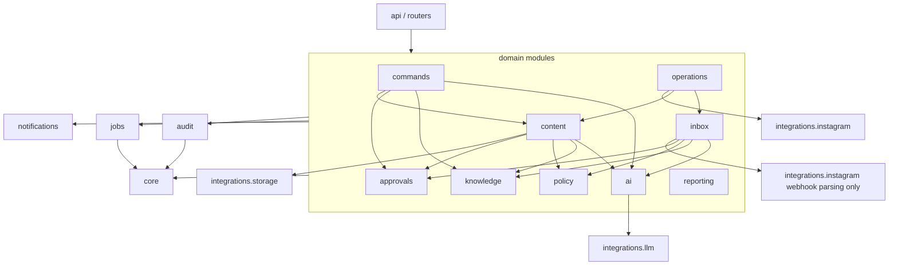

# Component Design

**Purpose:** Backend modules, their responsibilities, their public interfaces and the dependency rules between them, plus the frontend structure. A coding agent uses this to decide **where code goes** and **what it may import**.

## 1. Backend package layout

```
backend/app/
├── main.py                 # create_app(): FastAPI app, routers, middleware, exception handlers
├── worker.py               # python -m app.worker: worker loop + scheduler
├── cli.py                  # python -m app.cli: seed, reset, simulate, run-due-jobs, generate-key, create-user
├── core/                   # cross-cutting, no domain knowledge
│   ├── config.py           # Settings (pydantic-settings) + startup safety checks
│   ├── db.py               # engine, SessionLocal, Base, naming conventions
│   ├── context.py          # WorkspaceContext, ActorRef (user|system|agent|provider)
│   ├── clock.py            # Clock protocol, SystemClock, FrozenClock
│   ├── ids.py              # uuid generation helpers
│   ├── errors.py           # AppError + error code catalog
│   ├── logging.py          # structlog config, redaction, contextvars binding
│   ├── security.py         # password hashing, session tokens, CSRF, AES-GCM token crypto
│   ├── i18n/               # t(key, locale, **params), tr.json, en.json, Babel formatting helpers
│   └── canonical.py        # canonical JSON + sha256 (payload hashes)
├── identity/               # users, sessions, workspaces, memberships, permissions, invites
├── audit/                  # audit_logs writer + activity feed queries
├── jobs/                   # jobs table, enqueue(), worker runtime, scheduler, handler registry
├── knowledge/              # facts, versions, candidates, templates, readiness, renderer, claims validator, approved answers, impact analysis
├── ai/                     # LLM task definitions (prompts, schemas, context builders, post-validators), task runner, agent_runs
├── commands/               # owner_commands, command registry, reference resolver, executors
├── approvals/              # approvals service, expiry sweep
├── policy/                 # policy engine, rules, automation_policies
├── inbox/                  # webhook ingestion, inbound processing, conversations, messages, reply drafts
├── content/                # content items, media assets + validation, scheduling
├── operations/             # operations ledger, executors (send_reply, publish_content), reconciliation, account health
├── notifications/          # notifications + delivery (web; telegram later)
├── reporting/              # metric definitions, daily reports, activity queries
├── integrations/
│   ├── instagram/          # base.py (protocol, types, errors), mock.py, meta.py, webhook_format.py
│   ├── llm/                # base.py, fake.py, anthropic.py
│   ├── storage/            # base.py, local.py, s3.py
│   └── channels/           # base.py, web.py, telegram.py (Phase 9)
├── demo/                   # seed data (YAML), simulator scripts, reset, dev routes (mounted only if DEMO_TOOLS_ENABLED)
└── api/                    # router assembly, shared dependencies (auth, membership, pagination), problem+json handlers
```

Each domain module uses the same internal shape where applicable:
- `models.py`: SQLAlchemy models.
- `schemas.py`: Pydantic API schemas.
- `service.py`: public functions; transaction boundaries.
- `repository.py`: queries; always takes `WorkspaceContext`.
- `router.py`: FastAPI routes; thin.
- `jobs.py`: job handlers registered with `jobs`.

## 2. Module responsibilities and public interfaces

Only the functions listed (and their obvious siblings) are called from other modules. Everything else is module-private (by convention, prefixed `_` or not exported from `__init__`).

| Module | Owns (tables) | Responsibility | Key public interface |
|---|---|---|---|
| `core` | — | Config, DB session, clock, errors, logging, security, i18n, canonical hashing | `get_settings()`, `Clock`, `AppError(code, **params)`, `t()`, `payload_hash(obj)` |
| `identity` | `users`, `sessions`, `workspaces`, `workspace_members`, `invites` | Auth, membership, roles, permissions | `authenticate()`, `require_membership(workspace_id, permission)` (FastAPI dep), `has_permission(ctx, perm)`, `create_workspace()` |
| `audit` | `audit_logs` | Append-only audit records, activity feed | `audit.record(ctx, actor, action, resource, metadata, is_simulated)`, must be called inside the caller's transaction |
| `jobs` | `jobs` | Queue, worker runtime, scheduler | `enqueue(session, job_type, payload, *, workspace_id, run_at=None, dedup_key=None, correlation_id)`, `@job_handler("type", payload_model, max_attempts, timeout)`, `run_due_jobs(clock, limit)` (tests/dev) |
| `knowledge` | `business_facts`, `fact_versions`, `fact_candidates`, `approved_answers`, `fact_references` | Fact lifecycle, conflicts, readiness, rendering, claim validation, impact analysis | `usable_facts(ctx, categories?)`, `update_fact(ctx, key, value, source, actor, reason)`, `propose_candidate(...)`, `resolve_candidate(...)`, `render(template, facts, locale) → RenderResult`, `validate_claims(text, render_result, locale) → ClaimReport`, `analyze_impact(ctx, fact_id) → ImpactReport`, `readiness(ctx)` |
| `ai` | `agent_runs` | LLM tasks and runner | `run_task(ctx, task_name, input_model, correlation_id) → TaskOutcome` |
| `policy` | `automation_policies` | Deterministic decisions | `evaluate_reply(ctx, ReplyPolicyInput) → Decision`, `evaluate_content(ctx, ContentPolicyInput) → Decision`, `get_policies(ctx)`, `set_policy(...)` |
| `approvals` | `approvals` | Create, decide, expire, invalidate | `request(ctx, kind, subject, payload, summary, required_permission, expires_at, execute_before)`, `decide(ctx, approval_id, decision, payload_hash, actor, channel)`, `cancel_for_subject(ctx, subject, reason)`, `assert_executable(ctx, approval_id, subject_version)` |
| `commands` | `owner_commands` | Submit, interpret (via `ai`), clarify, confirm (via `approvals`), execute | `submit(ctx, user, text, channel, client_request_id)`, `answer_clarification(...)`, `on_approval_decided(...)` (callback) |
| `inbox` | `inbound_events`, `conversations`, `messages`, `reply_drafts` | Webhook ingestion, conversation state, draft workflow | `ingest_webhook(provider, raw_body, headers)`, `process_inbound_event(event_id)`, `draft_reply(conversation_id)`, `submit_manual_reply(...)`, `takeover()/release()` |
| `content` | `content_items`, `media_assets` | Drafting, media, validation, scheduling | `create_draft(...)`, `generate_draft(...)`, `update(...)`, `submit(ctx, item_id, schedule, actor)`, `cancel(...)`, `hold_for_fact_change(...)` |
| `operations` | `operations`, `sim_*` (via mock), account health fields | Execute external side effects, reconcile, account health and circuit | `execute_send_reply(draft_id)`, `execute_publish(content_id, version)`, `reconcile(operation_id)`, `record_provider_failure(account, error)` |
| `notifications` | `notifications`, `notification_deliveries` (Phase 9) | Create, list, mark read, deliver | `notify(ctx, recipients_rule, type, params, subject, severity)` |
| `reporting` | `daily_reports` | Metric definitions and aggregation | `compute_metrics(ctx, period) → Metrics`, `generate_daily_report(ctx, local_date)`, `activity_summary(ctx, period)` |
| `integrations.*` | `social_accounts` (instagram), `channel_links` (channels) | Provider adapters | Protocols in [integrations.md](integrations.md) |
| `demo` | — | Seed, simulator, reset, dev routes | `seed()`, `reset(workspace_id)`, `simulate_customer_message(...)`, `set_failure_rule(...)` |

## 3. Dependency rules (enforced by an import-linter test)



Rules:
1. `core` imports nothing from the app.
2. `integrations.*` import only `core`. They know nothing of domain tables except their own (`social_accounts`, `channel_links`, `sim_*`).
3. **Only `operations` may call side-effecting `InstagramProvider` methods** (`send_text_message`, `create_media_container`, `publish_container`, `refresh_token`). `inbox` may use `verify_signature` and `parse_webhook`. Reads used for reconciliation are also only in `operations`. ([INV-15](../invariants.md))
4. **Only `ai` may import `integrations.llm`.**
5. Routers call services only. No queries and no provider calls in routers.
6. Domain modules call each other only through the public interfaces above. Circular imports are resolved by callbacks registered at startup (e.g., `approvals` emits "decided" to a registry, and `commands`, `inbox` and `content` subscribe), not by importing back.
7. `demo` may import anything but must not be imported by anything except `main.py` (conditional mount) and `cli.py`.

## 4. Transaction boundaries

- **One request = one transaction** for synchronous state changes, committed by the service function at the end. Audit entries, approvals, notifications and job enqueues are written in the **same** transaction.
- **Job handlers** open their own transactions. A handler that performs an external call uses **at least two transactions**: (1) mark the operation `in_progress` and commit; (2) after the external call, record the outcome and the domain update and commit. It never holds a DB transaction open across an external call ([background-jobs.md §5](background-jobs.md)).
- Row locks (`SELECT … FOR UPDATE`) on the subject (content item, reply draft) when changing its state, to serialise concurrent workers and user actions.
- State transitions use **conditional updates** (`UPDATE … WHERE id = :id AND status = :expected`) and check the affected row count, as a second guard against races.

## 5. Cross-module workflows (who orchestrates)

| Workflow | Orchestrating module | Collaborators |
|---|---|---|
| A. Onboarding | `identity` (workspace) + `knowledge` (facts, readiness) | `ai` (extraction), `integrations.instagram` (connect) |
| B. Fact update | `commands` | `ai`, `knowledge`, `approvals`, `content` (hold), `inbox` (supersede drafts), `notifications` |
| C. Incoming message | `inbox` | `ai`, `knowledge`, `policy`, `approvals`, `operations`, `notifications` |
| D. Approval | `approvals` | subject owner modules via decided-callbacks |
| E. Content scheduling | `content` | `ai`, `knowledge`, `policy`, `approvals`, `operations`, `jobs` |
| F. Daily report | `reporting` | `notifications`, `jobs` (schedule) |
| G. Integration failure | `operations` | `integrations.instagram`, `notifications`, `content` (hold), `inbox` |

Full contracts: [workflows.md](workflows.md).

## 6. Frontend structure

```
frontend/src/
├── main.tsx, app/
│   ├── router.tsx            # routes; auth guard; workspace guard
│   ├── providers.tsx         # QueryClient, i18n, auth context
│   └── layout/               # MobileShell (bottom tabs), DesktopShell (sidebar), SimulationBanner
├── api/
│   ├── schema.d.ts           # generated from openapi.json (committed)
│   └── client.ts             # openapi-fetch wrapper: credentials, CSRF header, error → AppError(code)
├── features/
│   ├── auth/  workspaces/  home/  inbox/  approvals/  content/  knowledge/
│   ├── commands/             # CommandBar, CommandResultCard, ConfirmationCard, ClarificationChips
│   ├── reports/  activity/  notifications/  settings/
│   └── dev/                  # Dev panel (route mounted only when /api/v1/meta reports demo tools enabled)
├── components/               # Button, Card, StatusBadge, SimulatedBadge, BottomSheet, EmptyState, TimeLeft, FactValueChip
├── i18n/locales/{tr,en}/*.json
└── lib/                      # formatting (Intl), dates in workspace TZ, polling helpers
```

Frontend rules:
- No business rules: the frontend never decides whether something needs approval or is valid. It renders server decisions and validation results.
- Status badges are a single component mapping server states to labels ([user-journeys.md §1](../product/user-journeys.md)).
- Every list or detail of workspace data shows `SimulatedBadge` when `is_simulated` is true.
- Money and time are displayed from server-provided values plus the workspace locale and timezone. Schedule inputs are sent as `{local_date, local_time}` and the server converts them.
