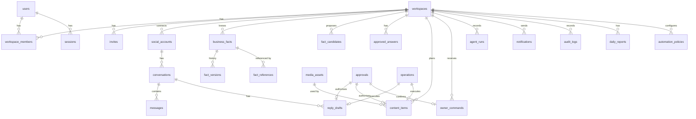

# Data Model

**Purpose:** The authoritative PostgreSQL schema: tables, columns, constraints, indexes, and the phase that introduces each table. Migrations must match this document. If they diverge, update this document in the same change.

## 1. Conventions

- **Primary keys:** `id uuid` generated by the application (`uuid4`). Exception: `workspace_members` uses a composite key.
- **Timestamps:** `timestamptz`, stored in UTC. Every table has `created_at timestamptz not null default now()`; mutable tables also have `updated_at`.
- **Tenant tables:** `workspace_id uuid not null` FK → `workspaces(id) on delete cascade`, plus `unique (workspace_id, id)` so that it can be the target of composite FKs.
- **Composite FKs:** a tenant child references a tenant parent as `foreign key (workspace_id, parent_id) references parent (workspace_id, id)`. Cross-workspace references are therefore impossible at the DB level ([INV-01](../invariants.md)).
- **Enumerations:** `text` columns with `CHECK (col IN (...))` (easier to migrate than PG enums). Allowed values are listed below and in [state-machines.md](state-machines.md).
- **Money:** inside JSONB fact values as `{"amount": "7000.00", "currency": "TRY"}` (decimal string). Never floats.
- **Simulation flag:** `is_simulated boolean not null default false` on every table whose rows can result from a mock provider ([INV-09](../invariants.md)).
- **Naming:** snake_case. Constraint names follow SQLAlchemy naming conventions set in `core/db.py` (`pk_`, `fk_`, `uq_`, `ck_`, `ix_`).
- **Deletion:** domain rows are not hard-deleted by normal workflows (status changes instead). Hard deletion happens only through workspace deletion, retention jobs and data deletion requests ([security-and-privacy.md §8](security-and-privacy.md)).

## 2. Entity relationship overview

## 3. Tables

Phase = the phase whose migration creates the table ([roadmap.md](../implementation/roadmap.md)).

### 3.1 Identity (Phase 1)

**`users`**
| Column | Type | Notes |
|---|---|---|
| id | uuid PK | |
| email | text not null | stored normalised (trimmed, lowercased); `unique`; `CHECK (email = lower(btrim(email)))` |
| password_hash | text not null | argon2id |
| display_name | text not null | |
| ui_locale | text not null default 'tr' | `CHECK in ('tr','en')` |
| is_active | boolean not null default true | |
| last_login_at | timestamptz null | |

**`sessions`**
| Column | Type | Notes |
|---|---|---|
| id | uuid PK | |
| user_id | uuid FK users on delete cascade | |
| token_hash | bytea not null unique | SHA-256 of the cookie token |
| csrf_token | text not null | returned by `/auth/me`; sent back in `X-CSRF-Token` |
| expires_at | timestamptz not null | sliding (14 days) |
| last_seen_at | timestamptz not null | |
| revoked_at | timestamptz null | |
| user_agent | text null | truncated to 200 chars |

**`workspaces`**
| Column | Type | Notes |
|---|---|---|
| id | uuid PK | |
| name | text not null | |
| slug | text not null unique | URL-safe; used by seed/CLI |
| business_category | text not null | `CHECK in ('gym','pilates_studio','other')` |
| market | text not null | `CHECK in ('tr','global')` |
| default_locale | text not null | `tr` / `en` |
| reply_languages | text[] not null default '{tr}' | subset of supported reply languages. The DB default applies to raw inserts only; `create_workspace` sets `[default_locale]` |
| timezone | text not null | IANA name; validated in service against `zoneinfo.available_timezones()` |
| currency | char(3) not null | ISO 4217 (`CHECK ~ '^[A-Z]{3}$'`); the service accepts only codes in current tender use (Babel/CLDR), not historic codes or `XXX` |
| is_demo | boolean not null default false | only demo workspaces may use mock providers in production config |
| status | text not null default 'active' | `active`, `deleting` |
| settings | jsonb not null default '{}' | validated by `WorkspaceSettings`: `disclosure_enabled` (default true), `disclosure_text{tr,en}`, `daily_report_hour` (default 20), `publish_max_delay_minutes` (default 360), `automation_reviewed_at` (null until the owner marks the automation policy as reviewed; stamped by the server from the `Clock`, never client-supplied) |

**`workspace_members`**: PK `(workspace_id, user_id)`; `role` `CHECK in ('owner','manager','staff')`; `invited_by_user_id` null. Service rule: a workspace always has ≥ 1 owner.

**`invites`** (Phase 6): `id`, `workspace_id`, `role`, `token_hash` unique, `created_by_user_id`, `expires_at` (default 7 days), `accepted_by_user_id`, `accepted_at`, `revoked_at`.

### 3.2 Audit and jobs (Phase 1)

**`audit_logs`** (append-only)
| Column | Type | Notes |
|---|---|---|
| id | uuid PK | |
| workspace_id | uuid null | null for system-level events (e.g., invalid webhook signature). **Not a foreign key**: audit rows must survive workspace deletion without being updated or cascaded |
| occurred_at | timestamptz not null | from `Clock` |
| actor_type | text not null | `user`, `system`, `agent`, `provider` |
| actor_id | text null | user ID, job type, agent run ID, provider name |
| action | text not null | catalog in [observability.md §5](observability.md) |
| resource_type / resource_id | text / uuid null | |
| correlation_id | uuid null | |
| is_simulated | boolean not null default false | |
| metadata | jsonb not null default '{}' | IDs, codes, old/new values for facts. **No message text, no tokens.** |

Index: `(workspace_id, occurred_at desc)`, `(workspace_id, action, occurred_at desc)`.

**`jobs`**
| Column | Type | Notes |
|---|---|---|
| id | uuid PK | |
| workspace_id | uuid null | FK workspaces on delete cascade |
| job_type | text not null | registry name |
| payload | jsonb not null | validated per type; **IDs only, no secrets or message text** |
| status | text not null | `queued`, `running`, `succeeded`, `dead`, `cancelled` |
| priority | smallint not null default 100 | lower runs first |
| run_at | timestamptz not null | |
| attempts / max_attempts | int not null | |
| lease_expires_at | timestamptz null | |
| locked_by | text null | worker instance ID |
| dedup_key | text null | `unique where status in ('queued','running')` |
| last_error_code / last_error_detail | text null | detail truncated and redacted |
| correlation_id | uuid null | |
| finished_at | timestamptz null | |

Indexes: `ix_jobs_due (run_at, priority) where status = 'queued'`; `ix_jobs_lease (lease_expires_at) where status = 'running'`; `uq_jobs_dedup_key_active` (unique on `dedup_key` where `status in ('queued','running')`); `ix_jobs_correlation_id`.

### 3.3 Knowledge (Phase 2; `approved_answers` and `fact_references` Phase 3–4)

**`business_facts`**
| Column | Type | Notes |
|---|---|---|
| id | uuid PK | `unique (workspace_id, id)` |
| workspace_id | uuid not null | |
| key | text not null | `^[a-z][a-z0-9_]*(\.[a-z0-9_]+)+$`; `unique (workspace_id, key) where status <> 'archived'` |
| category | text not null | `identity`, `contact`, `location`, `hours`, `service`, `pricing`, `promotion`, `policy`, `booking`, `faq`, `brand`, `escalation`, `schedule`, `custom` |
| label | jsonb not null | `{"tr": "...", "en": "..."}` owner-facing name |
| value_type | text not null | `money`, `weekly_hours`, `text`, `localized_text`, `phone`, `email`, `address`, `url`, `boolean`, `enum`, `string_list` |
| value | jsonb not null | shape per type ([business-knowledge.md §2](business-knowledge.md)) |
| status | text not null | `unverified`, `verified`, `archived` |
| criticality | text not null | `critical`, `standard` |
| current_version | int not null | equals the latest `fact_versions.version` |
| valid_from / valid_until | date null | promotions; evaluated in the workspace timezone |
| last_verified_at | timestamptz null | |
| last_verified_by_user_id | uuid null | foreign key to `users` (`ON DELETE SET NULL`); null for seeded facts |

**`fact_versions`** (append-only)
| Column | Type | Notes |
|---|---|---|
| id | uuid PK | |
| workspace_id, fact_id | uuid | composite FK → business_facts |
| version | int not null | `unique (fact_id, version)` |
| value | jsonb not null | full snapshot |
| status | text not null | status after this change |
| valid_from / valid_until | date null | the validity window after this change (so a window edit is a normal versioned change; added in Phase 2 because the snapshot must be complete) |
| source_type | text not null | `owner_entry`, `owner_command`, `candidate_accepted`, `seed`, `template_default` |
| source_ref | text null | e.g., candidate ID, command ID |
| actor_type / actor_id | text | |
| reason | text null | user-supplied or system reason |
| change_kind | text not null | `created`, `value_changed`, `verified`, `archived`, `restored` |

**`fact_candidates`**
| Column | Type | Notes |
|---|---|---|
| id | uuid PK | |
| workspace_id | uuid | |
| fact_key | text not null | proposed key (existing or new) |
| fact_id | uuid null | composite FK when the key exists |
| proposed_value / value_type | jsonb / text | |
| source_type | text not null | `staff_proposal`, `pasted_text`, `instagram_profile` (P7+), `website` (later) |
| source_excerpt | text null | ≤ 500 chars, the text the value came from |
| relation | text not null | `new`, `same`, `discrepancy`, `contest` (computed at creation and recomputed when the fact changes) |
| status | text not null | `pending`, `accepted`, `rejected`, `superseded` |
| proposed_by_actor_type / proposed_by_actor_id | text | |
| agent_run_id | uuid null | for extraction. Phase 2 creates the column without a foreign key because `agent_runs` does not exist yet; Phase 3 adds the constraint |
| resolved_by_user_id / resolved_at | | `resolved_by_user_id` is a foreign key to `users` (`ON DELETE SET NULL`) |

Index: `(workspace_id, status)`, `(workspace_id, fact_key) where status = 'pending'`.

**`approved_answers`** (Phase 4)
| Column | Type | Notes |
|---|---|---|
| id, workspace_id | uuid | |
| title | text not null | |
| intent | text not null | from the intent list ([agent-runtime.md §4](agent-runtime.md)) |
| example_questions | jsonb not null | list of strings |
| answer_template | text not null | may contain `{{fact:key}}` placeholders |
| language | text not null | |
| status | text not null | `active`, `needs_review`, `archived` |
| version | int not null | |
| created_from_message_id | uuid null | |
| created_by_user_id | uuid | |

**`fact_references`** (Phase 3)
| Column | Type | Notes |
|---|---|---|
| id, workspace_id | uuid | |
| fact_id | uuid | composite FK |
| fact_version | int not null | version used |
| referrer_type | text not null | `reply_draft`, `content_item`, `approved_answer` |
| referrer_id | uuid not null | |

Index: `(workspace_id, fact_id)`; `unique (referrer_type, referrer_id, fact_id)` (one row per fact per referrer). Rows are replaced whenever the referrer's text is regenerated or edited. Impact analysis joins on `fact_id` ([workflows.md §B](workflows.md)).

### 3.4 Commands, AI, approvals, policy (Phase 3–4)

**`owner_commands`**
| Column | Type | Notes |
|---|---|---|
| id, workspace_id | uuid | |
| user_id | uuid not null | |
| channel | text not null | `web`, `telegram` |
| client_request_id | text not null | `unique (user_id, client_request_id)` for client retries |
| raw_text | text not null | ≤ 1000 chars |
| status | text not null | [state-machines.md §3](state-machines.md) |
| command_type | text null | registry name |
| interpreted | jsonb null | validated typed command |
| resolution | jsonb null | resolved references (IDs) |
| clarification | jsonb null | `{question_key, options:[{id,label}]}` |
| result | jsonb null | `{message_key, params, links[]}` |
| error_code | text null | |
| approval_id | uuid null | confirmation approval |
| agent_run_id | uuid null | |
| correlation_id | uuid not null | |
| expires_at | timestamptz null | for clarification/confirmation waits |
| completed_at | timestamptz null | |

**`agent_runs`**
| Column | Type | Notes |
|---|---|---|
| id, workspace_id | uuid | |
| task | text not null | `interpret_command`, `draft_reply`, `draft_content`, `extract_fact_candidates` |
| provider / model / prompt_version | text | |
| status | text not null | `queued`, `running`, `succeeded`, `failed`. `queued` exists so an endpoint can store the redacted input (pasted text) on the run before the job starts; queued rows do not count against the daily budget |
| input_snapshot | jsonb null | redacted; deleted after retention (30 days) |
| output | jsonb null | validated output |
| validation_errors | jsonb null | |
| error_code | text null | |
| input_tokens / output_tokens / latency_ms | int null | |
| repair_attempts | smallint not null default 0 | |
| job_id / correlation_id | uuid | |
| is_fake | boolean not null | |
| started_at / completed_at | timestamptz | |

**`approvals`**
| Column | Type | Notes |
|---|---|---|
| id, workspace_id | uuid | |
| kind | text not null | `confirmation`, `authorization` |
| action | text not null | what is being approved: `command.update_fact`, `command.update_brand_voice`, `command.cancel_content`, `reply.send`, `content.publish`. Not the same as an automation-policy action class. |
| subject_type / subject_id | text / uuid | `owner_command`, `reply_draft`, `content_item` |
| subject_version | int not null | |
| payload_hash | char(64) not null | hex SHA-256 of canonical payload |
| summary | jsonb not null | render data for the approval card |
| required_permission | text not null | |
| status | text not null | `pending`, `approved`, `rejected`, `expired`, `cancelled` |
| requested_by_actor_type / requested_by_actor_id | text | |
| decided_by_user_id / decided_at / decision_channel / decision_note | | |
| expires_at | timestamptz not null | |
| execute_before | timestamptz null | execution deadline |
| operation_id | uuid null | set when consumed by an operation |
| cancel_reason | text null | e.g., `SUBJECT_EDITED`, `SUPERSEDED`, `FACT_CHANGED` |
| is_simulated | boolean | |

Constraint: `unique (workspace_id, subject_type, subject_id) where status = 'pending'`. Index: `(workspace_id, status, expires_at)`. There is no `payload` column: the payload lives with the subject (for a command, `owner_commands.resolution`), and execution recomputes its hash and compares it with `payload_hash`.

**`automation_policies`**: PK `(workspace_id, action_class)`; `mode` `CHECK in ('auto','approval','off')`; `updated_by_user_id`; `updated_at`. Missing rows mean the default (`approval`).

### 3.5 Instagram, inbox (Phase 4)

**`social_accounts`**
| Column | Type | Notes |
|---|---|---|
| id, workspace_id | uuid | |
| platform | text not null | `instagram` |
| provider_kind | text not null | `mock`, `meta` |
| external_account_id | text not null | IG user ID (`IG_ID`) |
| username | text null | |
| status | text not null | `connected`, `needs_reauth`, `degraded`, `disconnected` |
| capabilities | jsonb not null | e.g., `{"messaging": true, "publish_feed_image": true, "publish_story_image": true}` |
| granted_scopes | text[] not null default '{}' | |
| token_ciphertext | bytea null | AES-GCM; `CHECK (provider_kind = 'meta' OR token_ciphertext IS NULL)` |
| token_key_id | text null | |
| token_expires_at / token_refreshed_at | timestamptz null | |
| consecutive_failures | int not null default 0 | circuit breaker |
| degraded_until | timestamptz null | |
| last_error_code | text null | |
| connected_at / disconnected_at | timestamptz | |

Constraints: `unique (workspace_id) where status <> 'disconnected'` (one active account per workspace in MVP); `unique (provider_kind, external_account_id) where status <> 'disconnected'`.

**`inbound_events`**
| Column | Type | Notes |
|---|---|---|
| id | uuid PK | |
| provider_kind | text not null | |
| dedup_key | text not null unique | `ig:{account_ext_id}:mid:{mid}` for messages and echoes; `ig:{account}:{field}:sha256(entry)` otherwise |
| workspace_id / social_account_id | uuid null | resolved at ingest from the receiving account |
| event_type | text not null | `message`, `echo`, `reaction`, `read`, `postback`, `other` |
| payload | jsonb null | the single webhook item (raw form kept for 30 days, then nulled, so the column is nullable) |
| status | text not null | `received`, `processed`, `ignored`, `failed` |
| ignore_reason / error_code | text null | |
| correlation_id | uuid not null | |
| is_simulated | boolean not null | |
| received_at / processed_at | timestamptz | |

**`conversations`**
| Column | Type | Notes |
|---|---|---|
| id, workspace_id | uuid | |
| social_account_id | uuid | composite FK |
| customer_external_id | text not null | IGSID; `unique (social_account_id, customer_external_id)` |
| customer_handle | text null | username if known (PII) |
| handling_mode | text not null default 'automatic' | `automatic`, `human` |
| attention | text not null default 'none' | `none`, `needs_approval`, `needs_human`, `failed` |
| last_inbound_at / last_outbound_at / last_message_at | timestamptz null | `last_inbound_at` = max of provider timestamps (out-of-order safe) |
| is_simulated | boolean | |

Index: `(workspace_id, attention, last_message_at desc)`.

**`messages`**
| Column | Type | Notes |
|---|---|---|
| id, workspace_id | uuid | |
| conversation_id | uuid | composite FK |
| direction | text not null | `inbound`, `outbound` |
| sender_kind | text not null | `customer`, `business_app` (sent by us), `business_native` (owner via the Instagram app, from echo) |
| external_message_id | text null | `mid`; `unique (social_account_id, external_message_id) where external_message_id is not null` (INV-06; `messages` therefore also carries `social_account_id`) |
| text | text null | subject to retention |
| attachments | jsonb not null default '[]' | `[{type, url?, note}]`; URLs are provider CDN links, which may expire |
| provider_timestamp | timestamptz not null | |
| reply_draft_id | uuid null | for outbound sent by us |
| is_deleted | boolean not null default false | customer unsent |
| is_simulated | boolean | |

Index: `(conversation_id, provider_timestamp)`.

**`reply_drafts`**
| Column | Type | Notes |
|---|---|---|
| id, workspace_id | uuid | |
| conversation_id | uuid | composite FK |
| covers_through_message_id | uuid not null | latest inbound included |
| source | text not null | `ai`, `approved_answer`, `owner` |
| language | text not null | |
| intent | text null | |
| flags | text[] not null default '{}' | e.g., `complaint`, `injection_suspected` |
| template | text null | pre-render text with placeholders (debugging) |
| text | text null | rendered final text (null for `human_required` without suggestion) |
| suggestion_text | text null | for `needs_human`: optional, not sendable as-is |
| validation | jsonb not null | claim report |
| decision | text not null | `auto`, `approval_required`, `human_required`, `blocked` |
| decision_reasons | text[] not null | |
| status | text not null | [state-machines.md §4](state-machines.md) |
| version | int not null default 1 | incremented on edit |
| approval_id / operation_id / agent_run_id | uuid null | |
| superseded_by_id | uuid null | |
| failure_code | text null | the reason code of any terminal state other than `sent`: `failed` (e.g. `OUTCOME_UNCONFIRMED`), `superseded` / `cancelled` (`NEW_INBOUND`, `OWNER_REPLIED_NATIVELY`, `FACT_CHANGED`, `HUMAN_TAKEOVER`, `SUBJECT_EDITED`), `expired` (`MESSAGING_WINDOW_CLOSED`) |
| created_by_actor_type / created_by_actor_id | text | |
| is_simulated | boolean | |

Constraint: `unique (conversation_id) where status in ('pending_approval','needs_human','queued','sending','outcome_unknown')` (at most one open draft per conversation).

### 3.6 Content and media (Phase 5)

**`media_assets`**
| Column | Type | Notes |
|---|---|---|
| id, workspace_id | uuid | |
| storage_backend / storage_key | text | key `{workspace_id}/{yyyy}/{mm}/{id}.jpg` |
| original_filename | text null | sanitised; display only |
| mime_type | text not null | after conversion (`image/jpeg`) |
| byte_size / width / height | int | |
| sha256 | char(64) not null | |
| status | text not null | `uploaded`, `ready`, `rejected`, `deleted` |
| rejection_code | text null | |
| created_by_user_id | uuid | |
| deleted_at | timestamptz null | |

**`content_items`**
| Column | Type | Notes |
|---|---|---|
| id, workspace_id | uuid | |
| social_account_id | uuid null | composite FK; required at submit |
| content_type | text not null | `feed_image`, `story_image` |
| status | text not null | [state-machines.md §5](state-machines.md) |
| version | int not null default 1 | increments on any payload change |
| title | text not null | internal label |
| objective | text null | owner's request |
| caption | text null | feed only; ≤ 2200 chars (**Instagram caption limit is an assumption to verify**, V-05) |
| overlay_text_suggestions | jsonb not null default '[]' | story only |
| visual_notes | text null | concept for the owner |
| media_asset_id | uuid null | composite FK |
| scheduled_at | timestamptz null | UTC |
| schedule_input | jsonb null | `{local_date, local_time, timezone}` as entered |
| approval_id | uuid null | current approval |
| hold_reason | text null | `FACT_CHANGED`, `ACCOUNT_UNAVAILABLE`, `APPROVAL_EXPIRED` |
| rejection_note | text null | |
| validation | jsonb not null default '{}' | last validation report |
| published_at | timestamptz null | |
| external_media_id / external_permalink | text null | |
| last_error_code | text null | |
| agent_run_id | uuid null | |
| created_by_user_id | uuid | |
| is_simulated | boolean | set from the target account at submit |

Index: `(workspace_id, status, scheduled_at)`.

### 3.7 Operations (Phase 4)

**`operations`**
| Column | Type | Notes |
|---|---|---|
| id, workspace_id | uuid | |
| operation_type | text not null | `send_reply`, `publish_content`, `refresh_token` |
| idempotency_key | text not null unique | see [ADR-011](decisions/ADR-011-external-operations-ledger.md) |
| subject_type / subject_id | text / uuid | |
| social_account_id | uuid | composite FK |
| provider_kind | text not null | |
| status | text not null | [state-machines.md §6](state-machines.md) |
| attempts / max_attempts | int | |
| next_attempt_at | timestamptz null | |
| deadline_at | timestamptz null | no attempts after this |
| provider_ref | jsonb not null default '{}' | e.g., `{"container_id": "..."}` |
| result | jsonb not null default '{}' | e.g., `{"message_id": "..."}`, `{"media_id": "...", "permalink": "..."}` |
| last_error_code / last_error_detail | text null | |
| correlation_id | uuid | |
| is_simulated | boolean | |
| started_at / completed_at | timestamptz null | |

### 3.8 Notifications and reports (notifications Phase 3; reports Phase 6)

**`notifications`**: `id`, `workspace_id`, `recipient_user_id` (FK users), `type`, `severity` (`info`, `attention`, `critical`), `params` jsonb, `subject_type`, `subject_id`, `dedup_key` (`unique (recipient_user_id, dedup_key) where read_at is null and dedup_key is not null`), `is_simulated`, `read_at`.

**`notification_deliveries`** (Phase 9): `id`, `notification_id`, `channel`, `status` (`pending`, `sent`, `failed`), `attempts`, `external_ref`, `delivered_at`.

**`channel_links`** (Phase 9, user-level, not tenant): `id`, `user_id`, `channel`, `external_user_id`, `external_chat_id`, `default_workspace_id`, `status` (`active`, `revoked`), `linked_at`, `revoked_at`. `unique (channel, external_user_id) where status='active'`.

**`daily_reports`**: `id`, `workspace_id`, `local_date` (date), `timezone`, `period_start`, `period_end` (UTC), `metrics` jsonb, `definitions_version` text, `has_simulated_data` boolean, `generated_at`. `unique (workspace_id, local_date)` (regeneration overwrites; the previous value is not needed because records are the source).

### 3.9 Simulator tables (Phase 4–5; written only by `MockInstagramProvider`)

All have `workspace_id` (for reset and isolation) and `social_account_id`.

| Table | Purpose | Key constraint |
|---|---|---|
| `sim_inbound_messages` | Customer messages the simulator delivered (`sender_id`, `mid`, `received_at`); the mock derives the 24 h messaging window from these, independently of the application's `messages` | `unique (social_account_id, mid)` |
| `sim_sent_messages` | Messages the simulator "delivered" (`message_id`, `recipient_id`, `text`, `sent_at`) | `unique (message_id)` |
| `sim_containers` | Media containers (`container_id`, `media_type`, `media_url`, `caption`, `status`, `ready_at`, `expires_at`, `published_media_id`) | `unique (container_id)` |
| `sim_published_media` | Published posts and stories (`media_id`, `container_id`, `permalink`, `published_at`) | `unique (container_id)`, so a container can never publish twice |
| `sim_failure_rules` | Injected failures (`operation`, `mode`, `remaining` null = always, `retry_after_s`) | — |

## 4. Data lifecycle summary

| Data | Created by | Mutable? | Retention default ([security-and-privacy.md §8](security-and-privacy.md)) |
|---|---|---|---|
| Facts / versions | Users, commands, seed | Fact row yes; versions never | Lifetime of workspace |
| Messages text | Inbound processing, sends | No (except `is_deleted` flag) | 365 days (configurable) |
| Inbound event payloads | Webhooks | Status only | Payload nulled after 30 days; rows deleted after 90 |
| Agent run input snapshots | AI runner | No | Nulled after 30 days |
| Audit logs | All services | Never | 2 years |
| Jobs | Queue | Status | Succeeded/cancelled deleted after 7 days; dead after 90 |
| Media | Uploads | Status | Orphans after 7 days; with content otherwise |
| Tokens | OAuth | Rotated | Deleted immediately on disconnect |
