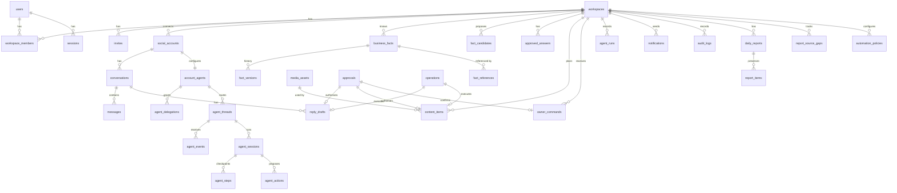

# Data Model

**Purpose:** The authoritative PostgreSQL schema: tables, columns, constraints, indexes, and the phase that introduces each table. Migrations must match this document. If they diverge, update this document in the same change.

**Phase 7.5 target:** [account-agent-contracts.md §§1–2](account-agent-contracts.md) fixes the target tenant tables, states, uniqueness and origin links. Session 02 adds the durable core in migration `0019` (§3.10); later sessions own customer memory, owner requests and comments. The new agent remains inactive on existing and newly connected accounts.

## 1. Conventions

- **Primary keys:** `id uuid` generated by the application (`uuid4`). Exception: `workspace_members` uses a composite key.
- **Timestamps:** `timestamptz`, stored in UTC. Every table has `created_at timestamptz not null default now()`; mutable tables also have `updated_at`.
- **Tenant tables:** `workspace_id uuid not null` FK → `workspaces(id) on delete cascade`, plus `unique (workspace_id, id)` so that it can be the target of composite FKs.
- **Composite FKs:** a tenant child references a tenant parent as `foreign key (workspace_id, parent_id) references parent (workspace_id, id)`. Cross-workspace references are therefore impossible at the DB level ([INV-01](../invariants.md)).
- **Enumerations:** `text` columns with `CHECK (col IN (...))` (easier to migrate than PG enums). Allowed values are listed below and in [state-machines.md](state-machines.md).
- **Money:** inside JSONB fact values as `{"amount": "7000.00", "currency": "TRY"}` (decimal string). Never floats.
- **Simulation flag:** `is_simulated boolean not null default false` on every table whose rows can result from a mock provider ([INV-09](../invariants.md)).
- **Connection UI (Phase 7 Session 4):** no new persistence or migration. `workspace.is_demo` is a workspace policy flag, not provider provenance: Meta accounts/records remain `is_simulated=false` even on a demo workspace. Optional disconnect erasure removes affected history queries from the frontend cache; safe delayed erasure and immutable ledger/audit records retain the Session 3 contract below.
- **Naming:** snake_case. Constraint names follow SQLAlchemy naming conventions set in `core/db.py` (`pk_`, `fk_`, `uq_`, `ck_`, `ix_`).
- **Deletion:** domain rows are not hard-deleted by normal workflows (status changes instead). Hard deletion happens only through workspace deletion, retention jobs and data deletion requests ([security-and-privacy.md §8](security-and-privacy.md)).

## 2. Entity relationship overview

## 3. Tables

Phase = the phase whose migration creates the table ([roadmap.md](../implementation/roadmap.md)).

### 3.1 Identity (Phase 1)

**`users`**
| Column | Type | Notes |
|---|---|---|
| id | uuid PK | |
| email | text not null | stored normalised (trimmed, lowercased); `unique`; `CHECK (email = lower(btrim(email)))` |
| password_hash | text not null | argon2id |
| display_name | text not null | |
| ui_locale | text not null default 'tr' | `CHECK in ('tr','en')` |
| is_active | boolean not null default true | |
| last_login_at | timestamptz null | |

**`sessions`**
| Column | Type | Notes |
|---|---|---|
| id | uuid PK | |
| user_id | uuid FK users on delete cascade | |
| token_hash | bytea not null unique | SHA-256 of the cookie token |
| csrf_token | text not null | returned by `/auth/me`; sent back in `X-CSRF-Token` |
| expires_at | timestamptz not null | sliding (14 days) |
| last_seen_at | timestamptz not null | |
| revoked_at | timestamptz null | |
| user_agent | text null | truncated to 200 chars |

**`workspaces`**
| Column | Type | Notes |
|---|---|---|
| id | uuid PK | |
| name | text not null | |
| slug | text not null unique | URL-safe; used by seed/CLI |
| business_category | text not null | `CHECK in ('gym','pilates_studio','other')` |
| market | text not null | `CHECK in ('tr','global')` |
| default_locale | text not null | `tr` / `en` |
| reply_languages | text[] not null default '{tr}' | subset of supported reply languages. The DB default applies to raw inserts only; `create_workspace` sets `[default_locale]` |
| timezone | text not null | IANA name; validated in service against `zoneinfo.available_timezones()` |
| currency | char(3) not null | ISO 4217 (`CHECK ~ '^[A-Z]{3}$'`); the service accepts only codes in current tender use (Babel/CLDR), not historic codes or `XXX` |
| is_demo | boolean not null default false | only demo workspaces may use mock providers in production config |
| status | text not null default 'active' | `active`, `deleting` |
| settings | jsonb not null default '{}' | validated by `WorkspaceSettings`: `disclosure_enabled` (default true), `disclosure_text{tr,en}`, `daily_report_hour` (default 20), `publish_max_delay_minutes` (default 1440, range 1 to 1440), `automation_reviewed_at` (null until the owner confirms the review with `POST /automation-policies/review`; stamped once by the server from the `Clock`, never client-supplied; saving the policies does not stamp it) |

**`workspace_members`**: PK `(workspace_id, user_id)`; `role` `CHECK in ('owner','manager','staff')`; `invited_by_user_id` null. Service rule: a workspace always has ≥ 1 owner.

**`invites`** (Phase 6): tenant table (`workspace_id`, `unique (workspace_id, id)`). `id`, `workspace_id`, `role` `CHECK in ('owner','manager','staff')`, `token_hash bytea not null unique` (SHA-256 of the raw token; the token itself is never stored), `created_by_user_id` (FK users, null), `expires_at` (7 days from creation), `accepted_by_user_id` (FK users, null), `accepted_at`, `revoked_at`, `created_at`.

### 3.2 Audit and jobs (Phase 1)

**`audit_logs`** (append-only)
| Column | Type | Notes |
|---|---|---|
| id | uuid PK | |
| workspace_id | uuid null | null for system-level events (e.g., invalid webhook signature). **Not a foreign key**: audit rows must survive workspace deletion without being updated or cascaded |
| occurred_at | timestamptz not null | from `Clock` |
| actor_type | text not null | `user`, `system`, `agent`, `provider` |
| actor_id | text null | user ID, job type, agent run ID, provider name |
| action | text not null | catalog in [observability.md §5](observability.md) |
| resource_type / resource_id | text / uuid null | |
| correlation_id | uuid null | |
| is_simulated | boolean not null default false | |
| metadata | jsonb not null default '{}' | IDs, codes, old/new values for facts. **No message text, no tokens.** |

Index: `(workspace_id, occurred_at desc)`, `(workspace_id, action, occurred_at desc)`.

**`jobs`**
| Column | Type | Notes |
|---|---|---|
| id | uuid PK | |
| workspace_id | uuid null | FK workspaces on delete cascade |
| job_type | text not null | registry name |
| payload | jsonb not null | validated per type; **IDs only, no secrets or message text** |
| status | text not null | `queued`, `running`, `succeeded`, `dead`, `cancelled` |
| priority | smallint not null default 100 | lower runs first |
| run_at | timestamptz not null | |
| attempts / max_attempts | int not null | |
| lease_expires_at | timestamptz null | |
| locked_by | text null | worker instance ID |
| dedup_key | text null | `unique where status in ('queued','running')` |
| last_error_code / last_error_detail | text null | detail truncated and redacted |
| correlation_id | uuid null | |
| finished_at | timestamptz null | |

Indexes: `ix_jobs_due (run_at, priority) where status = 'queued'`; `ix_jobs_lease (lease_expires_at) where status = 'running'`; `uq_jobs_dedup_key_active` (unique on `dedup_key` where `status in ('queued','running')`); `ix_jobs_correlation_id`.

### 3.3 Knowledge (Phase 2; `approved_answers` and `fact_references` Phase 3–4)

**`business_facts`**
| Column | Type | Notes |
|---|---|---|
| id | uuid PK | `unique (workspace_id, id)` |
| workspace_id | uuid not null | |
| key | text not null | `^[a-z][a-z0-9_]*(\.[a-z0-9_]+)+$`; `unique (workspace_id, key) where status <> 'archived'` |
| category | text not null | `identity`, `contact`, `location`, `hours`, `service`, `pricing`, `promotion`, `policy`, `booking`, `faq`, `brand`, `escalation`, `schedule`, `custom` |
| label | jsonb not null | `{"tr": "...", "en": "..."}` owner-facing name |
| value_type | text not null | `money`, `weekly_hours`, `text`, `localized_text`, `phone`, `email`, `address`, `url`, `boolean`, `enum`, `string_list` |
| value | jsonb not null | shape per type ([business-knowledge.md §2](business-knowledge.md)) |
| status | text not null | `unverified`, `verified`, `archived` |
| criticality | text not null | `critical`, `standard` |
| current_version | int not null | equals the latest `fact_versions.version` |
| valid_from / valid_until | date null | promotions; evaluated in the workspace timezone |
| last_verified_at | timestamptz null | |
| last_verified_by_user_id | uuid null | foreign key to `users` (`ON DELETE SET NULL`); null for seeded facts |

**`fact_versions`** (append-only)
| Column | Type | Notes |
|---|---|---|
| id | uuid PK | |
| workspace_id, fact_id | uuid | composite FK → business_facts |
| version | int not null | `unique (fact_id, version)` |
| value | jsonb not null | full snapshot |
| status | text not null | status after this change |
| valid_from / valid_until | date null | the validity window after this change (so a window edit is a normal versioned change; added in Phase 2 because the snapshot must be complete) |
| source_type | text not null | `owner_entry`, `owner_command`, `candidate_accepted`, `seed`, `template_default` |
| source_ref | text null | e.g., candidate ID, command ID |
| actor_type / actor_id | text | |
| reason | text null | user-supplied or system reason |
| change_kind | text not null | `created`, `value_changed`, `verified`, `archived`, `restored` |

**`fact_candidates`**
| Column | Type | Notes |
|---|---|---|
| id | uuid PK | |
| workspace_id | uuid | |
| fact_key | text not null | proposed key (existing or new) |
| fact_id | uuid null | composite FK when the key exists |
| proposed_value / value_type | jsonb / text | |
| source_type | text not null | `staff_proposal`, `pasted_text`, `instagram_profile` (P7+), `website` (later) |
| source_excerpt | text null | ≤ 500 chars, the text the value came from |
| relation | text not null | `new`, `same`, `discrepancy`, `contest` (computed at creation and recomputed when the fact changes) |
| status | text not null | `pending`, `accepted`, `rejected`, `superseded` |
| proposed_by_actor_type / proposed_by_actor_id | text | |
| agent_run_id | uuid null | for extraction. Phase 2 creates the column without a foreign key because `agent_runs` does not exist yet; Phase 3 adds the constraint |
| resolved_by_user_id / resolved_at | | `resolved_by_user_id` is a foreign key to `users` (`ON DELETE SET NULL`) |

Index: `(workspace_id, status)`, `(workspace_id, fact_key) where status = 'pending'`.

**`approved_answers`** (Phase 4)
| Column | Type | Notes |
|---|---|---|
| id, workspace_id | uuid | |
| title | text not null | |
| intent | text not null | from the intent list ([agent-runtime.md §4](agent-runtime.md)) |
| example_questions | jsonb not null | list of strings |
| answer_template | text not null | may contain `{{fact:key}}` placeholders |
| language | text not null | |
| status | text not null | `active`, `needs_review`, `archived` |
| version | int not null | |
| created_from_message_id | uuid null | |
| created_by_user_id | uuid | |

**`fact_references`** (Phase 3)
| Column | Type | Notes |
|---|---|---|
| id, workspace_id | uuid | |
| fact_id | uuid | composite FK |
| fact_version | int not null | version used |
| referrer_type | text not null | `reply_draft`, `content_item`, `approved_answer` |
| referrer_id | uuid not null | |

Index: `(workspace_id, fact_id)`; `unique (referrer_type, referrer_id, fact_id)` (one row per fact per referrer). Rows are replaced whenever the referrer's text is regenerated or edited. Impact analysis joins on `fact_id` ([workflows.md §B](workflows.md)).

### 3.4 Commands, AI, approvals, policy (Phase 3–4)

**`owner_commands`**
| Column | Type | Notes |
|---|---|---|
| id, workspace_id | uuid | |
| user_id | uuid not null | |
| channel | text not null | `web`, `telegram` |
| client_request_id | text not null | `unique (user_id, client_request_id)` for client retries |
| raw_text | text not null | ≤ 1000 chars |
| status | text not null | [state-machines.md §3](state-machines.md) |
| command_type | text null | registry name |
| interpreted | jsonb null | validated typed command |
| resolution | jsonb null | resolved references (IDs) |
| clarification | jsonb null | `{question_key, options:[{id,label}]}` |
| result | jsonb null | `{message_key, params, links[]}` |
| error_code | text null | |
| approval_id | uuid null | confirmation approval |
| agent_run_id | uuid null | |
| correlation_id | uuid not null | |
| expires_at | timestamptz null | for clarification/confirmation waits |
| completed_at | timestamptz null | |

**`agent_runs`**
| Column | Type | Notes |
|---|---|---|
| id, workspace_id | uuid | |
| task | text not null | `interpret_command`, `draft_reply`, `draft_content`, `extract_fact_candidates` |
| provider / model / prompt_version | text | |
| status | text not null | `queued`, `running`, `succeeded`, `failed`. `queued` exists so an endpoint can store the redacted input (pasted text) on the run before the job starts; queued rows do not count against the daily budget |
| input_snapshot | jsonb null | redacted; deleted after retention (30 days) |
| output | jsonb null | validated output |
| validation_errors | jsonb null | |
| error_code | text null | |
| input_tokens / output_tokens / latency_ms | int null | |
| repair_attempts | smallint not null default 0 | |
| job_id / correlation_id | uuid | |
| is_fake | boolean not null | |
| started_at / completed_at | timestamptz | |

**`approvals`**
| Column | Type | Notes |
|---|---|---|
| id, workspace_id | uuid | |
| kind | text not null | `confirmation`, `authorization` |
| action | text not null | what is being approved: `command.update_fact`, `command.update_brand_voice`, `command.cancel_content`, `reply.send`, `content.publish`. Not the same as an automation-policy action class. |
| subject_type / subject_id | text / uuid | `owner_command`, `reply_draft`, `content_item` |
| subject_version | int not null | |
| payload_hash | char(64) not null | hex SHA-256 of canonical payload |
| summary | jsonb not null | render data for the approval card |
| required_permission | text not null | |
| status | text not null | `pending`, `approved`, `rejected`, `expired`, `cancelled` |
| requested_by_actor_type / requested_by_actor_id | text | |
| decided_by_user_id / decided_at / decision_channel / decision_note | | |
| expires_at | timestamptz not null | |
| execute_before | timestamptz null | execution deadline |
| operation_id | uuid null | set when consumed by an operation |
| cancel_reason | text null | e.g., `SUBJECT_EDITED`, `SUPERSEDED`, `FACT_CHANGED` |
| is_simulated | boolean | |

Constraint: `unique (workspace_id, subject_type, subject_id) where status = 'pending'`. Index: `(workspace_id, status, expires_at)`. There is no `payload` column: the payload lives with the subject (for a command, `owner_commands.resolution`), and execution recomputes its hash and compares it with `payload_hash`.

**`automation_policies`**: PK `(workspace_id, action_class)`; `mode` `CHECK in ('auto','approval','off')`; `updated_by_user_id`; `updated_at`. Missing rows mean the default (`approval`).

### 3.5 Instagram, inbox (Phase 4)

**`oauth_states`** (migration `0017`, Phase 7 Session 3): tenant-owned UUID and `(workspace_id, id)` unique key; `user_id` references `users`, `state_hash bytea` is globally unique, `purpose` is `connect` or `reconnect`, optional `social_account_id` has a composite tenant FK, and `expires_at`, `used_at`, `invalidated_at`, `created_at`, `updated_at` are timezone-aware timestamps. Purpose/account consistency is checked. Only SHA-256 of 32 random bytes is stored; expiry is ten minutes. `invalidated_at` is an offline contract addition: disconnect invalidates even a state already consumed by an exchange that is still in flight, preventing stale callback resurrection. Membership and integration permission are checked again at completion. Reconnect also compares the captured encrypted credential snapshot before writing. Account changes serialize on a workspace `FOR NO KEY UPDATE` mutex, which excludes another account-change mutex while allowing tenant inserts to acquire FK `KEY SHARE`; full workspace `FOR UPDATE` would deadlock against workers already holding account/draft rows. Disconnected rows can be deliberately reused through a newly authorized connect; selection is deterministic when multiple historical rows match.

**`social_accounts`**
| Column | Type | Notes |
|---|---|---|
| id, workspace_id | uuid | |
| platform | text not null | `instagram` |
| provider_kind | text not null | `mock`, `meta` |
| external_account_id | text not null | IG user ID (`IG_ID`) |
| username | text null | |
| status | text not null | `connected`, `needs_reauth`, `degraded`, `disconnected` |
| capabilities | jsonb not null | e.g., `{"messaging": true, "publish_feed_image": true, "publish_story_image": true}` |
| granted_scopes | text[] not null default '{}' | |
| token_ciphertext | bytea null | AES-GCM; `CHECK (provider_kind = 'meta' OR token_ciphertext IS NULL)` |
| token_key_id | text null | |
| token_expires_at / token_refreshed_at | timestamptz null | |
| consecutive_failures | int not null default 0 | circuit breaker |
| degraded_until | timestamptz null | the circuit is open until then (Phase 6) |
| failure_window_started_at | timestamptz null | start of the window `consecutive_failures` counts in (`CIRCUIT_WINDOW_MINUTES`, migration `0013`); reset by any success |
| last_error_code | text null | |
| connected_at / disconnected_at | timestamptz | |

Constraints: `unique (workspace_id) where status <> 'disconnected'` (one active account per workspace in MVP); `unique (provider_kind, external_account_id) where status <> 'disconnected'`.

**`inbound_events`**
| Column | Type | Notes |
|---|---|---|
| id | uuid PK | |
| provider_kind | text not null | |
| dedup_key | text not null unique | `ig:{account_ext_id}:mid:{mid}` for messages and echoes; `ig:{account}:delete:{mid}` for unsends (separate from the original); `ig:{account}:{field}:sha256(entry)` otherwise |
| workspace_id / social_account_id | uuid null | resolved at ingest from the receiving account |
| event_type | text not null | `message`, `echo`, `delete`, `reaction`, `read`, `postback`, `other` |
| payload | jsonb null | the single webhook item (raw form kept for 30 days, then nulled, so the column is nullable) |
| status | text not null | `received`, `processed`, `ignored`, `failed` |
| ignore_reason / error_code | text null | |
| correlation_id | uuid not null | |
| is_simulated | boolean not null | |
| received_at / processed_at | timestamptz | |

**`conversations`**
| Column | Type | Notes |
|---|---|---|
| id, workspace_id | uuid | |
| social_account_id | uuid | composite FK |
| customer_external_id | text not null | IGSID; `unique (social_account_id, customer_external_id)` |
| customer_handle | text null | username if known (PII) |
| handling_mode | text not null default 'automatic' | `automatic`, `human` |
| attention | text not null default 'none' | `none`, `needs_approval`, `needs_human`, `failed` |
| last_inbound_at / last_outbound_at / last_message_at | timestamptz null | `last_inbound_at` = max of provider timestamps (out-of-order safe) |
| is_simulated | boolean | |

Index: `(workspace_id, attention, last_message_at desc)`.

**`messages`**
| Column | Type | Notes |
|---|---|---|
| id, workspace_id | uuid | |
| conversation_id | uuid | composite FK |
| direction | text not null | `inbound`, `outbound` |
| sender_kind | text not null | `customer`, `business_app` (sent by us), `business_native` (owner via the Instagram app, from echo) |
| external_message_id | text null | `mid`; `unique (social_account_id, external_message_id) where external_message_id is not null` (INV-06; `messages` therefore also carries `social_account_id`) |
| text | text null | subject to retention |
| attachments | jsonb not null default '[]' | `[{type, url?, note}]`; URLs are provider CDN links, which may expire |
| provider_timestamp | timestamptz not null | |
| reply_draft_id | uuid null | for outbound sent by us |
| is_deleted | boolean not null default false | customer unsent |
| is_simulated | boolean | |

Index: `(conversation_id, provider_timestamp)`.

**`reply_drafts`**
| Column | Type | Notes |
|---|---|---|
| id, workspace_id | uuid | |
| conversation_id | uuid | composite FK |
| covers_through_message_id | uuid not null | latest inbound included |
| source | text not null | `ai`, `approved_answer`, `owner` |
| language | text not null | |
| intent | text null | |
| flags | text[] not null default '{}' | e.g., `complaint`, `injection_suspected` |
| template | text null | pre-render text with placeholders (debugging) |
| text | text null | rendered final text (null for `human_required` without suggestion) |
| suggestion_text | text null | for `needs_human`: optional, not sendable as-is |
| validation | jsonb not null | claim report `{passed, issues[{code, span, text}], rendered[{key, fact_id, version, span, display}]}`; `rendered` lets the UI draw fact chips without re-rendering |
| decision | text not null | `auto`, `approval_required`, `human_required`, `blocked` |
| decision_reasons | text[] not null | |
| status | text not null | [state-machines.md §4](state-machines.md) |
| version | int not null default 1 | incremented on edit |
| approval_id / operation_id / agent_run_id | uuid null | |
| superseded_by_id | uuid null | |
| failure_code | text null | the reason code of any terminal state other than `sent`: `failed` (e.g. `OUTCOME_UNCONFIRMED`), `superseded` / `cancelled` (`NEW_INBOUND`, `OWNER_REPLIED_NATIVELY`, `FACT_CHANGED`, `HUMAN_TAKEOVER`, `SUBJECT_EDITED`), `expired` (`MESSAGING_WINDOW_CLOSED`) |
| created_by_actor_type / created_by_actor_id | text | |
| is_simulated | boolean | |

Constraint: `unique (conversation_id) where status in ('pending_approval','needs_human','queued','sending','outcome_unknown')` (at most one open draft per conversation).

### 3.6 Content and media (Phase 5)

**`media_assets`**
| Column | Type | Notes |
|---|---|---|
| id, workspace_id | uuid | |
| storage_backend / storage_key | text | key `{workspace_id}/{yyyy}/{mm}/{id}.jpg` |
| original_filename | text null | sanitised; display only |
| mime_type | text not null | after conversion (`image/jpeg`) |
| byte_size / width / height | int | |
| sha256 | char(64) not null | |
| status | text not null | `uploaded`, `ready`, `rejected`, `deleted`. Upload writes only `ready`: validation and conversion are synchronous, and a rejected upload stores **no row** (it is audited as `media.rejected`), so `uploaded` and `rejected` are reserved. The `media_cleanup` job (Phase 6) sets `deleted` after removing the file |
| rejection_code | text null | reserved (see `status`) |
| created_by_user_id | uuid null | FK `users`, `ON DELETE SET NULL` |
| created_at / updated_at | timestamptz | |
| deleted_at | timestamptz null | set by `media_cleanup` |

`sha256` is the hash of the stored (re-encoded) JPEG, not of the upload; `width`, `height` and `byte_size` describe it too. Constraints: `unique (workspace_id, id)` (target of the composite FK from `content_items`) and `unique (storage_backend, storage_key)`. Migration 0008.

**`content_items`**
| Column | Type | Notes |
|---|---|---|
| id, workspace_id | uuid | |
| social_account_id | uuid null | composite FK; required at submit |
| content_type | text not null | `feed_image`, `story_image` (check constraint) |
| status | text not null | [state-machines.md §5](state-machines.md) (check constraint); changes only through `content.transitions.apply` |
| version | int not null default 1 | `>= 1`. Increments on a payload change (caption, overlay suggestions, media) and on re-approval (state-machines §5, G2). A title or a visual note is not a payload change |
| title | text not null | internal label |
| objective | text null | owner's request |
| caption | text null | feed only; ≤ 2200 chars (**Instagram caption limit is an assumption to verify**, V-05). The *rendered* text: generation renders `{{fact:key}}` placeholders and stores the result, an edit is plain text (plan G6). The API stores up to 5000 characters; the 2200 limit is a submit rule |
| overlay_text_suggestions | jsonb not null default '[]' | story only; list of strings (up to 10 of 500 characters at the API). Claim validation covers them too |
| visual_notes | text null | concept for the owner |
| media_asset_id | uuid null | composite FK |
| scheduled_at | timestamptz null | UTC |
| schedule_input | jsonb null | what was asked for: `{mode: "local", local_date, local_time, timezone, ambiguous?}` (`ambiguous` when the local time exists twice and the earlier instant was taken, G13) or `{mode: "now"}`. Cleared when an approval expires |
| approval_id | uuid null | current approval |
| hold_reason | text null | `FACT_CHANGED`, `ACCOUNT_UNAVAILABLE`, `APPROVAL_EXPIRED` |
| rejection_note | text null | |
| validation | jsonb not null default '{}' | last validation report: `{passed, issues: [{code, field, span, text, matches_verified, fact_key}], stale, warnings?: [{code, field, params}]}`. `passed` is true when every issue is a verified value (`matches_verified`). `field` is `caption` or `overlay_text_suggestions.{index}`; `warnings` are the non-blocking submit warnings of the last successful submission (P5-04); `stale` is set when a referenced fact changed after the check (P5-07) |
| published_at | timestamptz null | |
| external_media_id / external_permalink | text null | |
| last_error_code | text null | |
| agent_run_id | uuid null | composite FK; the `draft_content` run of a generated draft. Created `queued` together with the draft (G7), so the generate response can report its status; the run keeps the redacted brief (`input_snapshot.notes`) until `stored_at` is set when the text is saved or discarded |
| created_by_user_id | uuid not null | FK `users` |
| client_request_id | text null | idempotent creation (plan G7): a second create or generate with the same id by the same author returns the first item |
| created_at / updated_at | timestamptz | |
| is_simulated | boolean not null default false | set from the target account at submit |

Constraints: `unique (workspace_id, id)`; composite FKs `(workspace_id, social_account_id)`, `(workspace_id, media_asset_id)`, `(workspace_id, approval_id)` and `(workspace_id, agent_run_id)` to the parent's `(workspace_id, id)`, so an item can never point at another workspace's row (INV-01); `unique (workspace_id, created_by_user_id, client_request_id)`; `version >= 1`. `approval_id` is the current or latest approval and is kept after the item returns to `draft`, so the author can still see how it ended. Index: `(workspace_id, status, scheduled_at)`. Migration 0009.

The facts a text states are recorded in `fact_references` (`referrer_type = 'content_item'`): the usable facts whose **current display** whole-token matches a critical value found in the caption or the suggestions (the matcher of an owner's own reply, made strict: `500 ₺` is not in `6.500 ₺`; a discount word counts only with the whole display of a `promotion.*` fact), plus every fact a generation rendered. They are replaced on every payload change, at generation, at submit and at re-approval. A value that matches is grounded (`matches_verified` in `validation.issues`) and does not block submission; any other claim issue does.

### 3.7 Operations (Phase 4)

**`operations`**
| Column | Type | Notes |
|---|---|---|
| id, workspace_id | uuid | |
| operation_type | text not null | `send_reply`, `publish_content`, `refresh_token` |
| idempotency_key | text not null unique | see [ADR-011](decisions/ADR-011-external-operations-ledger.md) |
| subject_type / subject_id | text / uuid | |
| social_account_id | uuid | composite FK |
| provider_kind | text not null | |
| status | text not null | [state-machines.md §6](state-machines.md) |
| attempts / max_attempts | int | |
| next_attempt_at | timestamptz null | |
| deadline_at | timestamptz null | no attempts after this |
| provider_ref | jsonb not null default '{}' | `send_reply`: `{recipient_id, text_sha256, echo_mid?}` (a hash, never the text; used to recognise the echo and the lookup result). Publishing: e.g. `{"container_id": "..."}` |
| result | jsonb not null default '{}' | e.g., `{"message_id": "..."}`, `{"media_id": "...", "permalink": "..."}` |
| last_error_code / last_error_detail | text null | |
| correlation_id | uuid | |
| is_simulated | boolean | |
| started_at / completed_at | timestamptz null | |

### 3.8 Notifications and reports (notifications Phase 3; reports Phase 6)

**`notifications`**: `id`, `workspace_id`, `recipient_user_id` (FK users), `type`, `severity` (`info`, `attention`, `critical`), `params` jsonb, `subject_type`, `subject_id`, `dedup_key` (`unique (recipient_user_id, dedup_key) where read_at is null and dedup_key is not null`), `is_simulated`, `read_at`.

**`notification_deliveries`** (Phase 9): `id`, `notification_id`, `channel`, `status` (`pending`, `sent`, `failed`), `attempts`, `external_ref`, `delivered_at`.

**`channel_links`** (Phase 9, user-level, not tenant): `id`, `user_id`, `channel`, `external_user_id`, `external_chat_id`, `default_workspace_id`, `status` (`active`, `revoked`), `linked_at`, `revoked_at`. `unique (channel, external_user_id) where status='active'`.

**`daily_reports`**: `id` (API `snapshot_id`), `workspace_id`, `local_date`, `revision`, `evidence_complete`, `timezone`, `period_start`, `period_end`, `metrics` jsonb (`{key: {value, breakdown?}}`), `definitions_version`, `has_simulated_data`, `generated_at`. Each generation is immutable after creation. Unique `(workspace_id, local_date, revision)` orders generations independently of clock/UUID ties; `(workspace_id, id)` supports tenant FKs. Generation takes a workspace row lock to allocate the next revision; ordinary historical reads select the latest revision. Regeneration inserts a new row and preserves all prior evidence.

**`report_items`**: `id`, `workspace_id`, `report_id`, `metric_key`, plus the registry's seven columns: `subject_type`, `subject_id`, `occurred_at`, `is_simulated`, `link_id`, `measure` numeric, `group_key`. Unique `(workspace_id, report_id, metric_key, subject_type, subject_id)`; composite FK `(workspace_id, report_id)` -> `daily_reports`, cascade on workspace/report deletion. Source IDs have no source FKs, so retention cannot cascade away evidence. No message/draft text, titles, handles, raw payloads or provider credentials are copied. All metrics are captured by one INSERT/SELECT and aggregated from these rows in SQL.

**`report_source_gaps`**: `id`, `workspace_id`, `metric_key`, `start_at`, `end_at` (inclusive UTC range), unique `(workspace_id, metric_key, start_at, end_at)`. Failed inbound-event deletion writes point gaps at `coalesce(processed_at, received_at)` in the same batch transaction; these mark days that cannot be completely regenerated. Gaps contain no content or source IDs. Workspace deletion cascades both evidence and gap rows.

### 3.9 Simulator tables (Phase 4–5; written only by `MockInstagramProvider`)

All have `workspace_id` (for reset and isolation) and `social_account_id`.

| Table | Purpose | Key constraint |
|---|---|---|
| `sim_inbound_messages` | Customer messages the simulator delivered (`sender_id`, `mid`, `received_at`); the mock derives the 24 h messaging window from these, independently of the application's `messages` | `unique (social_account_id, mid)` |
| `sim_sent_messages` | Messages the simulator "delivered" (`message_id`, `recipient_id`, `text`, `sent_at`) | `unique (message_id)` |
| `sim_containers` | Media containers (`container_id`, `media_type` IMAGE or STORIES, `media_url` (the `localmedia:` reference), `caption`, `status`, `ready_at`, `expires_at`, `published_media_id`). `status` stores `IN_PROGRESS`, `ERROR` or `PUBLISHED`; `FINISHED` and `EXPIRED` are derived from `ready_at`/`expires_at` and the clock | `unique (container_id)` |
| `sim_published_media` | Published posts and stories (`media_id`, `container_id` referencing `sim_containers.container_id`, `permalink`, `published_at`) | `unique (container_id)`, so a container can never publish twice; `unique (media_id)` |
| `sim_failure_rules` | Injected failures (`operation`, `mode`, `remaining` null = always, `retry_after_s`) | — |

### 3.10 Account agent core (Phase 7.5 Session 02, migration `0019`)

All seven tables use UUID primary keys, required `workspace_id`, `(workspace_id,id)` uniqueness and composite tenant FKs. `account_agents` has a unique `(workspace_id,social_account_id)` row, initially `legacy`/`inactive` with epoch 0, empty goals/persona and no delegation. Migration `0019` backfills old accounts and a database insert trigger initializes new social accounts identically. The trigger is removed on downgrade.

| Table | Durable fields and constraints |
|---|---|
| `account_agents` | Account FK, `controller_mode`, `state`, monotonic `controller_epoch`, config/persona versions, JSONB goals/persona. Unique account pair; state/version checks. |
| `agent_delegations` | Account, immutable version, grantor, policy/hash, effective/revoked timestamps. Unique account/version and partial unique current unrevoked version. No default row or authority. |
| `agent_threads` | Account, surface/ref, optional DM conversation FK on `(workspace_id,social_account_id,dm_conversation_id)`, state, handling mode, thread version, event cursor, controller epoch and deletion generation. Unique account/surface/ref and account/thread key. |
| `agent_events` | Thread/account, monotonic cursor, kind, source identity/version and timestamp. Unique account/source key and thread/cursor; no generic body. Event and `agent_wake` job are inserted in one caller transaction. |
| `agent_sessions` | Thread/goal, initiating cursor, status/version, cumulative model/tool/token/cost counters, deadline and wake condition. Unique thread/goal and partial unique active session per thread. |
| `agent_steps` | Session/sequence, claim token, lease, captured cursor/epoch/policy/deletion generation, model/prompt/tool versions, context references and token reservation/usage. Unique sequence and claim token; no personal body. |
| `agent_actions` | Account/thread/session, stable intent key, action/target, payload reference/hash/version, initiating event/cursor, status, delegation/grant or approval, operation, deadline and outcome. Unique thread/intent key; operation FK includes account. |

`agent_runs` gains nullable `agent_step_id` and task `account_agent_step`. `reply_drafts` and `content_items` gain `origin=legacy|agent` plus nullable `agent_action_id`; old rows default to `legacy`. Agent content origins require an account and match the action's account through a composite FK. Reply drafts have no account column, so the Session 07 projection must prove its conversation and action share an account before linking them. The polymorphic approval record likewise needs Session 03 subject/account validation. A linked action is not authorization; executors keep the existing approval and operation checks.

Downgrade to `0018` refuses any agent thread, event, delegation, session, step, action or changed agent configuration and any linked existing row. With only disabled backfill rows, it removes the new tables/columns while preserving legacy data. The unrelated existing `invites` metadata drift is outside migration `0019`.

## 4. Data lifecycle summary

**Phase 6 migrations (in order).** `0012` creates daily reports; `0013` adds the circuit window; `0014` creates invites. `0015` (`20261022_0015_phase_6_report_snapshots.py`, after `0014`) replaces the report day unique key with `(workspace_id, local_date, revision)`, adds revision/evidence completeness, and creates `report_items` and `report_source_gaps`. Existing reports keep their IDs and aggregates as revision 1 with `evidence_complete=false`: mutable sources cannot reconstruct their original membership. If pre-upgrade system-wide cleanup audits show deleted webhook rows, migration conservatively marks history up to the last such cleanup as incomplete for then-existing workspaces; those old audits cannot identify the actual affected tenant/day. Downgrade refuses when multiple generations exist rather than discarding history. Apply with `uv run alembic upgrade head`.

**Phase 7 Session 2 migration.** `0016` (`20261023_0016_phase_7_webhook_deletions.py`, after `0015`) extends only the inbound-event type check to admit `delete`. Existing rows are preserved. Downgrade refuses while deletion events exist rather than discarding evidence; after their removal under an authorized retention/deletion policy it can restore the old check. The planned OAuth migration moves to `0017` in Session 3. No historical migration is edited.

| Data | Created by | Mutable? | Retention default ([security-and-privacy.md §8](security-and-privacy.md)) |
|---|---|---|---|
| Facts / versions | Users, commands, seed | Fact row yes; versions never | Lifetime of workspace |
| Messages text | Inbound processing, sends | No (except `is_deleted` flag, and the retention job nulling `text` after 365 days) | 365 days (`RETENTION_MESSAGE_TEXT_DAYS`) |
| Inbound event payloads | Webhooks | Status only (the retention job nulls `payload`) | Payload nulled after 30 days; rows deleted after 90 (implemented, Phase 6) |
| Agent run input snapshots | AI runner | No | Nulled after 30 days (implemented, Phase 6; a `queued` or `running` run keeps it) |
| Audit logs | All services | Never | 2 years in the policy; **no purge in Phase 6** (needs an ADR with the Phase 8 DB privileges) |
| Notifications | Services | `read_at` only | Deleted 90 days after they were read; an unread one is never deleted (implemented, Phase 6) |
| Jobs | Queue | Status | Succeeded/cancelled deleted after 7 days; dead after 90 (implemented, Phase 6) |
| Report generations / contributing evidence | Reporting | Immutable after creation; regeneration inserts a new generation | Lifetime of workspace; no copied source text or payloads |
| Report source gaps | Retention; migration for legacy uncertainty | Insert-only completeness markers | Lifetime of workspace |
| Media | Uploads | Status (`ready` to `deleted`, by `media_cleanup`) | Orphans after 7 days; with content otherwise; published items' media 90 days after publication (implemented, Phase 6) |
| Tokens | OAuth | Rotated | Deleted immediately on disconnect |

### Phase 7.5 Session 05, migration 0021

`agent_sessions` gains `activation_cursor bigint`, `activation_started_at timestamptz`,
`activation_steps bigint`, `activation_tools bigint`, `reserved_tokens bigint` and nullable
`outcome_code text`. The counters survive worker retry/restart; only a resolved wait or new
eligible event starts a new activation, while cumulative goal counters remain charged.
`agent_steps.read_checkpoint jsonb` stores only successful built-in read names and validated
routing arguments; it contains no message body or tool result. Reads are reconstructed from
scoped source records on resume. Downgrade refuses when any session evidence exists.

### Phase 7.5 Session 06, migration 0022

`agent_steps.captured_persona_version integer NOT NULL DEFAULT 1` fences model results
after a voice edit. `agent_sessions.validation_failures integer NOT NULL DEFAULT 0` limits
grounding repair to one retry per activation; cumulative model/token budgets remain charged.
Downgrade refuses while agent session evidence exists. Existing `account_agents.persona`
stores the closed Session 06 voice schema and `persona_version` provides optimistic editing.
Voice edits increment `config_version` without changing controller ownership or delegation.
No customer text, retrieved result, or voice example is copied into generic steps/runs.

### Phase 7.5 Session 07: migration 0023

`0023` follows `0022` and adds monotonic `account_agents.cutover_generation`, `agent_threads.ownership_generation`, `agent_steps.captured_ownership_generation`, and `agent_actions.ownership_generation`, each non-null bigint defaulting to zero. Controller mode changes advance the cutover fence used by legacy plans/drafts. Every agent thread takeover/release or epoch adoption advances thread ownership; steps and stable actions bind the captured value. The downgrade refuses to discard execution/cutover evidence.

Agent-origin DM payloads remain in `reply_drafts`: `validation.agent_proposal` is the closed Session 06 typed proposal, with cursor/ownership metadata. It follows the draft's personal-data lifecycle; generic steps/jobs/actions retain only IDs, hashes and routing/state metadata. Actions point to the draft through `payload_ref`; operation linkage is projected from the existing draft/ledger. Conversation erasure explicitly nulls `agent_threads.dm_conversation_id` and increments deletion generation before deleting personal domain rows, preserving minimal controller/action/run/ledger history.

### Phase 7.5 Session 08: migration 0024

Account-scoped `customer_identities` store provider subject digest/evidence, generation,
revision and content-free erasure cutoff metadata. `customer_memories` hold one bounded
preference/customer claim/open goal per closed business topic, correction version and expiry.
`customer_memory_versions` carry provenance and correcting user ID; explicit privacy changes
null historical bodies. `customer_memory_sources` link exact message/version evidence through
workspace/account composite FKs; removed links expose no message body/reference through APIs.
`customer_summary_versions` carry thread/customer scope, source cursor, generation/revision,
query digest and derived body; privacy invalidation clears body and query digest.
`customer_source_fences` preserve only scoped source hashes across physical deletion to reject
old-source replay. Thread identity references and source-message links have account-composite
FKs. A populated privacy-evidence downgrade is refused. The send proposal now binds thread
deletion generation; erasure marks retained uncertain drafts `privacy_redacted` so read DTOs
and later delivery projection cannot resurrect personal bodies.

### Phase 7.5 Session 09: migration 0025

`owner_questions` persist a private question body, pending/answered/expired/cancelled state,
version, required-information slot, visibility and seven-day expiry. Scope includes
workspace/account/thread/customer/session; original message/cursor/hash, knowledge digest
and ownership/deletion generations fence continuation. The unique continuation key is
server-derived from thread/session/source/slot. Nullable exact answer and holding-action
links use scoped composite FKs. `owner_answers` persist versioned authoritative answers,
staff proposals and cancellations, author/user role, UUID request/hash, answer expiry and
optional reusable candidate. Request IDs are unique per question; answer versions are unique
per question. Bodies redact while minimal ledger/version identifiers survive.

`fact_candidates.owner_answer_id` and `source_type=owner_answer` preserve true provenance
for explicitly requested reusable knowledge; these are unverified candidates, never an
automatic change to business facts. Answer/candidate and question/answer cycles use named
scoped constraints. Downgrade refuses when any owner-question evidence exists.

## Phase 7.5 Session 10: public sources (0026)

`public_media` owns account-scoped provider IDs, ownership state (`unverified` or
`verified_synthetic`), caption, provider timestamp/revision, local version and terminal
provider-deleted state. A comment cannot establish media ownership through another
account's rows. Missing post details remain unknown. `public_threads` maps one root
provider-comment ID to one media/account. `public_comments` stores provider ID, scoped
thread/media/parent, optional stable provider-author ID, owner flag, visible/hidden/
unknown/deleted text lifecycle, provider timestamp/revision and local version.
Composite FKs bind workspace/account/media/thread for parent links; public agent threads
have a scoped `public_thread_id` FK. No public record resolves a private customer identity.
Scoped page indexes support bounded UUID cursor reads.

The provisional synthetic schema supports a root and direct replies only; an out-of-order
reply creates its placeholder root. Conflicting media/lineage/authors reject atomically.
Nested lineage is rejected pending R75-02. Higher provider revisions replace live source
state; equal revisions retain the first body except deletion wins a tie. Terminal deleted
or erased sources cannot resurrect. Server receipt time drives local retention; provider
UTC timestamps and revisions remain separate. Caption expiry clears its body and bumps
media version without claiming provider deletion or suppressing fresh comments.

`sim_public_comments` stores separate mock remote state. Public source deletion, account
erasure and retention redact source-bearing receipt/mock caches. Disconnect's existing
erasure request clears public bodies immediately while preserving content-free IDs and
existing uncertain-operation evidence. Public tools/context suppress deleted/hidden sources.
Migration 0026 refuses downgrade with public sources until explicit archival/erasure.

Session 11 migration `0027` adds `public_comment_actions` with composite workspace/account
FKs to one agent action and one public target, exact local target/media versions and reply
payload; `sim_comment_effects` holds independent mock outcome evidence keyed by account
and operation. The operations and simulator failure constraints gain distinct public reply,
hide, unhide and delete types. Reply bodies are cleared from action and simulator evidence
after verified success or public-source erasure. The operation ledger keeps only target ID,
version, result ID/state and error code. Downgrade refuses populated public-effect history.

### Phase 7.5 Session 12: private-reply opportunity (0028)

`private_reply_opportunities` has one unique row per account/comment. Composite FKs bind
the workspace/account comment, agent action and optional inbound DM conversation. It
stores exact comment/media versions, proposal and eligibility deadline until settled;
then the body is cleared. Reserved and unknown rows continue to block another private
reply. Provider-returned reply/recipient IDs are separate from public author IDs, and a
conversation link is written only on a new matching inbound DM. Public-source erasure
clears recipient evidence and the conversation link. `sim_private_replies` is an
independent mock provider record keyed by account/comment and operation, with injectable
send and lookup failures. The operation and failure-rule constraints add distinct
private-reply types. Populated evidence prevents an unreviewed downgrade.
