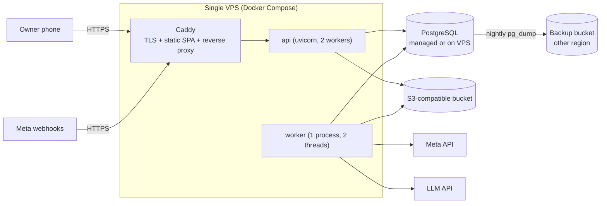

# Deployment

**Purpose:** How the system runs locally and in the first production environment (pilots), at minimal cost and operational complexity. Local setup steps are in [local-development.md](../operations/local-development.md). This document covers topology and production.

## 1. Local (S1)

| Component | How |
|---|---|
| PostgreSQL 16 | `docker compose up -d postgres` (host port 5433; databases `agentnest` and `agentnest_test` created by an init script) |
| API | `uv run uvicorn app.main:create_app --factory --reload --port 8000` |
| Worker | `uv run python -m app.worker` |
| Frontend | `npm run dev` (Vite on 5173, proxying `/api` and `/webhooks` to 8000) |
| Media | `./backend/var/media` (git-ignored) |

No other services. Phone testing: `npm run dev -- --host` plus the LAN IP. Cookies work on HTTP in development (`COOKIE_SECURE=false`).

## 2. Production topology for pilots (S3)

- **One VPS** (2 vCPU / 4 GB RAM is ample for tens of workspaces), running Docker Compose with `caddy`, `api`, `worker`, and optionally `postgres`.
- **PostgreSQL:** either a managed instance (simpler backups, higher cost) or a container with a volume plus nightly dumps. Provisional default: **container + nightly encrypted dumps to object storage + restore drill**, because of the budget. Revisit once the number of paying customers justifies a managed DB.
- **Object storage:** S3-compatible (e.g., Cloudflare R2, Backblaze B2, Hetzner Object Storage) for media and backups. The region follows OQ-04.
- **Domain + TLS:** Caddy with automatic certificates. The webhook URL is `https://<domain>/webhooks/instagram`.
- **Images:** one backend Docker image (multi-stage, `uv sync --frozen`, non-root user) used for both `api` and `worker` with different commands. Frontend built into static files served by Caddy.
- **Migrations:** `alembic upgrade head` as a one-off container before rolling restart. Migrations must be backward-compatible with the previous app version (expand → migrate → contract).
- **Deploy:** GitHub Actions builds images on tag → pushes to GHCR → SSH deploy script pulls, migrates and restarts. Zero-downtime is not required for pilots; the worker restarts safely ([INV-07](../invariants.md)).
- **Secrets:** `.env` on the server with permissions 600, owned by the deploy user. Never in images.
- **Monitoring (pilot level):** external uptime check on `/readyz`, the system health panel, optional Sentry-compatible error tracking, and log rotation by Docker.

## 3. Cost guidance (order of magnitude, verify at purchase time)
- VPS: low tens of USD per month or less. Object storage: near zero at pilot volumes. Domain: yearly fee.
- LLM: proportional to DMs and commands. Measure per workspace in `agent_runs` before setting prices (OQ-09).
- Meta APIs: no fee. WhatsApp (if ever used): per-message pricing ([platform-capabilities.md §2](../research/platform-capabilities.md)).

## 4. Environments
| Env | Purpose | Data |
|---|---|---|
| development | local | fictional seed |
| test/CI | automated tests | ephemeral |
| staging (optional, Phase 8) | rehearse deploys and Meta webhooks with a test account | fictional + founder test account |
| production | pilots | real; `is_demo` workspaces allowed for sales demos if `ALLOW_SIMULATED_WORKSPACES=true` |

## 5. Revisit when
- More than ~50 active workspaces, or any SLA commitment → managed Postgres, 2+ app instances behind a load balancer, OpenTelemetry, alerting.
- Media volume grows (video) → a separate transcoding worker.
