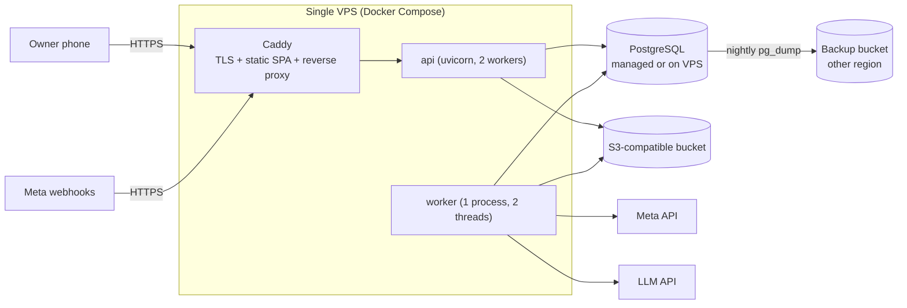

# Deployment

**Purpose:** How the system runs locally and in the first production environment (pilots), at minimal cost and operational complexity. Local setup steps are in [local-development.md](../operations/local-development.md). This document covers topology and production.

## 1. Local (S1)

| Component | How |
|---|---|
| PostgreSQL 16 | `docker compose up -d postgres` (host port 5433; databases `agentnest` and `agentnest_test` created by an init script) |
| API | `uv run uvicorn app.main:create_app --factory --reload --port 8000` |
| Worker | `uv run python -m app.worker` |
| Frontend | `npm run dev` (Vite on 5173, proxying `/api` and `/webhooks` to 8000) |
| Media | `./backend/var/media` (git-ignored) |

No other services. Phone testing: `npm run dev -- --host` plus the LAN IP. Cookies work on HTTP in development (`COOKIE_SECURE=false`).

## 2. Production topology for pilots (S3)

- **One VPS** (2 vCPU / 4 GB RAM is ample for tens of workspaces), running Docker Compose with `caddy`, `api`, `worker`, and optionally `postgres`.
- **PostgreSQL & Backups:** either a managed instance (simpler backups, higher cost) or a container with a volume plus nightly dumps. Provisional default: **container + nightly encrypted `pg_dump -Fc` backups (`scripts/backup.sh` / `scripts/backup.py`) to off-site object storage + verified restore drill (`scripts/restore.sh` / `scripts/restore.py`)**, because of the budget. Backups are encrypted with authenticated AES-256-GCM (`AGNBKP01` envelope using `BACKUP_ENCRYPTION_KEY`), uploaded with a JSON manifest to `BACKUP_S3_BUCKET`, pruned to the canonical **35-day retention window** (`BACKUP_RETENTION_DAYS=35`) after verified upload, and monitored via `.backup-status.json` and `system_health.backup_health()` (`stale_or_failed` > 26h threshold per [ADR-025](decisions/ADR-025-phase-8-hardening-contracts.md) §4.3). Restores run `post-restore-reconcile` (`ADR-025` §3.3) before workers start, pausing all `account_agents`, revoking `agent_delegations`, fencing `in_progress` operations and `sending` drafts to `outcome_unknown`, and re-applying post-snapshot deletion tombstones. Full procedure and drill metrics are in [backup-restore.md](../operations/backup-restore.md). Revisit once the number of paying customers justifies a managed DB.
- **Object storage:** S3-compatible (e.g., Cloudflare R2, Backblaze B2, Hetzner Object Storage) for media (`S3_BUCKET` with versioning and incomplete-multipart cleanup) and off-site backups (`BACKUP_S3_BUCKET` with least-privilege credentials and Object Lock / versioning). The region follows OQ-04.
- **Domain + TLS:** Caddy (`Caddyfile`) with automatic certificates (`APP_DOMAIN`, optional `CADDY_TLS_CONFIG`). Proxies `/api/*`, `/webhooks/*`, `/oauth/*`, `/healthz`, and `/readyz` to `api:8000` while preserving exact paths, query strings, raw bodies, and cookies, and serves the static React SPA from `/srv/app` with `try_files {path} /index.html` and production security headers (`Strict-Transport-Security`, `X-Content-Type-Options: nosniff`, `X-Frame-Options: DENY`, `Referrer-Policy: strict-origin-when-cross-origin`, `Permissions-Policy`, and strict `Content-Security-Policy`). The webhook URL is `https://<domain>/webhooks/instagram`.
- **Images:** root multi-stage `Dockerfile` with frozen dependency installation (`uv sync --frozen --no-dev` and `npm ci`). Target `backend` builds one non-root image (`agentnest`, `uid=10001`, `gid=10001`) shared by `api` (`uvicorn app.main:create_app --factory`), `worker` (`python -m app.worker`), `migrate` (`alembic upgrade head`), and CLI (`python -m app.cli`). Target `caddy` builds the Caddy image containing the compiled `frontend/dist` bundle at `/srv/app`.
- **Migrations:** `docker compose -f compose.prod.yml --profile migrate run --rm migrate` (`alembic upgrade head`) runs as a one-off container before rolling restart, using `MIGRATION_DATABASE_URL` when set (falling back to `DATABASE_URL`). `compose.prod.yml` blanks `MIGRATION_DATABASE_URL: ""` on the long-running `api` and `worker` containers so privileged DDL credentials are never held by runtime processes ([ADR-025](decisions/ADR-025-phase-8-hardening-contracts.md)). Migrations must be backward-compatible with the previous app version (expand → migrate → contract).
- **Deploy & Rollback:** `.github/workflows/deploy.yml` builds `backend` and `caddy` images on release tags (`v*`) or `workflow_dispatch`, pushes pinned tags (`v*` and `sha-<commit>`) to GHCR with `permissions: contents: read, packages: write`, serializes runs per environment (`concurrency: deploy-<env>`, `cancel-in-progress: false`), and deploys over verified SSH (`StrictHostKeyChecking=yes` with `DEPLOY_SSH_KNOWN_HOSTS`) via `scripts/deploy.sh` (`scripts/deploy.py`). Host-side locking (`.deploy.lock`) prevents overlapping manual/automated runs. After preflight (`.env` `0600` permissions, `python -m app.cli check-config --production`) and the migration gate, `scripts/deploy.sh` updates `api`, `worker`, and `caddy`, polls `/readyz` until green (`database: true`, `migrations: true`), and records state in `.deploy-state`. `scripts/rollback.sh` (`python scripts/deploy.py rollback`) rolls back to the previous `IMAGE_TAG` **only** when `current_revision` matches the target rollback image's `head_revision` (blocking image-only rollback with exit code `3` if a forward migration was already applied). Zero-downtime is not required for pilots; the worker drains in-flight jobs for up to 30 seconds (`stop_grace_period: 35s`) and restarts safely ([INV-05](../invariants.md), [INV-07](../invariants.md)). Full operator steps are in [deployment-runbook.md](../operations/deployment-runbook.md).
- **Secrets:** `.env` on the server with permissions `600` (`chmod 600 .env`), owned by the deploy user (`chown deploy:deploy .env`). Excluded from Docker build contexts by `.dockerignore` and never baked into images or frontend assets. Startup checks (`validate_production_settings()` / `Settings.safety_problems()`) fail fast if any production requirement is violated.
- **Monitoring (pilot level):** external uptime check on `/readyz`, the system health panel, optional Sentry-compatible error tracking, and bounded `json-file` log rotation by Docker (`max-size: 10m`, `max-file: 5`).
- **Optional staging (`P8-12`):** `compose.prod.yml` and `Caddyfile` are parameterized via `COMPOSE_PROJECT_NAME`, `ENV_FILE`, `APP_DOMAIN`, `CADDY_TLS_CONFIG`, `IMAGE_TAG`, and `HTTP_PORT`/`HTTPS_PORT`, allowing an isolated staging stack to run on a separate VM (or side-by-side with isolated volumes/networks) without forking deployment files.

## 3. Cost guidance (order of magnitude, verify at purchase time)
- VPS: low tens of USD per month or less. Object storage: near zero at pilot volumes. Domain: yearly fee.
- LLM: proportional to DMs and commands. Measure per workspace in `agent_runs` before setting prices (OQ-09).
- Meta APIs: no fee. WhatsApp (if ever used): per-message pricing ([platform-capabilities.md §2](../research/platform-capabilities.md)).

## 4. Environments
| Env | Purpose | Data |
|---|---|---|
| development | local | fictional seed |
| test/CI | automated tests | ephemeral |
| staging (optional, Phase 8) | rehearse deploys and Meta webhooks with a test account | fictional + founder test account |
| production | pilots | real; `is_demo` workspaces allowed for sales demos if `ALLOW_SIMULATED_WORKSPACES=true` |

## 5. Revisit when
- More than ~50 active workspaces, or any SLA commitment → managed Postgres, 2+ app instances behind a load balancer, OpenTelemetry, alerting.
- Media volume grows (video) → a separate transcoding worker.
