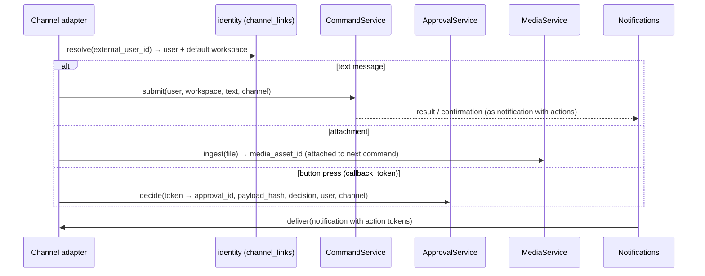

# External Integration Contracts

**Purpose:** The interfaces that isolate external services, and how mock and real implementations satisfy the same contracts. Covers Instagram (customer channel), owner channels (web, Telegram, WhatsApp), LLM providers and media storage. Platform facts and their verification status are in [platform-capabilities.md](../research/platform-capabilities.md). Do not implement anything here beyond what is marked confirmed there without first completing the listed verification item.

## 1. Integration principles

1. **Interfaces are owned by the core**, not by the vendor. Adapters translate.
2. **Mocks are stateful simulators** that enforce the same constraints as the real service (window, limits, async processing, failures).
3. **Typed errors** cross the boundary. HTTP details never leak into domain code.
4. **Side-effecting methods are only called by `operations`** ([INV-15](../invariants.md)).
5. **No retries inside adapters** for non-idempotent calls. Retry policy belongs to the operations layer.
6. **Every adapter call is logged** with operation ID, duration and outcome code (no secrets, no message text).

## 2. Provider registry

`integrations/registry.py` resolves an adapter by `(platform, provider_kind)`, honouring `INSTAGRAM_ENABLED_PROVIDERS`, `LLM_PROVIDER` and `MEDIA_STORAGE_BACKEND`. Domain code asks `registry.instagram_for(account)`; it never constructs adapters directly.

## 3. Instagram (customer channel)

### 3.1 Contract

```python
class InstagramProvider(Protocol):
    kind: Literal["mock", "meta"]

    # --- webhook side (used by inbox; no side effects) ---
    def verify_signature(self, raw_body: bytes, signature_header: str | None) -> bool: ...
    def parse_webhook(self, payload: dict) -> list[NormalizedInboundEvent]: ...

    # --- reads (used by operations / health / connect) ---
    def get_account_profile(self, account: AccountRef) -> AccountProfile: ...
    def get_container_status(self, account: AccountRef, container_id: str) -> ContainerStatus: ...
    def get_media(self, account: AccountRef, media_id: str) -> MediaInfo: ...
    def get_publishing_quota(self, account: AccountRef) -> PublishingQuota: ...
    def find_recent_outbound(self, account: AccountRef, recipient_id: str,
                             since: datetime) -> list[OutboundMessageInfo]: ...   # reconciliation

    # --- side effects (operations module only) ---
    def send_text_message(self, account: AccountRef, recipient_id: str, text: str) -> SendResult: ...
    def create_media_container(self, account: AccountRef, spec: ContainerSpec) -> str: ...  # container_id
    def publish_container(self, account: AccountRef, container_id: str) -> str: ...          # media_id
    def refresh_token(self, account: AccountRef) -> TokenInfo: ...
```

Types (Pydantic or dataclasses in `integrations/instagram/base.py`):
- `AccountRef{social_account_id, workspace_id, external_account_id, token_provider}`. `token_provider` is a callable that decrypts the token on demand, so the token never sits in job payloads or logs (`None` for the mock). `workspace_id` scopes the simulator tables.
- `registry.account_ref(account: SocialAccount, settings: Settings) -> AccountRef` captures the loaded encrypted ciphertext, key ID, account/workspace IDs and key-ring settings. Its callable captures no ORM row or session, decrypts with account-bound AAD only when the Meta adapter requests a token, and raises content-free `ProviderAuthError` if unavailable or invalid. Executors close/commit their preparation transaction before calling the provider.
- `NormalizedInboundEvent{event_type: message|echo|delete|reaction|read|postback|other, account_id, customer_id, mid?, text?, attachments[], provider_timestamp, is_echo, app_id?, raw_item}`. `account_id` is always the business account and `customer_id` always the other party, for customer messages and echoes alike (Meta swaps sender and recipient in an echo). Parsing lives in `webhook_format.py`, shared by the mock and the Meta adapter.
- `AccountProfile{external_account_id, username?}`, `OutboundMessageInfo{message_id, recipient_id, text?, sent_at}`.
- `ContainerSpec{media_type: IMAGE|STORIES, image_url, caption?}` (MVP. `REELS`, `VIDEO` and `CAROUSEL` come later.)
- `ContainerStatus{status_code: IN_PROGRESS|FINISHED|ERROR|EXPIRED|PUBLISHED, error_detail?, media_id?}`. `media_id` is set only with `PUBLISHED` (P5-06): after a lost `publish_container` answer, reconciliation reads the container and needs the media it became to fetch the permalink (`get_media` is keyed by media id). An adapter that cannot tell returns `None`; the executor then records the publication without a permalink. The change is additive; the Meta adapter fills it in Phase 7 if the Graph API allows, otherwise it stays `None` (open question for Phase 7).
- `SendResult{message_id}`, `MediaInfo{media_id, permalink?, timestamp?}`, `PublishingQuota{used, limit, window_hours}`.
- `TokenInfo{expires_at, access_token?}` carries the returned refresh token to the operations refresh consumer. `access_token` defaults to `None` for compatibility and is excluded from `repr`; the shape is internal and must never be serialized in API responses, ledger results, jobs or logs. The consumer encrypts it immediately. Meta computes expiry from the injected `Clock` plus validated `expires_in` seconds.

Typed errors (`integrations/instagram/errors.py`): `ProviderTransientError`, `ProviderRateLimited(retry_after_s)`, `ProviderAuthError`, `ProviderPermissionError`, `ProviderInvalidRequest(code)`, `ProviderWindowClosed`, `ProviderOutcomeUnknown`. Mapping to app error codes: [workflows.md §G.1](workflows.md).

**Ambiguity rule:** an adapter raises `ProviderOutcomeUnknown` when a side-effecting request **may have been accepted**: a read timeout after sending the request, a 5xx on `media_publish` or `messages`, or a connection reset after the request body was sent. It raises `ProviderTransientError` only when the request certainly did not reach processing (connect timeout, DNS failure, connection refused) or the provider explicitly rejected it with a retryable code.

For Meta sends and publishes, malformed successful responses (invalid JSON, missing/invalid IDs or malformed error envelopes) are also `ProviderOutcomeUnknown`; they must never trigger a blind resend. Reads, refresh and invisible container creation map those failures to `ProviderTransientError`. The adapter performs no retries and does not follow redirects. Response shapes and timestamps are validated before returning; final structured logs include operation, provider kind, duration and outcome after validation. Graph message bodies and transport exception text/chains are not exposed; httpx/httpcore request logging is suppressed below WARNING, including when application logging is DEBUG, because token refresh requires a query token.

### 3.2 Capabilities
`social_accounts.capabilities` is computed at connect and refresh:
- `messaging`: scope `instagram_business_manage_messages` granted.
- `publish_feed_image`, `publish_story_image`: scope `instagram_business_content_publish` granted (story: pending V-03; mock: true). These are the only publishing capability names: an earlier build used `content_publish` for mock accounts, and migration `0011` rewrote those rows to the two documented names (keeping their value). `MOCK_CAPABILITIES = {messaging, publish_feed_image, publish_story_image}` (plan G4).
- `comments`: false in MVP.

The policy engine (R1) and the content submit validation check capabilities. Missing capability → `CAPABILITY_MISSING`.

### 3.3 Mock simulator (`MockInstagramProvider`)

| Behaviour | Simulation |
|---|---|
| Signature | HMAC-SHA256 with `MOCK_INSTAGRAM_APP_SECRET`, same header format as Meta, delivered to `POST /webhooks/instagram/mock` (mounted only when `mock` is enabled) |
| Inbound messages | `demo.simulate_customer_message(workspace, customer_alias, text)` builds a Meta-format payload (`object: "instagram"`, `entry[].messaging[]` with `sender.id`, `recipient.id`, `timestamp`, `message.mid`, `message.text`), signs it, and submits the signed raw bytes to the **same ingestion function** that serves `POST /webhooks/instagram` (with provider kind `mock`). The CLI posts over HTTP to the running API. The dev panel endpoint and tests call `inbox.ingest_webhook(session, clock, settings, "mock", raw_body, headers)` in-process, which avoids the API calling itself. |
| Echo of native owner reply | `demo.simulate_owner_native_reply(...)` emits an echo event with an unknown `mid` |
| `send_text_message` | Enforces window (based on the last simulated inbound for that recipient, read from `sim_inbound_messages`), ≤ 1000 bytes; writes `sim_sent_messages`; returns `message_id`; can emit an echo event: the `demo_emit_echo` job (in `operations`, mock accounts only) enqueues a signed echo webhook through the real ingestion path, 1 s after a successful send and 5 s after an unknown outcome |
| `create_media_container` | Requires a JPEG at the URL (plan G3): the URL is the `localmedia:{key}?exp=…` reference of the local `MediaStorage` ([ADR-015](decisions/ADR-015-media-storage.md)). The registry passes the storage to the mock, which resolves the reference through it; an expired reference, a missing object or a non-JPEG (magic bytes `FF D8 FF`) is `ProviderInvalidRequest(MEDIA_REJECTED)`. A story with a caption is `ProviderInvalidRequest(CAPTION_NOT_ALLOWED)` (G5: stories use `ContainerSpec(STORIES, caption=None)`). Writes `sim_containers(status=IN_PROGRESS, ready_at=now+SIM_CONTAINER_DELAY_SECONDS (default 2 s), expires_at=now+24h)` and returns `mock-container-{uuid}` |
| `get_container_status` | `IN_PROGRESS` until `ready_at`, then `FINISHED`; `PUBLISHED` once published (and it stays so; the status then carries the post's `media_id`); `EXPIRED` for an unpublished container at `expires_at`; `ERROR` once the provider failed it (stored, sticky). Only `IN_PROGRESS`, `ERROR` and `PUBLISHED` are stored; the rest is derived from `ready_at`/`expires_at` and the injected `Clock`. An unknown container, or one of another account, is `ProviderInvalidRequest(CONTAINER_NOT_FOUND)` |
| `publish_container` | Locks the container row and requires `FINISHED`, otherwise `ProviderInvalidRequest` with `CONTAINER_NOT_READY` (`IN_PROGRESS`), `CONTAINER_EXPIRED`, `CONTAINER_ERROR` or `CONTAINER_PUBLISHED`. Inserts `sim_published_media` (`unique(container_id)`, so publishing twice is a DB error mapped to `ProviderInvalidRequest(CONTAINER_PUBLISHED)`) and marks the container `PUBLISHED`; returns `mock-media-{uuid}`; permalink `https://instagram.example/sim/{media_id}` (clearly fake domain). With `PUBLISH_DAILY_LIMIT` posts already in the last 24 h it raises `ProviderRateLimited(retry_after_s = oldest post + 24 h - now)` instead of publishing (INV-11) |
| `get_media` | Returns `MediaInfo(media_id, permalink, timestamp=published_at)` from `sim_published_media`; an unknown id (or another account's) is `ProviderInvalidRequest(MEDIA_NOT_FOUND)`. Not injectable |
| `get_publishing_quota` | Counts the account's `sim_published_media` in the last 24 h (a post leaves the window exactly 24 h after it was published); `limit = PUBLISH_DAILY_LIMIT` (default 50), `window_hours = 24`. Not injectable |
| `refresh_token` | Unsupported (`NotImplementedError`; mock accounts have no token) |
| Failure injection | `sim_failure_rules`: `operation ∈ {send, lookup, create_container, container_status, publish, refresh, profile, any}` (`lookup` = `find_recent_outbound`, so reconciliation can be made unavailable; `echo` suppresses the simulated echo of an accepted message, so the no-echo path can be demonstrated), `mode ∈ {transient, rate_limited, auth_revoked, permission_missing, invalid_media, timeout_after_success, window_closed}`, `remaining` (null = always), `retry_after_s`. `timeout_after_success` performs the effect and **then** raises `ProviderOutcomeUnknown`. **Publishing failure modes (plan G18):** `create_container` + `invalid_media` → `ProviderInvalidRequest(MEDIA_REJECTED)` and no container; `container_status` + `invalid_media` → the container becomes (and stays) `ERROR` and the call returns that status; `publish` + `timeout_after_success` → the post is published, then `ProviderOutcomeUnknown` is raised (a second publish is rejected because the container is `PUBLISHED`, which reconciliation relies on); `transient`, `rate_limited` (with `retry_after_s`) and `auth_revoked` apply to all three operations. `any` reaches the three as well. `timeout_after_success` is meant for `send` and `publish`; the mock also honours it for `create_container` (the container exists, the answer is lost; the executor treats an unknown outcome while creating a container as one failed attempt, because nothing was visible yet) and turns it into a transient error for `container_status`, and `get_media` and `get_publishing_quota` ignore rules. |
| `reauthorize(session, account)` | Simulator support, not part of the provider protocol (Phase 6, H12): deletes the account's `auth_revoked` failure rules in the caller's transaction (no commit) and returns how many. `reconnect_mock` calls it, because a fresh token ends the revoked one; other rules stay. |
| Time | Uses the injected `Clock`, so tests control expiry and readiness. |

### 3.4 Meta adapter (`MetaInstagramProvider`): Phase 7

**Offline Session 2 implementation:** profile, send, outbound lookup, containers/status/publish/media/quota and refresh are implemented with fixture transports. All current Meta fixtures are explicitly synthetic offline contracts, not recordings. Gate 2/V-05 and all live acceptance remain pending; the error mapping must be checked against authentic sanitized responses before live use. OAuth and refresh scheduling are implemented offline in Session 3; live response verification remains pending.

- Host `graph.instagram.com`, API version from `META_GRAPH_API_VERSION` (pinned; upgrade deliberately).
- Requests use a 15-second timeout and bearer headers; only the unversioned `/refresh_access_token` endpoint uses a query token. Lookup filters sender, recipient and lower timestamp bound, follows cursor pagination on fixed Graph paths only, and refuses incomplete/repeated pagination rather than returning a partial reconciliation result (100-page bound per collection).
- Media URLs must be syntactically valid HTTPS URLs with a hostname and no embedded credentials; `localmedia:` is rejected before token access/network. Every non-`None` story caption, including an empty string, is rejected. `PUBLISHED` container reads can return `media_id=None`; the executor records verified publication without inventing a permalink. Quota usage, total and duration come from the response (`quota_duration` seconds converted to whole hours).
- Mapping precedence is 5xx ambiguity, auth, closed window, rate limit, permission, media errors, explicit retryable rejection and remaining request rejection. `Retry-After` supports numeric seconds and HTTP dates relative to the injected clock; malformed or greater-than-signed-32-bit delays return no hint. Numeric codes/subcodes follow the provisional Session 2 I4 table; provider message text is inspected only for a closed-window classification and is never retained in errors or logs.
- **OAuth connect flow:**
  1. `POST /social-accounts/instagram/connect` → the server creates a `state` (random, stored hashed with workspace, user and expiry 10 min) → returns the authorize URL (`https://www.instagram.com/oauth/authorize`, scopes `instagram_business_basic,instagram_business_manage_messages,instagram_business_content_publish`).
  2. `GET /oauth/instagram/callback?code&state` → verify state (single use, same user session) → exchange the code (server-side) → exchange for a long-lived token (server-side) → `get_account_profile` → encrypt the token → upsert `social_accounts(meta, connected, capabilities, granted_scopes, token_expires_at)` → subscribe the app to webhooks for the account if required (V-01) → audit `social_account.connected` → redirect to the SPA settings page with a status.
  3. Reconnect for an existing account verifies the same `external_account_id`; a mismatch → error `ACCOUNT_MISMATCH`.
- **Webhook endpoint:** `GET /webhooks/instagram` for the verification handshake (`hub.verify_token == META_WEBHOOK_VERIFY_TOKEN` → echo `hub.challenge`). `POST` with signature verification against `META_APP_SECRET`.
- **Send:** `POST /{ig_id}/messages` with `recipient.id` and `message.text`.
- **Publish:** `POST /{ig_id}/media` (`image_url`, `caption` or `media_type=STORIES`) → `GET /{container_id}?fields=status_code` → `POST /{ig_id}/media_publish` (`creation_id`) → `GET /{media_id}?fields=permalink,timestamp`.
- **Quota:** `GET /{ig_id}/content_publishing_limit`.
- **Error mapping:** built from recorded responses in V-05 and stored as fixtures in `tests/contract/fixtures/meta/`. Unknown errors map to `ProviderTransientError` if 5xx (or `OutcomeUnknown` for side-effecting calls) and to `ProviderInvalidRequest` if 4xx.
- **Disconnect:** delete the token ciphertext immediately, status `disconnected`, cancel queued sends, hold scheduled content, audit. Data deletion follows [security-and-privacy.md §8](security-and-privacy.md).
- **Meta callbacks (Phase 8, V-06):** deauthorize and data-deletion endpoints verify the `signed_request` (HMAC-SHA256 with the app secret) and respond with `{url, confirmation_code}` for data deletion.

OAuth exchange accepts a flat short-token object or exactly one object in a `data` array; mixed flat/wrapped identity or credentials are rejected. Both shapes are synthetic provisional contracts, not Meta recordings. Integer/string `user_id`, nonempty token and positive bounded long-token expiry are validated. Actual short-exchange `permissions` determine capabilities; an absent permissions list grants no capabilities. Requested scopes are never treated as granted. The configured story flag gates the story capability; V-03 remains pending. Both exchanges and the profile call occur outside all service and request-auth transactions. HTTP request/debug logging is suppressed before the first exchange, and typed errors retain no provider body or secret traceback chain.

### 3.5 Contract tests
The Session 4 manual harness is `tests/contract/test_meta_live.py`. It skips unless both `META_LIVE_ACCESS_TOKEN` and `META_LIVE_IG_USER_ID` are explicitly set. Profile/quota are reads; `META_LIVE_RECIPIENT_ID` separately opts into one real DM plus exact-ID lookup, and `META_LIVE_IMAGE_URL` into one real feed-image creation/poll/publish/permalink sequence. Polls are bounded reads, with no automatic send/publish retry. These future manually operated **direct adapter contract probes** intentionally bypass application persistence; production sends/publishes remain approval-bound operations-ledger executions. The harness suppresses live exception traces and never records objects/URLs. A recorder was omitted; all current JSON fixtures remain labelled synthetic, with authentic sanitized recordings pending V-05. See [local-development.md §12](../operations/local-development.md#12-real-instagram-development-phase-7-optional).

`tests/contract/test_instagram_provider_contract.py` defines behaviour that every adapter must satisfy (parameterised by adapter):
- Signature valid/invalid; parse fixtures for message, echo, reaction, attachments and unknown items.
- Send within window → message ID; outside window → `ProviderWindowClosed`; oversize text → `ProviderInvalidRequest`.
- Container lifecycle → `FINISHED` → publish → `PUBLISHED`; publishing twice is rejected; expiry → `EXPIRED`.
- Error mapping for each injected failure mode.

Adapter-neutral cases run against both `mock` and `meta` with deterministic `httpx.MockTransport` and explicitly synthetic JSON fixtures. Existing mock persistence/failure-rule assertions remain separately identified and unchanged. Authentic recordings and the manual `-m meta_live` suite require the later authorized live-account verification; offline tests do not satisfy that acceptance.

### 3.6 Content-type constraints (from verified docs)
| Type | MVP | Constraints enforced |
|---|---|---|
| `feed_image` | yes | JPEG, ≤ 8 MB, aspect 4:5–1.91:1, width 320–1440 (scaled), caption ≤ 2200 chars (to verify) |
| `story_image` | yes (story publishing behaviour pending V-03) | JPEG, ≤ 8 MB, 9:16 recommended, **no caption**: text must be in the image |
| Reels / video / carousel | no | — |

## 4. LLM provider
Contract and behaviour: [ADR-009](decisions/ADR-009-llm-provider-abstraction.md), [agent-runtime.md](agent-runtime.md). Adapters: `fake` (default), `openai`. Only `app/ai` imports `integrations.llm`.

## 5. Owner channels

### 5.1 Contract

```python
class OwnerChannel(Protocol):
    name: Literal["web", "telegram", "whatsapp"]
    def deliver(self, notification: Notification, recipient: ChannelRecipient) -> DeliveryResult: ...
    def render_command_result(self, command: OwnerCommand, recipient: ChannelRecipient) -> None: ...
    # inbound is handled by channel-specific webhook routes that normalise into:
    #   ChannelInbound{channel, external_user_id, chat_id, text?, attachments[], callback_token?, update_id}
```

Flow through the core (identical for every channel):



**Action tokens** (for buttons): a random 16-byte token (base64url, 22 chars, within Telegram's 64-byte `callback_data` limit), stored hashed with `(approval_id, decision, user_id, payload_hash, expires_at, used_at)`. Single use; it must be pressed by the linked user; it expires with the approval.

**Linking:** the user generates a one-time code in the web app (Settings → Channels) and sends `/link <code>` to the bot → `channel_links` row. Unlinking is available from both sides.

### 5.2 Web channel (MVP)
- Commands: `POST /commands`. Results: polled command resource. Notifications: `notifications` table + bell. Approvals: approval screens.
- `deliver()` is a no-op beyond the stored notification.

### 5.3 Telegram (Phase 9, provisional per OQ-01)
- Inbound: `POST /webhooks/telegram`, verifying `X-Telegram-Bot-Api-Secret-Token == TELEGRAM_WEBHOOK_SECRET`. Dedup on `update_id`. Local development may use `getUpdates` long polling (`python -m app.cli telegram-poll`) instead of a public webhook.
- Outbound: `sendMessage` with an inline keyboard. Photos ≤ 20 MB downloadable via `getFile`.
- Approval messages include the full summary (text to be sent or published, schedule, account, simulated flag) and two buttons (Approve / Reject), plus an "Open in app" link.

### 5.4 WhatsApp (deferred, OQ-01)
Same contract. Additional constraints: per-message pricing, free-form only within 24 h of the owner's last message (otherwise paid utility templates), template approval, business verification, and the AI-provider policy review ([platform-capabilities.md §2](../research/platform-capabilities.md)). It must never become a dependency of core flows.

## 6. Media storage
Contract and rules: [ADR-015](decisions/ADR-015-media-storage.md). Backends `local` (default), `s3` (Phase 7). The real Meta adapter requires `public_fetch_url()` to return an Internet-reachable URL. The local backend returns `localmedia:{key}?exp=<unix seconds>`, an opaque reference only the mock provider resolves; `integrations/storage/registry.py` builds the backend from `MEDIA_STORAGE_BACKEND`.

Phase 7 Session 1 adds the S3 backend: private objects, explicit credentials, SigV4 presigned GET URLs, validated keys, and no SDK retries. Owners still read media through the authenticated API. Meta requires S3 in development/test as well as production until secured local-media tunnel serving is specified and implemented; `MEDIA_PUBLIC_BASE_URL` is reserved. The S3 endpoint is optional for AWS; set the bucket's actual AWS region instead of the `auto` default used for R2. Offline stub tests prove storage behavior; V-09 remains pending live verification.
