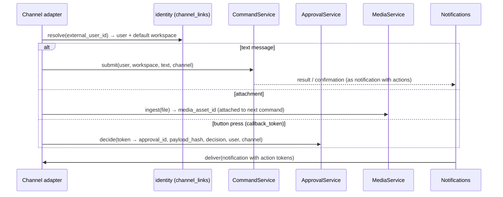

# External Integration Contracts

**Purpose:** The interfaces that isolate external services, and how mock and real implementations satisfy the same contracts. Covers Instagram (customer channel), owner channels (web, Telegram, WhatsApp), LLM providers and media storage. Platform facts and their verification status are in [platform-capabilities.md](../research/platform-capabilities.md). Do not implement anything here beyond what is marked confirmed there without first completing the listed verification item.

## 1. Integration principles

1. **Interfaces are owned by the core**, not by the vendor. Adapters translate.
2. **Mocks are stateful simulators** that enforce the same constraints as the real service (window, limits, async processing, failures).
3. **Typed errors** cross the boundary. HTTP details never leak into domain code.
4. **Side-effecting methods are only called by `operations`** ([INV-15](../invariants.md)).
5. **No retries inside adapters** for non-idempotent calls. Retry policy belongs to the operations layer.
6. **Every adapter call is logged** with operation ID, duration and outcome code (no secrets, no message text).

## 2. Provider registry

`integrations/registry.py` resolves an adapter by `(platform, provider_kind)`, honouring `INSTAGRAM_ENABLED_PROVIDERS`, `LLM_PROVIDER` and `MEDIA_STORAGE_BACKEND`. Domain code asks `registry.instagram_for(account)`; it never constructs adapters directly.

## 3. Instagram (customer channel)

### 3.1 Contract

F-09 adds read-only `get_profile_details(AccountRef) -> ProfileDetails` (external account ID, optional username/name/biography/website) and `list_recent_captions(AccountRef, limit) -> list[RecentCaption]` (media ID, optional caption/aware posted_at/permalink/media_type, newest-first). Reads are allowed outside `operations` and are not INV-15 mutations. Both run without an open caller transaction. Meta reads one page, clamps limit to 1–50, tolerates invalid timestamps as null; mock uses deterministic Clock-relative fixtures with process-local test overrides.

```python
class InstagramProvider(Protocol):
    kind: Literal["mock", "meta"]

    # --- webhook side (used by inbox; no side effects) ---
    def verify_signature(self, raw_body: bytes, signature_header: str | None) -> bool: ...
    def parse_webhook(self, payload: dict) -> list[NormalizedInboundEvent]: ...

    # --- reads (used by operations / health / connect) ---
    def get_account_profile(self, account: AccountRef) -> AccountProfile: ...
    def get_container_status(self, account: AccountRef, container_id: str) -> ContainerStatus: ...
    def get_media(self, account: AccountRef, media_id: str) -> MediaInfo: ...
    def get_publishing_quota(self, account: AccountRef) -> PublishingQuota: ...
    def find_recent_outbound(self, account: AccountRef, recipient_id: str,
                             since: datetime) -> list[OutboundMessageInfo]: ...   # reconciliation

    # --- side effects (operations module only) ---
    def send_text_message(self, account: AccountRef, recipient_id: str, text: str) -> SendResult: ...
    def create_media_container(self, account: AccountRef, spec: ContainerSpec) -> str: ...  # container_id
    def publish_container(self, account: AccountRef, container_id: str) -> str: ...          # media_id
    def refresh_token(self, account: AccountRef) -> TokenInfo: ...
```

Types (Pydantic or dataclasses in `integrations/instagram/base.py`):
- `AccountRef{social_account_id, workspace_id, external_account_id, token_provider}`. `token_provider` is a callable that decrypts the token on demand, so the token never sits in job payloads or logs (`None` for the mock). `workspace_id` scopes the simulator tables.
- `registry.account_ref(account: SocialAccount, settings: Settings) -> AccountRef` captures the loaded encrypted ciphertext, key ID, account/workspace IDs and key-ring settings. Its callable captures no ORM row or session, decrypts with account-bound AAD only when the Meta adapter requests a token, and raises content-free `ProviderAuthError` if unavailable or invalid. Executors close/commit their preparation transaction before calling the provider.
- `NormalizedInboundEvent{event_type: message|echo|delete|reaction|read|postback|other, account_id, customer_id, mid?, text?, attachments[], provider_timestamp, is_echo, app_id?, raw_item}`. `account_id` is always the business account and `customer_id` always the other party, for customer messages and echoes alike (Meta swaps sender and recipient in an echo). Parsing lives in `webhook_format.py`, shared by the mock and the Meta adapter.
- **Story attachments (F-04).** `message.reply_to.story = {id, url}` becomes one `{type: "story_reply", url, note: <story id>}` attachment; an attachment `{type: "story_mention", payload.url}` becomes `{type: "story_mention", url, note: null}`. Both URLs are provider CDN links that expire with the story (24 h): they are stored and never rendered by the UI (CSP `img-src 'self'`). The mention payload carries **no story id and no caption**, and the story-reply payload carries no caption either, so the parser reads only these three fields (`story.id`, `story.url`, the mention `url`). **Unverified (V-08):** all of this follows the documented Messenger-style shape and our synthetic fixtures (`webhook_story_reply.json`, `webhook_story_mention.json`); no real capture exists, and whether a mention also arrives as a `mentions` field change is unknown. The mock simulator builds a story reply from an attachment `{type: story_reply, url, note: <story id>}` (written back as `reply_to.story`) and a mention from `{type: story_mention, url}`.
- **Attachments** (`attachments[]` items are `{type, url, note}`). `type` is the lower-cased Meta attachment type (`image`, `audio`, `video`, `file`, ...; a missing type is `file`), plus the synthetic `story_reply` and `unsupported`. A **voice note** is `type: "audio"` with the media URL in `payload.url` (Meta's webhook examples, read 2026-11-16: type values and `payload.url` are documented; **how long the URL lives and which hosts serve it are not documented**, and no real recorded payload exists yet, so both are unverified). An audio URL longer than 2 048 characters is dropped. The mock produces `{type: audio, url: "mock-audio://<fixture>"}` (`webhook_format.audio_attachment`, `demo/simulator.voice_attachment`, the `voice_note` demo script); the fixtures are in `integrations/transcription/fake.py`.
- **Website fetcher** (`app/integrations/web/`, F-09 part 2): not a provider interface but a single hardened outbound path for owner-typed URLs. `PageFetcher.fetch(url) -> FetchedPage{url, host, final_host, status, content_type, body, redirects}`; `SafeFetcher` (live) resolves once and pins the connection to a public address, `FakeWebsiteFetcher` (offline, `simulated = True`) returns a deterministic Turkish gym site. `html_text` turns HTML into text and links with the standard library only. Selected by `WEBSITE_IMPORT_FETCHER` (`auto` follows `LLM_PROVIDER`). It imports only `app.core` (import-linter contract). The full rule list is in [security-and-privacy.md §7](security-and-privacy.md).
- **Transcription provider** (`app/integrations/transcription/`, F-03): its own small interface next to the LLM provider, not part of it. `TranscriptionProvider.transcribe_audio(clip, model, timeout) -> TranscriptionResult{text, language?, duration_seconds?, provider, model, is_fake, latency_ms}`; `AudioFetcher.fetch(url, max_bytes, timeout) -> FetchedAudio`. Implementations: `FakeTranscriptionProvider` (deterministic text from a fixture; real audio is refused, it never invents a transcript) with `FixtureAudioFetcher` (mock accounts, no network), and `OpenAITranscriptionProvider` (`audio.transcriptions`, only the audio is sent: no prompt, no handle, no workspace; `max_retries=0`) with `HttpsAudioFetcher` (real accounts). Selection: `TRANSCRIPTION_PROVIDER` (`auto` follows `LLM_PROVIDER`; `off` disables). Typed errors map to the `VOICE_*` reason codes ([background-jobs.md §6](background-jobs.md)). It has no tools and its text is untrusted data. The `openai` SDK is imported only by the two OpenAI adapters (import-linter).
- **Image download** (`app/integrations/vision/`, F-03 Session 03): there is no vision provider interface, because describing an image is an LLM task (`describe_image`, [agent-runtime.md §6a](agent-runtime.md)); this package only gets the bytes. `ImageFetcher.fetch(url, max_bytes, timeout) -> FetchedImage{data, content_type}`. `FixtureImageFetcher` (mock accounts: only `mock-image://<fixture>` URLs, no network; fixtures `price_screenshot_tr`, `product_photo`, `location_pin`, `blurry`, `injection_text`, failure fixtures `expired`, `unreachable`, `oversize`, `notimage`) and `HttpsImageFetcher` (real accounts: the rules of the voice-note fetcher, whose host list and address check it reuses: https only, no credentials or non-443 port, Instagram/Facebook CDN host suffix allowlist, every resolved address globally routable, no redirects, no cookies or proxy, **no Authorization header**, size cap by `Content-Length` and while streaming, content-type and file-signature check, total deadline; the signed URL is never logged or put in an error). Accepted files: JPEG, PNG, WebP (a declared type that disagrees with the file signature is refused; an animated GIF is not accepted). An image attachment is `type: "image"` with the URL in `payload.url` (Meta webhook examples; **the CDN hosts and the URL lifetime for images are unverified**, as for audio). Typed errors map to the `IMAGE_*` reason codes ([background-jobs.md §6](background-jobs.md)). The image is held in memory during the job and never stored.
- `AccountProfile{external_account_id, username?}`, `OutboundMessageInfo{message_id, recipient_id, text?, sent_at}`.
- `ContainerSpec{media_type: IMAGE|STORIES, image_url, caption?}` (MVP. `REELS`, `VIDEO` and `CAROUSEL` come later.)
- `ContainerStatus{status_code: IN_PROGRESS|FINISHED|ERROR|EXPIRED|PUBLISHED, error_detail?, media_id?}`. `media_id` is set only with `PUBLISHED` (P5-06): after a lost `publish_container` answer, reconciliation reads the container and needs the media it became to fetch the permalink (`get_media` is keyed by media id). An adapter that cannot tell returns `None`; the executor then records the publication without a permalink. The change is additive; the Meta adapter fills it in Phase 7 if the Graph API allows, otherwise it stays `None` (open question for Phase 7).
- `SendResult{message_id}`, `MediaInfo{media_id, permalink?, timestamp?}`, `PublishingQuota{used, limit, window_hours}`.
- `TokenInfo{expires_at, access_token?}` carries the returned refresh token to the operations refresh consumer. `access_token` defaults to `None` for compatibility and is excluded from `repr`; the shape is internal and must never be serialized in API responses, ledger results, jobs or logs. The consumer encrypts it immediately. Meta computes expiry from the injected `Clock` plus validated `expires_in` seconds.

Typed errors (`integrations/instagram/errors.py`): `ProviderTransientError`, `ProviderRateLimited(retry_after_s)`, `ProviderAuthError`, `ProviderPermissionError`, `ProviderInvalidRequest(code)`, `ProviderWindowClosed`, `ProviderOutcomeUnknown`. Mapping to app error codes: [workflows.md §G.1](workflows.md).

**Ambiguity rule:** an adapter raises `ProviderOutcomeUnknown` when a side-effecting request **may have been accepted**: a read timeout after sending the request, a 5xx on `media_publish` or `messages`, or a connection reset after the request body was sent. It raises `ProviderTransientError` only when the request certainly did not reach processing (connect timeout, DNS failure, connection refused) or the provider explicitly rejected it with a retryable code.

For Meta sends and publishes, malformed successful responses (invalid JSON, missing/invalid IDs or malformed error envelopes) are also `ProviderOutcomeUnknown`; they must never trigger a blind resend. Reads, refresh and invisible container creation map those failures to `ProviderTransientError`. The adapter performs no retries and does not follow redirects. Response shapes and timestamps are validated before returning; final structured logs include operation, provider kind, duration and outcome after validation. Graph message bodies and transport exception text/chains are not exposed; httpx/httpcore request logging is suppressed below WARNING, including when application logging is DEBUG, because token refresh requires a query token.

### 3.2 Capabilities
`social_accounts.capabilities` is computed at connect and refresh:
- `messaging`: scope `instagram_business_manage_messages` granted.
- Meta `comments_permission`: true only when returned `granted_scopes` includes `instagram_business_manage_comments`, now requested as the fifth OAuth scope. This records consent; the separately stored owner opt-in is also required for comment read/private reply. Existing stored JSON is not migrated: a missing key means permission not granted. Active real accounts without it show an owner reconnect action in Connections (non-owners see the owner-only notice); mock accounts are unchanged.
- `publish_feed_image`, `publish_story_image`: scope `instagram_business_content_publish` granted (story: pending V-03; mock: true). These are the only publishing capability names: an earlier build used `content_publish` for mock accounts, and migration `0011` rewrote those rows to the two documented names (keeping their value). `MOCK_CAPABILITIES = {messaging, publish_feed_image, publish_story_image}` (plan G4).
- Meta `comment_read` and `comment_private_reply` require actual comment scope plus the
  persisted owner opt-in. Public `comment_reply` and `comment_moderate` remain false.
  Live rollout still requires the R75 evidence below; subscriptions remain manual.
  Mock effects use separate synthetic capabilities.

The policy engine (R1) and the content submit validation check capabilities. Missing capability → `CAPABILITY_MISSING`.

### 3.3 Mock simulator (`MockInstagramProvider`)

| Behaviour | Simulation |
|---|---|
| Signature | HMAC-SHA256 with `MOCK_INSTAGRAM_APP_SECRET`, same header format as Meta, delivered to `POST /webhooks/instagram/mock` (mounted only when `mock` is enabled) |
| Inbound messages | `demo.simulate_customer_message(workspace, customer_alias, text)` builds a Meta-format payload (`object: "instagram"`, `entry[].messaging[]` with `sender.id`, `recipient.id`, `timestamp`, `message.mid`, `message.text`), signs it, and submits the signed raw bytes to the **same ingestion function** that serves `POST /webhooks/instagram` (with provider kind `mock`). The CLI posts over HTTP to the running API. The dev panel endpoint and tests call `inbox.ingest_webhook(session, clock, settings, "mock", raw_body, headers)` in-process, which avoids the API calling itself. |
| Echo of native owner reply | `demo.simulate_owner_native_reply(...)` emits an echo event with an unknown `mid` |
| `send_text_message` | Enforces window (based on the last simulated inbound for that recipient, read from `sim_inbound_messages`), ≤ 1000 bytes; writes `sim_sent_messages`; returns `message_id`; can emit an echo event: the `demo_emit_echo` job (in `operations`, mock accounts only) enqueues a signed echo webhook through the real ingestion path, 1 s after a successful send and 5 s after an unknown outcome |
| `create_media_container` | Requires a JPEG at the URL (plan G3): the URL is the `localmedia:{key}?exp=…` reference of the local `MediaStorage` ([ADR-015](decisions/ADR-015-media-storage.md)). The registry passes the storage to the mock, which resolves the reference through it; an expired reference, a missing object or a non-JPEG (magic bytes `FF D8 FF`) is `ProviderInvalidRequest(MEDIA_REJECTED)`. A story with a caption is `ProviderInvalidRequest(CAPTION_NOT_ALLOWED)` (G5: stories use `ContainerSpec(STORIES, caption=None)`). Writes `sim_containers(status=IN_PROGRESS, ready_at=now+SIM_CONTAINER_DELAY_SECONDS (default 2 s), expires_at=now+24h)` and returns `mock-container-{uuid}` |
| `get_container_status` | `IN_PROGRESS` until `ready_at`, then `FINISHED`; `PUBLISHED` once published (and it stays so; the status then carries the post's `media_id`); `EXPIRED` for an unpublished container at `expires_at`; `ERROR` once the provider failed it (stored, sticky). Only `IN_PROGRESS`, `ERROR` and `PUBLISHED` are stored; the rest is derived from `ready_at`/`expires_at` and the injected `Clock`. An unknown container, or one of another account, is `ProviderInvalidRequest(CONTAINER_NOT_FOUND)` |
| `publish_container` | Locks the container row and requires `FINISHED`, otherwise `ProviderInvalidRequest` with `CONTAINER_NOT_READY` (`IN_PROGRESS`), `CONTAINER_EXPIRED`, `CONTAINER_ERROR` or `CONTAINER_PUBLISHED`. Inserts `sim_published_media` (`unique(container_id)`, so publishing twice is a DB error mapped to `ProviderInvalidRequest(CONTAINER_PUBLISHED)`) and marks the container `PUBLISHED`; returns `mock-media-{uuid}`; permalink `https://instagram.example/sim/{media_id}` (clearly fake domain). With `PUBLISH_DAILY_LIMIT` posts already in the last 24 h it raises `ProviderRateLimited(retry_after_s = oldest post + 24 h - now)` instead of publishing (INV-11) |
| `get_media` | Returns `MediaInfo(media_id, permalink, timestamp=published_at)` from `sim_published_media`; an unknown id (or another account's) is `ProviderInvalidRequest(MEDIA_NOT_FOUND)`. Not injectable |
| `get_publishing_quota` | Counts the account's `sim_published_media` in the last 24 h (a post leaves the window exactly 24 h after it was published); `limit = PUBLISH_DAILY_LIMIT` (default 50), `window_hours = 24`. Not injectable |
| `refresh_token` | Unsupported (`NotImplementedError`; mock accounts have no token) |
| Failure injection | `sim_failure_rules`: `operation ∈ {send, lookup, create_container, container_status, publish, refresh, profile, any}` (`lookup` = `find_recent_outbound`, so reconciliation can be made unavailable; `echo` suppresses the simulated echo of an accepted message, so the no-echo path can be demonstrated), `mode ∈ {transient, rate_limited, auth_revoked, permission_missing, invalid_media, timeout_after_success, window_closed}`, `remaining` (null = always), `retry_after_s`. `timeout_after_success` performs the effect and **then** raises `ProviderOutcomeUnknown`. **Publishing failure modes (plan G18):** `create_container` + `invalid_media` → `ProviderInvalidRequest(MEDIA_REJECTED)` and no container; `container_status` + `invalid_media` → the container becomes (and stays) `ERROR` and the call returns that status; `publish` + `timeout_after_success` → the post is published, then `ProviderOutcomeUnknown` is raised (a second publish is rejected because the container is `PUBLISHED`, which reconciliation relies on); `transient`, `rate_limited` (with `retry_after_s`) and `auth_revoked` apply to all three operations. `any` reaches the three as well. `timeout_after_success` is meant for `send` and `publish`; the mock also honours it for `create_container` (the container exists, the answer is lost; the executor treats an unknown outcome while creating a container as one failed attempt, because nothing was visible yet) and turns it into a transient error for `container_status`, and `get_media` and `get_publishing_quota` ignore rules. |
| `reauthorize(session, account)` | Simulator support, not part of the provider protocol (Phase 6, H12): deletes the account's `auth_revoked` failure rules in the caller's transaction (no commit) and returns how many. `reconnect_mock` calls it, because a fresh token ends the revoked one; other rules stay. |
| Time | Uses the injected `Clock`, so tests control expiry and readiness. |

### 3.4 Meta adapter (`MetaInstagramProvider`): Phase 7

**Feature Phase 3 Session 02:** real individual comment reads and private sends now
reuse the transport from the synthetic scaffold, behind account capability checks in
application admission and execution. Public listing/effects/lookups remain disabled.
`SyntheticMetaCommentProvider` still requires exact `httpx.MockTransport` and is never
constructed by the registry. The Meta codec parses documented comments; all fixtures
and live acceptance remain pending. Generic transient mutation responses are unknown
unless a definitive rejection applies, and private sends have no remote readback.
See [research evidence](../research/meta-comments-session16.md).

**Offline Session 2 implementation:** profile, send, outbound lookup, containers/status/publish/media/quota and refresh are implemented with fixture transports. All current Meta fixtures are explicitly synthetic offline contracts, not recordings. Gate 2/V-05 and all live acceptance remain pending; the error mapping must be checked against authentic sanitized responses before live use. OAuth and refresh scheduling are implemented offline in Session 3; live response verification remains pending.

- Host `graph.instagram.com`, API version from `META_GRAPH_API_VERSION` (pinned; upgrade deliberately).
- Requests use a 15-second timeout and bearer headers; only the unversioned `/refresh_access_token` endpoint uses a query token. Lookup filters sender, recipient and lower timestamp bound, follows cursor pagination on fixed Graph paths only, and refuses incomplete/repeated pagination rather than returning a partial reconciliation result (100-page bound per collection).
- Media URLs must be syntactically valid HTTPS URLs with a hostname and no embedded credentials; `localmedia:` is rejected before token access/network. Every non-`None` story caption, including an empty string, is rejected. `PUBLISHED` container reads can return `media_id=None`; the executor records verified publication without inventing a permalink. Quota usage, total and duration come from the response (`quota_duration` seconds converted to whole hours).
- Mapping precedence is 5xx ambiguity, auth, closed window, rate limit, permission, media errors, explicit retryable rejection and remaining request rejection. `Retry-After` supports numeric seconds and HTTP dates relative to the injected clock; malformed or greater-than-signed-32-bit delays return no hint. Numeric codes/subcodes follow the provisional Session 2 I4 table; provider message text is inspected only for a closed-window classification and is never retained in errors or logs.
- **OAuth connect flow:**
  1. `POST /social-accounts/instagram/connect` → the server creates a `state` (random, stored hashed with workspace, user and expiry 10 min) → returns the authorize URL (`https://www.instagram.com/oauth/authorize`, scopes `instagram_business_basic,instagram_business_manage_messages,instagram_business_content_publish`).
  2. `GET /oauth/instagram/callback?code&state` → verify state (single use, same user session) → exchange the code (server-side) → exchange for a long-lived token (server-side) → `get_account_profile` → encrypt the token → upsert `social_accounts(meta, connected, capabilities, granted_scopes, token_expires_at)` → subscriptions remain a manual operator step (V-01) → audit `social_account.connected` → redirect to the SPA settings page with a status.
  3. Reconnect for an existing account verifies the same `external_account_id`; a mismatch → error `ACCOUNT_MISMATCH`.
- **Webhook endpoint:** `GET /webhooks/instagram` for the verification handshake (`hub.verify_token == META_WEBHOOK_VERIFY_TOKEN` → echo `hub.challenge`). `POST` with signature verification against `META_APP_SECRET`.
- **Send:** `POST /{ig_id}/messages` with `recipient.id` and `message.text`.
- **Publish:** `POST /{ig_id}/media` (`image_url`, `caption` or `media_type=STORIES`) → `GET /{container_id}?fields=status_code` → `POST /{ig_id}/media_publish` (`creation_id`) → `GET /{media_id}?fields=permalink,timestamp`.
- **Quota:** `GET /{ig_id}/content_publishing_limit`.
- **Error mapping:** built from recorded responses in V-05 and stored as fixtures in `tests/contract/fixtures/meta/`. Unknown errors map to `ProviderTransientError` if 5xx (or `OutcomeUnknown` for side-effecting calls) and to `ProviderInvalidRequest` if 4xx.
- **Disconnect:** delete the token ciphertext immediately, status `disconnected`, cancel queued sends, hold scheduled content, audit. Data deletion follows [security-and-privacy.md §8](security-and-privacy.md).
- **Meta callbacks (Phase 8, V-06):** deauthorize and data-deletion endpoints verify the `signed_request` (HMAC-SHA256 with the app secret) and respond with `{url, confirmation_code}` for data deletion.

OAuth exchange accepts a flat short-token object or exactly one object in a `data` array; mixed flat/wrapped identity or credentials are rejected. Both shapes are synthetic provisional contracts, not Meta recordings. Integer/string `user_id`, nonempty token and positive bounded long-token expiry are validated. Actual short-exchange `permissions` determine capabilities; an absent permissions list grants no capabilities. Requested scopes are never treated as granted. The configured story flag gates the story capability; V-03 remains pending. Both exchanges and the profile call occur outside all service and request-auth transactions. HTTP request/debug logging is suppressed before the first exchange, and typed errors retain no provider body or secret traceback chain.

### 3.5 Contract tests
The Session 4 manual harness is `tests/contract/test_meta_live.py`. It skips unless both `META_LIVE_ACCESS_TOKEN` and `META_LIVE_IG_USER_ID` are explicitly set. Profile/quota are reads; `META_LIVE_RECIPIENT_ID` separately opts into one real DM plus exact-ID lookup, and `META_LIVE_IMAGE_URL` into one real feed-image creation/poll/publish/permalink sequence. Polls are bounded reads, with no automatic send/publish retry. These future manually operated **direct adapter contract probes** intentionally bypass application persistence; production sends/publishes remain approval-bound operations-ledger executions. The harness suppresses live exception traces and never records objects/URLs. A recorder was omitted; all current JSON fixtures remain labelled synthetic, with authentic sanitized recordings pending V-05. See [local-development.md §12](../operations/local-development.md#12-real-instagram-development-phase-7-optional).

`tests/contract/test_instagram_provider_contract.py` defines behaviour that every adapter must satisfy (parameterised by adapter):
- Signature valid/invalid; parse fixtures for message, echo, reaction, attachments and unknown items.
- Send within window → message ID; outside window → `ProviderWindowClosed`; oversize text → `ProviderInvalidRequest`.
- Container lifecycle → `FINISHED` → publish → `PUBLISHED`; publishing twice is rejected; expiry → `EXPIRED`.
- Error mapping for each injected failure mode.

Adapter-neutral cases run against both `mock` and `meta` with deterministic `httpx.MockTransport` and explicitly synthetic JSON fixtures. Existing mock persistence/failure-rule assertions remain separately identified and unchanged. Authentic recordings and the manual `-m meta_live` suite require the later authorized live-account verification; offline tests do not satisfy that acceptance.

### 3.6 Content-type constraints (from verified docs)
| Type | MVP | Constraints enforced |
|---|---|---|
| `feed_image` | yes | JPEG, ≤ 8 MB, aspect 4:5–1.91:1, width 320–1440 (scaled), caption ≤ 2200 chars (to verify) |
| `story_image` | yes (story publishing behaviour pending V-03) | JPEG, ≤ 8 MB, 9:16 recommended, **no caption**: text must be in the image |
| Reels / video / carousel | no | — |

## 4. LLM provider
Contract and behaviour: [ADR-009](decisions/ADR-009-llm-provider-abstraction.md), [agent-runtime.md](agent-runtime.md). Adapters: `fake` (default), `openai`. Only `app/ai` imports `integrations.llm`.

## 5. Owner channels

### 5.1 Contract

```python
class OwnerChannel(Protocol):
    name: Literal["web", "telegram", "web_push", "whatsapp"]
    def deliver_notification(
        self,
        db: Session,
        clock: Clock,
        delivery: NotificationDelivery,
        recipient: ChannelRecipient,
    ) -> ChannelDeliveryResult: ...
    def render_command_result(
        self,
        db: Session,
        clock: Clock,
        command: OwnerCommand,
        recipient: ChannelRecipient,
    ) -> None: ...
```

Channel adapters register in `app.integrations.channels.registry` via `register_channel(adapter)`. Delivery orchestration runs through `app.notifications.delivery.deliver_pending_notifications`, recording per-recipient attempts and statuses (`delivered`, `failed`, `skipped_quiet_hours`) in the `notification_deliveries` ledger (`migration 0039`).

Flow through the core (identical for every channel):



**Action tokens** (for buttons): a random 16-byte token (base64url, 22 chars, within Telegram's 64-byte `callback_data` limit), stored SHA-256 hashed in `action_tokens` (`migration 0041`) with `(workspace_id, approval_id, decision, user_id, payload_hash, expires_at, used_at)`.
- **Save-as-fact button (D-05):** after an owner answers a question on Telegram, the confirmation message carries one inline button, `fsv:<token>` ("Save as verified fact"), when the answer is plain text and the answerer holds `knowledge.verify`. The token is a separate single-use record (`fact_save_tokens`, migration `0055`, 48-hour life) bound to the candidate and the linked user. The tap resolves it, checks that the Telegram account is linked to that user and workspace, marks it used and runs the ordinary `accept_candidate`. A replay answers "already saved" and removes the keyboard; another user's tap is refused; an expired token, a candidate decided meanwhile (`CONFLICT_STATE`) and an unknown token each get their own alert and change nothing. An answer with a price, hours or contact details gets no button, only a note to confirm it in Business knowledge. Dispatcher actions: `fact_saved`, `fact_save_already_used`, `fact_save_expired`, `fact_save_unauthorized`, `fact_save_conflict`, `fact_save_needs_editor`, `fact_save_failed`.
- **Single use (`INV-16`):** Tapping the button atomically consumes the token (`used_at = clock.now()`), invokes `ApprovalService.decide`, and triggers side-effects (e.g. enqueuing `send_reply` or `publish_content`).
- **Replay safe (`INV-06`, `AC-1`):** A second press on the same token or its sister token returns an `"already decided"` modal alert (`show_alert=True`), removes keyboard buttons, and produces strictly zero duplicate jobs or external actions.
- **Access control (`ADR-014`):** If a third party or different workspace member taps a forwarded button, the token consumption rejects with 403 Forbidden and displays an unauthorized alert.
- **Staleness protection (`INV-16`):** If the subject entity (reply draft or content item) changed version on the web, `payload_hash` mismatches and decision is rejected as stale (`APPROVAL_STALE`).

**Quiet Hours Policy (`ADR-012`, Phase 9):**
- Evaluated per user in their local timezone (`workspace.timezone`, default `Europe/Istanbul`).
- Standard quiet window: 22:00 to 08:00 local time.
- Non-critical notifications (`report.daily_ready`, general suggestions, operational warnings) are suppressed with status `skipped_quiet_hours`.
- Critical alerts bypass quiet hours immediately (`bypassed_quiet_hours=True`):
  - High/critical severity alerts (`system.integration_error`, security alerts)
  - Account reauthorization warnings (`account.needs_reauth`)
  - Urgent pending approvals expiring within 2 hours.

**Linking:** the user generates an 8-character one-time alphanumeric code in the web app (`Settings -> Channels / Connections`), valid for 10 minutes, and sends `/link <code>` to the bot. The adapter validates the code and creates a `channel_links` row (`migration 0038`). Unlinking is available both from the web UI and via `/unlink` in chat.

### 5.2 Web channel (MVP)
- Commands: `POST /commands`. Results: polled command resource. Notifications: `notifications` table + bell. Approvals: approval screens.
- `deliver_notification()` is a no-op beyond the stored notification.

### 5.2a Web Push (Feature Phase 1, F-01)
A phone or browser notification for the owner. `WebPushChannel` (`app.integrations.channels.web_push`) implements `OwnerChannel`; `registry.get_channel("web_push")` imports it lazily, so web-only operation never loads `pywebpush`. Only the registry imports the package (import-linter), only `sender.py` imports `pywebpush`/`py_vapid`, and the package cannot import any module that holds customer text.

- **What is pushed:** `approval.requested` (approvals), `owner_question.requested` and `owner_question.window_closed` (questions), `content.failed`, `reply.failed` and `account.needs_reauth` (failures). The list and the category of each type are `notifications/catalog.py` `PUSH_TYPES`. Anything else stays in the app.
- **Who gets it:** a user who opted into the type's category (`push_preferences`, off by default; `GET/PUT /…/push-subscriptions/preferences`) and has at least one active device (`push_subscriptions`, registered by the browser through `POST /…/push-subscriptions`). Nobody else in the workspace, and no device of another workspace, is used. A device whose user is no longer an active member is not pushed to.
- **Flow:** `notify()` calls `push_dispatch.dispatch_web_push` in the notification's own transaction. When the checks above pass, `dispatch_channel_notification` evaluates `delivery_policy` for channel `web_push` (the Telegram quiet-hours window 22:00 to 08:00 in the workspace timezone; critical severity, `account.needs_reauth` and an approval expiring within 2 hours bypass it), writes a `notification_deliveries` row (`pending`, or `skipped_quiet_hours` with nothing sent: a held push is not replayed in the morning, it stays in the in-app list) and, if delivering now, enqueues `deliver_channel_notification`. The worker claims the row, calls `WebPushChannel.deliver_notification` **outside any transaction** (the adapter ends its read transaction before the first send), then records the result.
- **Result:** delivered when at least one device accepted the push (`last_success_at` is set on those devices). A 404 or 410 from the push service revokes that device (`revoked_at`, audit `push_subscription.revoked` by the system actor with `reason`), so the next notification no longer attempts it. 5xx, 429 and timeouts leave the row `pending` and the job retries with backoff (5, 30, 120 s; three attempts), then `failed` and a dead job. No device, opt-out and membership loss are terminal `failed` rows with a fixed `last_error`. A retry re-sends to devices that already got the push; the shared `tag` makes the device replace rather than stack the notification.
- **Payload and SSRF rules:** [security-and-privacy.md §7.2](security-and-privacy.md) (no customer text; allowlist, public addresses, no redirects, short timeout). Approve and reject are not available from a push.
- **Client:** `frontend/public/sw.js` shows the payload (plain text) and opens the same-origin `url`. The opt-in lives in Settings next to Telegram; the app offers it once, after the owner's first approval; on iOS Safari outside an installed app it shows an "Add to Home Screen" guide instead, because iOS delivers pushes only to an installed web app (iOS 16.4 or later).
- **Not verified offline:** delivery through a real push service to a real Android or iOS device. See the Session 04 report for the manual steps.

### 5.3 Telegram (Phase 9)
- **Inbound Endpoint:** `POST /webhooks/telegram` router in `app.api.v1.webhooks`. Enforces `X-Telegram-Bot-Api-Secret-Token` matching `TELEGRAM_WEBHOOK_SECRET` (returns HTTP 401 on mismatch when configured).
- **Update Deduplication (`INV-06`):** Durable ledger `telegram_updates` (`migration 0040`). Duplicate `update_id` deliveries return status `duplicate` without re-executing actions or dispatching duplicate outbound API calls.
- **Local Development Polling:** CLI runner `python -m app.cli telegram-poll` uses `getUpdates` long-polling with identical routing and deduplication logic, eliminating the need for public webhooks or tunnels during development.
- **Outbound Notifications:** Formatted using Telegram HTML parse mode (`<b>`, `<i>`, `<blockquote>`), simulation warning banner (`[SİMÜLASYON]` per `INV-09`), inline action buttons (`act:<token>`), and deep link (`/approvals`).
- **Media Ingestion (`INV-11`, `AC-3`):** Photos downloaded via `getFile` up to a strict 20 MB ceiling. Files exceeding 20 MB are rejected immediately before storage intake, generating a user alert and an audit record (`media.rejected`). Ingested photos attach to subsequent commands or immediately create draft story items (`ContentItem`, type `story_image`). Free-text captions (e.g. *"bu story'yi 19:00'da paylaş"*) create drafts with schedule proposals that require explicit owner approval (`INV-04`); free text never auto-schedules or publishes directly.
- **Domain Queries (`AC-2`):** Inbound natural language reporting questions (e.g., *"Bugün kaç DM geldi?"*, *"Bugünkü özet"*) route directly to `get_daily_summary`, returning identical counts and metrics to the web dashboard.
- **Fact sources in reply approvals (D-01):** the approval message for a reply draft lists, under the proposed reply, one compact line per verified fact the reply quotes: `• <b>6.000 ₺ / ay</b> — from: Monthly membership, verified 2026-11-03` (`kaynak:` / `doğrulandı` for a Turkish recipient; the date is the day in the workspace timezone that the rendered fact version was verified, or "verification date not recorded"). The mapping is the server's (`knowledge/sources.py`, the same one the web draft view uses). All database text is HTML-escaped, a value is clipped to 40 characters and a label to 60, and lines that would take the message over a 3,900-character budget (Telegram's limit is 4,096) are dropped and replaced by "+N more". A reply with no placeholders has no such block. Customer data rules are unchanged (the message already showed the customer's handle and the last inbound text, trimmed to 200 characters).
- **Daily summary (D-01):** "Bugünkü özet" / "Today's summary" ends with "Replies sent" and "Replies with unverified values sent" from the daily report's metrics ([workflows.md §F.1](workflows.md)); both are shown at zero. The report is not pushed to Telegram on a schedule.
- **Architectural Isolation (`AC-4`):** Strictly enforced via import linter. Only `app.integrations.channels.registry` and `app.api.v1.webhooks` import `app.integrations.channels.telegram`. Core modules (`app.commands`, `app.approvals`, `app.inbox`, `app.policy`, `app.identity`, etc.) have zero dependencies on the Telegram adapter.

### 5.4 WhatsApp (deferred, OQ-01)
Same contract. Additional constraints: per-message pricing, free-form only within 24 h of the owner's last message (otherwise paid utility templates), template approval, business verification, and the AI-provider policy review ([platform-capabilities.md §2](../research/platform-capabilities.md)). It must never become a dependency of core flows.

## 6. Media storage
Contract and rules: [ADR-015](decisions/ADR-015-media-storage.md). Backends `local` (default), `s3` (Phase 7). The real Meta adapter requires `public_fetch_url()` to return an Internet-reachable URL. The local backend returns `localmedia:{key}?exp=<unix seconds>`, an opaque reference only the mock provider resolves; `integrations/storage/registry.py` builds the backend from `MEDIA_STORAGE_BACKEND`.

Phase 7 Session 1 adds the S3 backend: private objects, explicit credentials, SigV4 presigned GET URLs, validated keys, and no SDK retries. Owners still read media through the authenticated API. Meta requires S3 in development/test as well as production until secured local-media tunnel serving is specified and implemented; `MEDIA_PUBLIC_BASE_URL` is reserved. The S3 endpoint is optional for AWS; set the bucket's actual AWS region instead of the `auto` default used for R2. Offline stub tests prove storage behavior; V-09 remains pending live verification.

### Real-account comment-to-DM (Feature Phase 3)

The Meta codec alone parses `entry[].changes[]` with `field=comments`: value `id`, `from.id`, `text`, `media.id`, optional `parent_id`; account is `entry.id`, timestamp is `entry.time` in seconds. Usernames are discarded. Malformed comments are dropped without payload logging and do not also become `other`. Normalized `provider-comment-v1` uses the existing CommentEvent contract; stable account/comment dedup ignores delivery-time changes. Mock synthetic parsing is unchanged.

The persisted `social_accounts.comment_automation_enabled` defaults false and is independent of OAuth capabilities JSON. Actual scope plus opt-in derive `comment_read` and `comment_private_reply` only. Off accounts store empty ignored comment payloads (`COMMENT_AUTOMATION_OFF`); processing and execution recheck opt-in. Signed own-account webhook evidence marks media `verified_provider`; mocks accept only `verified_synthetic`. Provider readback independently verifies the media owner before private sending.

Real `read_comment` and `send_private_reply` use the existing operations executor; public reads/listing and reply/moderation mutations stay `*_NOT_VERIFIED`. GET comment fields `id,media,timestamp,text,hidden`, GET media `id,owner`, then POST `/{ig-user-id}/messages` with `recipient.comment_id` and `message.text` (1–1000 UTF-8 bytes). Ambiguous POST is outcome unknown; there is no private-reply remote readback and no automatic resend. Reads and writes happen outside DB transactions after write-ahead admission.

The pure real-account rules enforce a 7-day minus 10-minute window, no parent, known author and strict one-per-commenter admission. They reuse verified-placeholder drafts, delegation and approval (Ask by default), and revalidate before dispatch. Count semantics and reply eligibility are ASSUMED-strict pending live evidence. The [rollout rule table](../operations/account-agent-rollout.md#real-account-comment-to-dm-rollout-feature-phase-3) defines reason codes and rollback.

Subscriptions remain manual: POST `https://graph.instagram.com/<version>/<ig-user-id>/subscribed_apps?subscribed_fields=comments`, then GET the same subscribed_apps endpoint with the account token. App Live/Advanced Access prerequisites and whether `comments` is accepted for this app remain a live gate. No application subscription effect was added.
