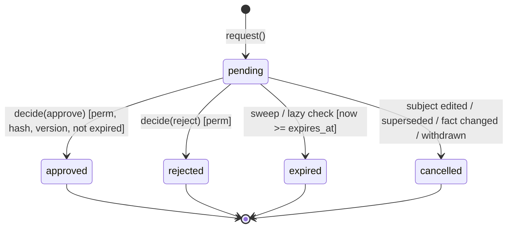
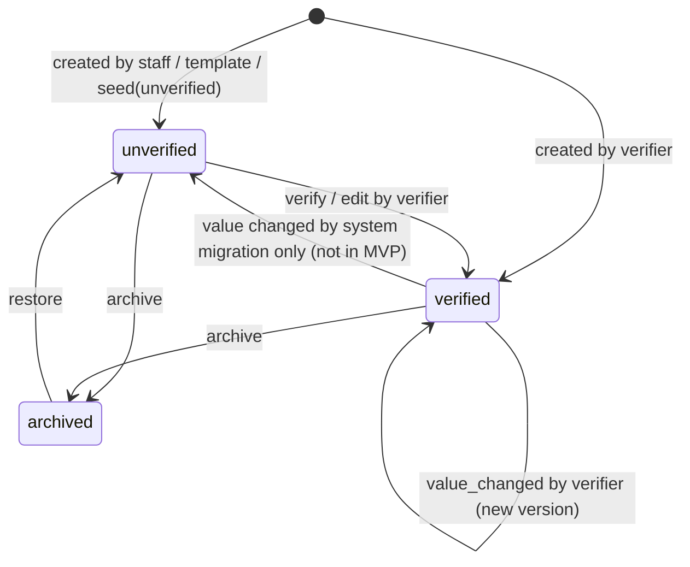
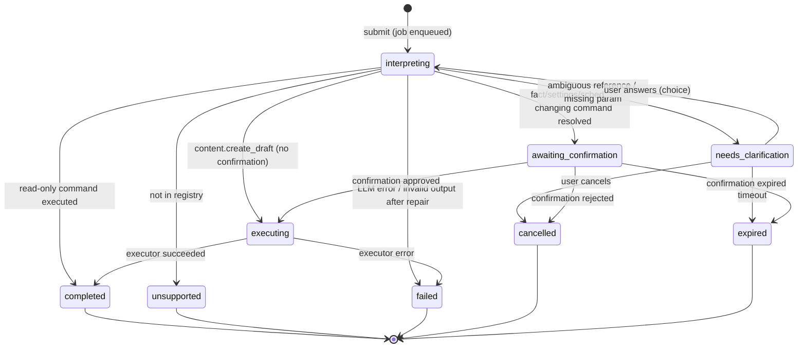
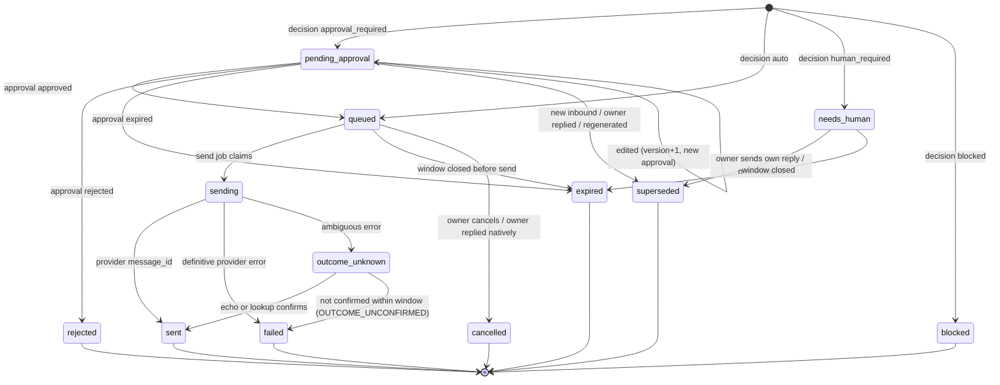
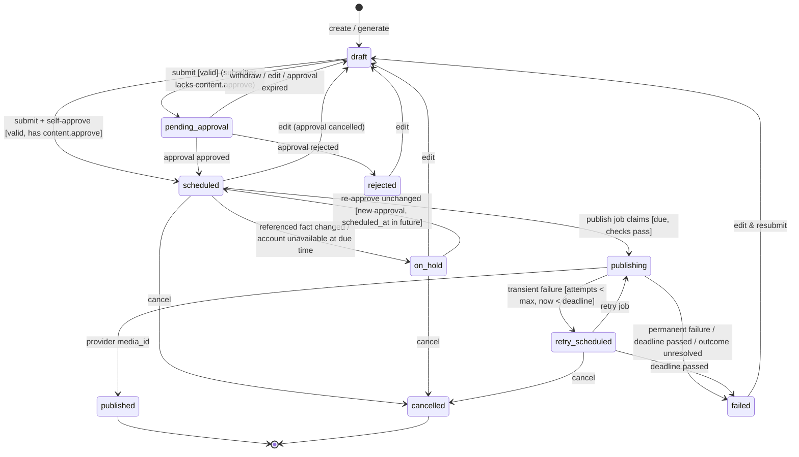
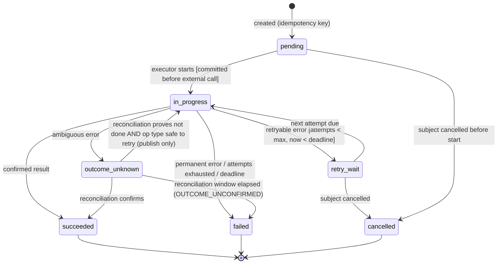
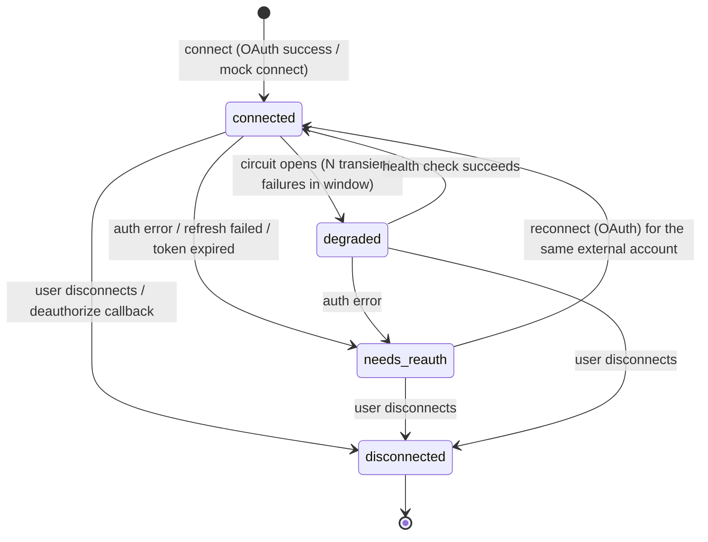

# State Machines

**Purpose:** The canonical states and allowed transitions for every stateful entity. Code must implement transitions **only** as listed here, through one function per entity (e.g., `content.transitions.apply(item, event)`) that rejects anything else with `CONFLICT_STATE`. Each transition writes an audit entry ([INV-12](../invariants.md)) unless marked *(no audit)*.

Common rules:
- Transitions are applied with a row lock or a conditional update on the expected current state.
- Terminal states are marked ■.
- "System" means a job or service acting without a user; "user" means an authenticated member with the stated permission.

---

## 1. Approval

| From | Event | Guard | To | Side effects |
|---|---|---|---|---|
| — | `request` | no other `pending` approval for the subject (DB constraint) | `pending` | notification `approval.requested` to users with `required_permission` |
| `pending` | `decide(approve)` | same workspace; actor has `required_permission`; `now < expires_at`; `payload_hash` matches; subject `version == subject_version` | `approved` ■ | decided-callback to the subject module (queue send, schedule publish, execute command) |
| `pending` | `decide(reject)` | same workspace; permission | `rejected` ■ | callback (draft → rejected, content → rejected, command → cancelled) |
| `pending` | `expire` | `now ≥ expires_at` | `expired` ■ | callback (subject → expired/draft) + notification to requester |
| `pending` | `cancel(reason)` | — | `cancelled` ■ | — |

An `approved` approval may be **consumed** by exactly one operation (`operation_id` set, not a state change). Executors call `assert_executable` (approved, version match, `now < execute_before` if set).

Errors: double decision → `409 APPROVAL_ALREADY_DECIDED`; stale → `409 APPROVAL_STALE`; expired → `409 APPROVAL_EXPIRED`; no permission → `403 FORBIDDEN`.

---

## 2. Business fact and fact candidate

**Fact**

- Every transition, and every value change, appends a `fact_versions` row.
- "Usable" is computed, not a state: `status = verified` ∧ within the validity window ∧ no pending `contest` candidate.

**Fact candidate**

| From | Event | To | Notes |
|---|---|---|---|
| — | `propose` | `pending` | `relation` computed: `same` (equals current value; auto-resolved to `superseded`, no owner action), `new`, `discrepancy`, `contest` |
| `pending` | `accept` (verifier) | `accepted` ■ | applies value via `update_fact` (new version, `source_type = candidate_accepted`) |
| `pending` | `reject` (verifier) | `rejected` ■ | if it was a `contest`, the fact becomes usable again |
| `pending` | fact changed so that the candidate equals the new value, or a newer candidate for the same key arrives from the same source | `superseded` ■ | (no audit) |

---

## 3. Owner command

- `interpreting` covers the LLM call and deterministic resolution. The UI polls.
- `needs_clarification` and `awaiting_confirmation` expire after 30 minutes (`expires_at`).
- `content.create_draft` skips confirmation: `interpreting → executing` directly. `executing` enqueues generation and completes when the draft exists (or fails).
- A staff member's `knowledge.update_fact` executes as "propose candidate" (FR-014), still after confirmation.

---

## 4. Reply draft

Notes:
- **Owner-written replies** (`source = owner`) are created directly in `queued`. The owner's send action is the authorisation; a self-approved approval is recorded for uniformity ([ADR-014](decisions/ADR-014-approval-and-policy-model.md)).
- Editing a `pending_approval` draft: version+1, previous approval `cancelled (SUBJECT_EDITED)`, a new approval is created (or self-approved if the editor has `reply.approve` and chooses "approve & send"). The edited text is re-validated by the claim validator; failures are shown inline and block sending until fixed or overridden by a fact update.
- `failed` drafts can be retried by the user via "Send again", which creates a **new** draft (`source = owner`) with the same text. This is a new operation, and the UI warns if the failure was `OUTCOME_UNCONFIRMED` ("check Instagram first").
- `blocked` reasons: `MESSAGING_WINDOW_CLOSED`, `ACCOUNT_NOT_CONNECTED`, `CAPABILITY_MISSING`.

**Conversation attention** (derived and stored for list filtering; updated in the same transaction as draft and message changes):
- `needs_human` if the open draft is `needs_human`, or the last inbound has no draft because the conversation is in `human` mode.
- `needs_approval` if the open draft is `pending_approval`.
- `failed` if the latest draft is `failed`/`blocked` and no later outbound message exists.
- otherwise `none`.

---

## 5. Content item

Notes:
- `publishing` includes waiting for container processing and reconciliation of `outcome_unknown` operations. The operation status distinguishes them, and the UI shows "Checking…" when the operation is `outcome_unknown`.
- **Due-time checks** before `scheduled → publishing`: workspace active; approval `approved` and executable; `version == approval.subject_version`; account `connected` with the needed capability. If the account is `needs_reauth`/`degraded`/`disconnected` → `on_hold (ACCOUNT_UNAVAILABLE)`; it does not fail silently.
- `cancel` during `publishing` is **not allowed** (`409 CONFLICT_STATE`): the outcome must be determined first.
- Publish now = submit with `scheduled_at = now`.
- `published` items are immutable ([INV-17](../invariants.md)).

Spec mapping (original §4.5): "Validation Failed" = validation errors shown on a `draft` (no state) or `failed` with `VALIDATION_FAILED` at due time. "Approval Rejected" = `rejected`. "Publishing Failed" = `failed`. "Retry Scheduled" = `retry_scheduled`. "Cancelled" = `cancelled`. "Approved" is folded into `scheduled`, because approval always includes the schedule.

---

## 6. Operation (external side effect)

- `send_reply`: `outcome_unknown → in_progress` is **forbidden**. Only `succeeded` (echo/lookup) or `failed`.
- `publish_content`: `outcome_unknown → in_progress` is allowed only when the container status is `FINISHED` (proven unpublished) or `EXPIRED` (new container).
- Backoff for `retry_wait`: 1 min, 5 min, 15 min, 30 min… capped by `deadline_at`. `retry_after` from the provider overrides it if larger.

---

## 7. Social account

- Entering `needs_reauth`, `degraded` or `disconnected` emits notifications. Scheduled content due while unavailable goes `on_hold (ACCOUNT_UNAVAILABLE)`. Queued replies wait if they are still within the window, otherwise they expire.
- Reconnecting with a **different** external account than the disconnected one creates a new row; historical rows remain.

---

## 8. Job

| From | Event | To |
|---|---|---|
| — | enqueue | `queued` |
| `queued` | claimed by worker (`run_at ≤ now`) | `running` (lease set) |
| `running` | handler returns | `succeeded` ■ |
| `running` | retryable error, attempts < max | `queued` (`run_at = now + backoff`) |
| `running` | non-retryable error or attempts exhausted | `dead` ■ (error recorded; domain handler decides user-visible consequences) |
| `running` | lease expired (worker crashed) | reclaimable as if `queued` (attempts incremented on claim) |
| `queued` | cancelled by domain (e.g., content cancelled) | `cancelled` ■ |

Job states are **internal** (*no audit*). Users see domain states. Dead jobs appear in the dev jobs page and system health.
