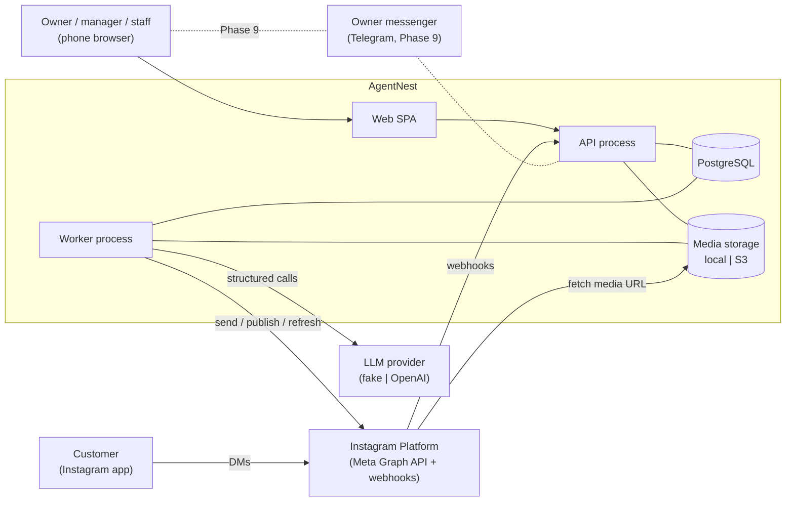

# System Overview

**Purpose:** The big picture: system boundary, external actors, runtime processes, technology stack, and how a request flows through the system. Component internals are in [component-design.md](component-design.md); decisions are in [decisions/](decisions/README.md).

## 1. System context



**Trust boundaries**
1. **Browser ↔ API:** authenticated users. Every workspace-scoped request is membership-checked.
2. **Instagram webhooks → API:** unauthenticated network. Trust comes only from the `X-Hub-Signature-256` signature. Payload content is untrusted customer data.
3. **Worker → LLM:** we send minimised data. Output is untrusted until validated.
4. **Worker → Instagram:** external side effects go through the operations ledger only.
5. **Owner messenger ↔ API (Phase 9):** the messenger identity is trusted only through an authenticated linking flow.

## 2. Runtime processes

| Process | Command (dev) | Responsibilities | Must not |
|---|---|---|---|
| `api` | `uv run uvicorn app.main:create_app --factory --reload` | HTTP API, auth, webhooks (verify, store, enqueue), synchronous internal state changes, enqueue jobs | Call LLMs or side-effecting provider methods; sleep or wait on external work |
| `worker` | `uv run python -m app.worker` | Claim and run jobs, periodic scheduler, reconciliation, notifications fan-out | Serve HTTP |
| `web` | `npm run dev` (Vite) | SPA | Hold secrets; compute business rules |
| `postgres` | `docker compose up -d postgres` | All persistent state, queue | — |

In production the SPA is built to static files and served by the reverse proxy (Caddy) with the API under `/api` on the same origin ([deployment.md](deployment.md)).

## 3. Technology stack

| Concern | Choice | ADR |
|---|---|---|
| Architecture | Modular monolith: API + worker from one codebase | [001](decisions/ADR-001-modular-monolith.md) |
| Backend | Python 3.12, FastAPI (sync handlers), SQLAlchemy 2.0 (sync, psycopg 3), Pydantic v2, Alembic, httpx, Babel, structlog, argon2-cffi, cryptography, Pillow | [003](decisions/ADR-003-backend-stack.md) |
| Datastore | PostgreSQL 16 only | [004](decisions/ADR-004-postgresql-only-datastore.md) |
| Jobs | In-house Postgres queue (`SKIP LOCKED`, leases, dedup keys) + scheduler loop | [006](decisions/ADR-006-postgres-job-queue.md) |
| AI | Four bounded LLM tasks with structured outputs; `fake` and `openai` providers | [007](decisions/ADR-007-deterministic-workflows-bounded-llm-tasks.md), [009](decisions/ADR-009-llm-provider-abstraction.md) |
| Knowledge | Typed versioned facts, candidates, placeholder rendering, claim validator | [008](decisions/ADR-008-structured-business-knowledge.md) |
| Instagram | `InstagramProvider` interface; stateful `mock`; `meta` (Instagram Login) | [010](decisions/ADR-010-instagram-provider-adapter.md) |
| Side effects | Operations ledger with reconciliation | [011](decisions/ADR-011-external-operations-ledger.md) |
| Owner channels | Channel abstraction; web first | [012](decisions/ADR-012-owner-channel-abstraction.md) |
| Auth / tenancy | Email+password, server sessions; `workspace_id` + composite FKs | [013](decisions/ADR-013-authentication-and-tenancy.md) |
| Policy / approvals | Deterministic engine; version-bound approvals | [014](decisions/ADR-014-approval-and-policy-model.md) |
| Media | `MediaStorage`: local / S3-compatible | [015](decisions/ADR-015-media-storage.md) |
| Localisation | i18next + backend JSON catalogs + Babel | [016](decisions/ADR-016-localization.md) |
| Config | pydantic-settings, startup safety checks, AES-GCM token encryption | [017](decisions/ADR-017-configuration-and-secrets.md) |
| Observability | structlog JSON, correlation IDs, error catalog, eval runner | [018](decisions/ADR-018-observability-and-evaluation.md) |
| Frontend | React 18 + TS + Vite, React Router, TanStack Query, Tailwind, openapi-typescript | [020](decisions/ADR-020-frontend-stack.md) |
| Tests | pytest, Vitest, Playwright | [testing-strategy.md](../implementation/testing-strategy.md) |

## 4. End-to-end flow (canonical)

The original spec's flow ("User or Instagram event → Gateway → Auth → Router/Processor → Knowledge & Policy → Agent/Logic → Approval → Worker → Instagram → Verification → Log & Notify") maps onto concrete components as follows:

```mermaid
sequenceDiagram
  autonumber
  participant IG as Instagram
  participant API as API (webhook)
  participant DB as PostgreSQL
  participant W as Worker
  participant AI as LLM task (draft_reply)
  participant P as Policy engine
  participant O as Owner (web)

  IG->>API: POST /webhooks/instagram (signed; simulator uses /webhooks/instagram/mock)
  API->>API: verify signature
  API->>DB: insert inbound_event (dedup) + enqueue process_inbound_event [1 tx]
  API-->>IG: 200 OK
  W->>DB: claim job, upsert conversation + message, enqueue draft_reply (debounced)
  W->>DB: load usable facts, approved answers, brand voice
  W->>AI: structured call (customer text as untrusted data)
  AI-->>W: proposal (intent, flags, template with placeholders)
  W->>W: render placeholders, claim validator
  W->>P: evaluate(reply, context)
  P-->>W: approval_required [reasons]
  W->>DB: reply_draft + approval + notification + audit [1 tx]
  O->>API: POST /approvals/{id}/decision (approve, payload_hash)
  API->>DB: approval approved + draft queued + enqueue send_reply [1 tx]
  W->>DB: operation pending→in_progress (idempotency key) [commit]
  W->>IG: send message
  IG-->>W: message_id
  W->>DB: operation succeeded, message row, draft sent, audit [1 tx]
```

## 5. Environments

| | development | test (CI) | production |
|---|---|---|---|
| LLM | `fake` (default) or `openai` | `fake` only | `openai` (fake refused) |
| Instagram | `mock` | `mock` | `meta` (+ `mock` for `is_demo` workspaces if `ALLOW_SIMULATED_WORKSPACES`) |
| Media | `local` | `local` (tmp dir) | `s3` |
| Demo tools | enabled | enabled in tests | **refused** |
| DB | Docker Postgres `agentnest` | Docker Postgres `agentnest_test` (CI service container) | Managed or self-run Postgres with backups |
| Logs | console | console | JSON |

## 6. Mapping from the original specification's components

| Original (§6) | Now |
|---|---|
| Command Router | `interpret_command` LLM task + `commands` module (registry, resolver, executor) |
| Business Knowledge Service | `knowledge` module (deterministic) |
| Conversation Agent | `draft_reply` LLM task inside the `inbox` workflow |
| Content Agent | `draft_content` LLM task inside the `content` workflow |
| Operations Orchestrator | Deterministic workflow code + state machines; there is no orchestrator agent |
| Deterministic Execution Workers | `worker` process + `operations` module |
| Policy and Approval Service | `policy` + `approvals` modules |
| Reporting Service | `reporting` module (SQL aggregation) |
