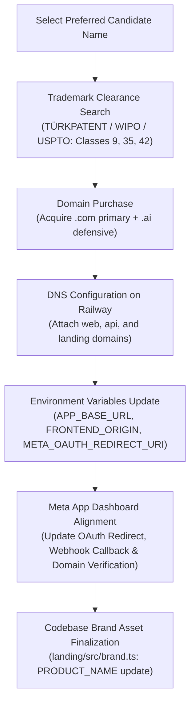

# Candidate Domains & Product Brand Exploration

**Context & Purpose:**  
This document tracks brand name candidates and verified domain availability for the Instagram Operations Assistant project (currently using the working name `Pivoris`). It directly informs:
1. **OQ-10 (Product Name and Trademark):** Finalizing a brand name before commercial pilot scaling and public release.
2. **P-07 (Production Custom Domain Rollout):** Replacing the temporary `*.up.railway.app` deployment URL with an authoritative custom domain across `APP_BASE_URL`, `FRONTEND_ORIGIN`, and `META_OAUTH_REDIRECT_URI`.

> [!NOTE]
> **Verification Methodology:** Every candidate below was checked directly against official registry RDAP (Registration Data Access Protocol) endpoints (Verisign for `.com` and Identity Digital for `.ai`).
> **Strict Inclusion Rule:** Any candidate where the `.com` domain was already registered has been completely excluded. All candidates listed below are currently available on both **`.com`** and **`.ai`**.

---

## 1. Abstract & Coined Names (Modern SaaS & AI Style)

Invented, non-dictionary terms designed for global brandability, clean trademark positioning, and frictionless English pronunciation (analogous to *Vercel*, *Figma*, *Twilio*, *Stripe*).

| # | Brand Name | English Pronunciation | Phonetic Vibe & Brand Character | `.com` Availability | `.ai` Availability |
|---|---|---|---|---|---|
| 1 | **Daxvelo** | `daks-VEL-oh` | Dynamic, two-syllable tech tempo; combines speed (*velo*) with modern SaaS crispness. | ✅ **Available** | ✅ **Available** |
| 2 | **Nestalux** | `NEST-uh-luks` | Preserves `Pivoris` project heritage while adding premium polish and enterprise clarity. | ✅ **Available** | ✅ **Available** |
| 3 | **Calyvix** | `KAL-ih-viks` | Sharp, futuristic AI agent identity; distinct consonant ending for strong recall. | ✅ **Available** | ✅ **Available** |
| 4 | **Kinvelix** | `kin-VEL-iks` | Evokes kinetic momentum and velocity; smooth, natural vocal transition. | ✅ **Available** | ✅ **Available** |
| 5 | **Flowisto** | `flow-ISS-toh` | Warm Mediterranean cadence paired with messaging workflow fluidity (*flow*). | ✅ **Available** | ✅ **Available** |
| 6 | **Syncelis** | `sin-SEL-iss` | Organic, melodic tone conveying background synchronization and calm automation. | ✅ **Available** | ✅ **Available** |
| 7 | **Talvelix** | `tal-VEL-iks` | Structured, authoritative tone well-suited for B2B operations and merchant trust. | ✅ **Available** | ✅ **Available** |
| 8 | **Lumvelo** | `loom-VEL-oh` | Blends clarity/light (*lumen*) with agility (*velo*); friendly, lightweight, non-intimidating. | ✅ **Available** | ✅ **Available** |
| 9 | **Daxvix** | `DAKS-viks` | Ultra-short (6 letters), high-impact developer and autonomous agent vibe. | ✅ **Available** | ✅ **Available** |
| 10 | **Pivoris** | `piv-OR-iss` | Suggests a central operational pivot/hub for local business customer engagement. | ✅ **Available** | ✅ **Available** |
| 11 | **Danvilo** | `dan-VEE-loh` | Warm, approachable European startup rhythm; easy to speak across languages. | ✅ **Available** | ✅ **Available** |
| 12 | **Quivelix** | `kwiv-EL-iks` | Fast, agile execution persona (*quick* + *velocity*). | ✅ **Available** | ✅ **Available** |

---

## 2. Descriptive & Compound Names (DM & Assistant Motifs)

Candidates utilizing recognizable, friendly metaphors—specifically small, agile songbirds and calm communication descriptors—tailored to small business owners.

| # | Brand Name | English Pronunciation | Brand Metaphor & Operational Association | `.com` Availability | `.ai` Availability |
|---|---|---|---|---|---|
| 1 | **DMWren** | `dee-em-REN` | **Wren:** Small, tireless, hyper-efficient songbird; reflects an alert, hardworking SMB assistant. | ✅ **Available** | ✅ **Available** |
| 2 | **DMLark** | `dee-em-LARK` | **Lark:** Cheerful early bird; morning digests, swift inbox replies, and active daytime operations. | ✅ **Available** | ✅ **Available** |
| 3 | **DMKite** | `dee-em-KITE` | **Kite:** Lightweight, soaring, effortless communication with minimal operator drag. | ✅ **Available** | ✅ **Available** |
| 4 | **DMBreeze** | `dee-em-BREEZ` | **Breeze:** Transforms overwhelming customer DMs into calm, effortless interactions. | ✅ **Available** | ✅ **Available** |
| 5 | **DMRobin** | `dee-em-ROB-in` | **Robin:** Familiar neighborhood bird; friendly, approachable community helper. | ✅ **Available** | ✅ **Available** |
| 6 | **DMKin** | `dee-em-KIN` | **Kin:** 5-letter brand emphasizing kinship, personal touch, and closer customer relations. | ✅ **Available** | ✅ **Available** |
| 7 | **ReplyPebble** | `ri-play-PEB-ul` | **Pebble:** Tactile, grounded, calm hardware/software feel; friendly, unhurried precision. | ✅ **Available** | ✅ **Available** |
| 8 | **NestPebble** | `nest-PEB-ul` | Preserves the familiar *Nest* motif while keeping customer interaction grounded and approachable. | ✅ **Available** | ✅ **Available** |
| 9 | **ReplyHue** | `ri-play-HYOO` | Expressive, multi-toned creative response engine; adaptable to merchant personality. | ✅ **Available** | ✅ **Available** |
| 10 | **OwnerLark** | `OWN-er-lark` | Explicitly targets the business owner, reinforcing the "owner-first, mobile-first" product thesis. | ✅ **Available** | ✅ **Available** |

---

## 3. Brand Selection & Deployment Protocol

When a candidate name is selected from the inventory above, execute the following operational sequence:

### 3.1 Trademark Clearance Check
Before finalizing registration:
- Run trademark checks on **TÜRKPATENT** (for Türkiye operations) and **WIPO Global Brand Database / USPTO TESS** (for international SaaS).
- Search under **Nice Classes 9** (computer software), **35** (business management & customer support operations), and **42** (SaaS / cloud services).

### 3.2 DNS & Infrastructure Integration (P-07 Resolution)
1. **Purchase Strategy:** Register both `.com` (primary customer & business owner portal) and `.ai` (AI engine / technical redirects).
2. **Railway Mapping:**
   - App Frontend: `app.<domain>.com`
   - API Backend: `api.<domain>.com`
   - Landing Page: `https://<domain>.com`
3. **Environment Updates:**
   - Update `APP_BASE_URL=https://api.<domain>.com`
   - Update `FRONTEND_ORIGIN=https://app.<domain>.com`
   - Update `META_OAUTH_REDIRECT_URI=https://api.<domain>.com/api/v1/auth/instagram/callback`
4. **Meta Verification:** Add the root domain DNS TXT record to Meta Business Manager to verify business ownership.

---

## 4. Associated Deliverables

- **Formal PDF Document:** [candidate-domains.pdf](candidate-domains.pdf) (in this directory)
- **Central Brand Variable:** [landing/src/brand.ts](../landing/src/brand.ts) (`PRODUCT_NAME`)
- **Open Questions Reference:** [docs/research/open-questions.md](research/open-questions.md) (`OQ-10`)
