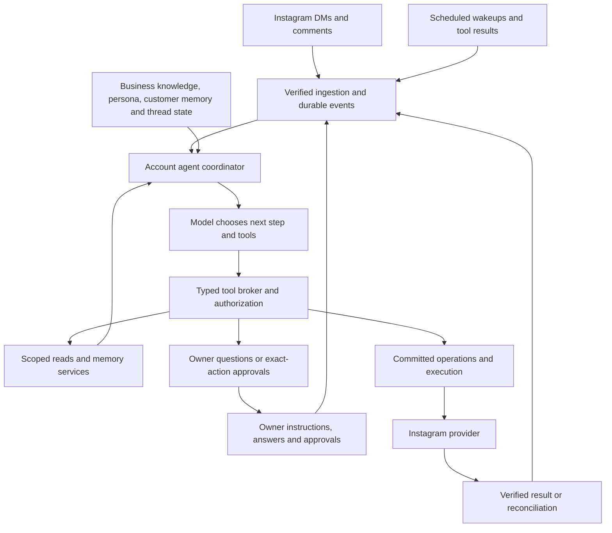

# Phase 7.5: Autonomous Instagram Account Agent

**Status:** Planned; no Phase 7.5 implementation or acceptance is claimed.
**Created:** 2026-10-25.
**Session plan:** [18 sequential implementation sessions](../phase-7.5-sessions/phase-7.5-sessions.md).
**Architecture direction:** [ADR-024](../../architecture/decisions/ADR-024-account-agent-and-delegated-autonomy.md), currently proposed.

## 1. Product outcome

AgentNest becomes a conversational representative that operates a business's supported Instagram capabilities. It understands the conversation, asks useful questions, remembers relevant context, speaks in the business's tone, chooses tools, performs delegated actions and resumes work after receiving information or approval.

The owner configures goals and authority, then supervises exceptions. Opening hours, prices and services are knowledge, not a fixed list of situations in which the agent is allowed to converse. Setting the existing topic dropdowns to automatic, adding a longer prompt, or relabelling the current draft workflow does not meet this phase.

The agent must be able to:

- Conduct natural, multi-turn DMs and public comment conversations, including mixed topics and questions outside the current intent enum.
- Remember customer preferences and relevant history across sessions, with a consistent, editable personality.
- Retrieve business knowledge, ask a customer for clarification, or ask the owner/authorized business member for information it lacks.
- Resume the relevant conversation after an answer or approval, using the latest context.
- Decide whether to reply publicly, send an eligible private reply, hide/unhide/delete a comment, or take no action.
- Delete comments autonomously when the owner delegates that authority; a per-deletion approval is not compulsory.
- Use existing content drafting, scheduling and image publishing capabilities through tools when authorized.
- Explain completed actions and pending work, support human takeover, and stop automatic execution when paused.

### Example acceptance journey

A customer comments on a post asking which service suits them. The agent reads the post and comment context, answers naturally, and chooses an eligible private reply when useful. The customer responds in DM; the agent asks about preferences, remembers them and recommends an appropriate service using verified business knowledge. A question about an undocumented business exception creates an owner information request. The owner answers; the agent resumes the customer conversation if still eligible. A later conversation recalls the preference. Separately, the agent removes a comment under the owner's moderation delegation and records the verified outcome.

This journey must run through ingestion, persistence, the real agent loop, policy, operations and UI. A standalone chatbot demo is insufficient.

## 2. Baseline, scope and planning assumptions

The inspected baseline has Phase 7's offline adapter/OAuth/storage implementation, existing deterministic LLM tasks, topic-based reply policies, version-bound approvals, a durable job queue and an external operations ledger. `InstagramProvider` currently lacks comment actions. `approvals.action`, approval subject types and `operations.operation_type` have closed database constraints that require migrations for new actions. There is no durable conversational agent loop or customer memory subsystem.

The [current roadmap](../roadmap.md) records Gate 1 closed on 2026-10-25. [Phase 7's summary](../phase-summaries/phase-07-summary.md) still records Gate 2 and real-account acceptance pending. Recheck these at implementation start; historical test counts are not current verification. Preserve independently ongoing OAuth fixes and session-file moves.

**In scope:** central coordinator; typed tools; account delegation; natural conversation and grounding; persona; business/customer/thread memory; owner questions; approvals and resume; DMs; public comment replies; comment moderation; comment-to-DM; existing feed-image/story-image content tools; activity, metrics and owner control UI; mock and Meta adapter extensions; migrations, evals, privacy lifecycle and staged rollout.

**Content assumption:** include tools for the existing image-content workflow so the agent can operate the account beyond conversations. New accounts can configure publishing authority independently; migrated accounts retain their previous publication approval setting. New AI image/video generation, Reels/video production and autonomous campaign optimization are outside this phase.

**Other exclusions:** arbitrary actions in the Instagram app, arbitrary third-party-post commenting, unrestricted outbound messaging, browser/password-based Instagram automation, booking/payment/refund integrations, a full CRM, additional social networks, multi-agent teams, vector infrastructure and a framework rewrite. Unsupported capabilities can become later tools; the agent must never claim they already exist. Platform-dependent actions remain conditional until verified.

**Planning authorization:** this document and its session briefs plan the work. They do not start implementation, paid model evaluations, live sends/deletions/publishing, deployment, App Review, commits or pushes.

## 3. Phase boundaries and gates

| Gate | Required evidence | What it enables |
|---|---|---|
| G7.5-A: contract baseline | Session 01 reconciles ADRs, invariants, product scope, module dependencies, permissions and target contracts; current Phase 7 changes inspected | Subsequent implementation against the target contract |
| G7.5-B: offline agent | Sessions 02-15 plus offline parts of 16-17 pass with scripted fake/model transport and stateful Instagram mock; existing flows regressions pass | Complete local agent demo; no real-account claim |
| G7.5-C: model quality | Versioned real-model multi-turn evaluation meets section 13 thresholds within an explicitly authorized spend budget | Evidence of conversational/tool-selection quality; not Meta acceptance |
| G7.5-D: platform capability | Existing Phase 7 prerequisites plus fresh primary documentation and authentic sanitized evidence for each new enabled capability | That capability may enter an authorized founder trial |
| G7.5-E: founder acceptance | Session 18 end-to-end real account evidence, owner Windows/phone walkthrough, rollout/rollback checks and clean required CI | Phase 7.5 fully complete; contributes to pilot eligibility alongside Phase 8 |

Offline engineering can be delivered before external gates close once implementation is requested and G7.5-A is satisfied. It must be reported as **offline complete, live pending** if C/D/E remain open. Phase 8 hardening and App Review preparation may proceed once the offline feature contracts are stable, even if a new capability's live acceptance is pending. Research may establish that Meta access needed for comments depends on that review: do not create a circular dependency by requiring full Phase 7.5 live acceptance before Phase 8 can prepare/obtain access. Real customer pilot rollout requires both the applicable agent/platform evidence and existing production/data gates. Do not turn a pending external gate into a fake pass or an indefinite block on independent offline work.

## 4. Target architecture

One logical agent per connected account shares goals and voice. Executions are scoped to a conversation, comment thread or owner task; separate customers do not share a model context. This does not require one blocking account-wide worker or multiple autonomous subagents.

### Module ownership

| Area | Responsibility |
|---|---|
| New `app/agent/` | Coordinator, runs/steps, event routing, context assembly, typed step contract, checkpoint/resume and owner-task entry |
| New `app/agent/tools/` | Registered tools, argument validation, server-side references, read/internal/effect handlers and tool-result projection |
| New `app/memory/` | Customer memory, identity evidence, relevance selection, correction and retention |
| New `app/owner_requests/` | Information questions, recipient routing, answers and durable continuations |
| New `app/comments/` | Media/comment/thread records, read services, ingestion and views |
| Existing `app/ai/`, `integrations/llm/` | Model provider extension, usage, versioned prompts and fake compatibility; existing extraction/content tasks remain available |
| Existing `app/policy/`, `approvals/` | Delegation, authorization evidence, exact-action human decisions and revocation |
| Existing `app/operations/` | All Instagram side effects, deadlines, retry, reconciliation and operation results |
| Existing `app/inbox/`, `content/`, `knowledge/` | Domain records/services reused behind tools; existing human flows remain valid |
| Existing jobs/audit/notifications/reporting | Durable work, inspection, owner attention and trustworthy metrics |
| New frontend `features/agent/`, `features/comments/` | Agent settings/activity, questions, memory, comment context and owner controls |

The coordinator imports domain service interfaces; domains emit durable events rather than importing the coordinator recursively. The broker never calls side-effecting provider methods. Session 01 records import-linter changes and transaction ownership before code is written.

## 5. Agent execution contract

### Model step

Add a vendor-neutral `generate_step(context, available_tools, limits)` contract beside existing bounded task generation. The result is a validated tool call, a wait decision, a completion decision, or a handoff. Each includes a short operational explanation and relevant evidence references, not private chain-of-thought. External-facing text is an argument to a send/reply tool; a model's final text cannot bypass authorization.

Use a typed application-owned loop. The adapter may implement the step through native function calling or equivalent structured output; Session 04 selects and documents one production path using the installed SDK and current official provider contract. Do not add a large orchestration framework without a demonstrated missing capability. Both fake and real providers must implement the same semantics.

Read tools may be batched when independent. Mutations/effects are serialized within a thread and observed before dependent steps. Unknown tools, malformed arguments, foreign references and invalid state return bounded structured errors. A single repair can address schema errors; permission failures cannot be repaired by silently broadening authority.

### Persistence and recovery

1. In a short transaction, claim work, snapshot thread/controller versions, create the step and reserve budget.
2. Call the model outside the transaction.
3. Re-lock and verify the event cursor, ownership epoch, takeover and policy. Discard stale output; coalesce a new wakeup.
4. Dispatch through the broker. Record internal mutations transactionally; persist external-action intent and authorization before its executor runs.
5. Consume the tool/operation result once, checkpoint the goal and yield or continue.

Run states: `queued`, `running`, `waiting_customer`, `waiting_owner`, `waiting_approval`, `waiting_operation`, `sleeping`, `completed`, `cancelled`, `failed`. Waiting/sleeping states have persisted wakeup conditions and no held worker/DB lock. New inbound events resume/replan the current goal or supersede it when the request changes. Define compare-and-swap transitions in one module.

Initial tunable engineering limits: 8 model steps per activation, 12 tool calls per activation, 120 seconds of activation wall time, and a cumulative limit of 24 steps per unresolved goal before visible handoff. A checkpoint/retry must not reset cumulative accounting. Keep per-workspace token/spend limits, account provider quotas and concurrency controls. Tune values with measured evals before rollout. Waiting for a person does not consume worker time or retry attempts.

Replace the existing fixed three-auto-replies/hour rule on the new controller with conversation-progress, repeated-message and abuse controls that permit normal multi-turn chat. Preserve platform limits. Persist rate/cost reservations atomically across workers. Stop echo loops and repeated identical tool attempts; no background customer follow-up is sent unless a durable task, delegation and current provider eligibility allow it.

## 6. Authority, tools and approval

The primary configuration is goals, personality and permitted account actions. Each effect uses `automatic`, `ask`, or `off`, with optional scope and quantitative limits. Topic controls may survive as advanced exceptions but do not define conversational coverage.

| Capability | Tool behavior | Human authority when approval is needed |
|---|---|---|
| `dm.send` | Natural replies, clarification and eligible follow-up | Existing `reply.approve`: owner/manager |
| `comment.reply` | Public reply with post/thread context | New `comments.approve`: owner/manager |
| `comment.private_reply` | A private reply tied to its source comment and current eligibility | `comments.approve` |
| `comment.hide`, `comment.unhide`, `comment.delete` | Separate moderation effects; broad autonomous deletion can be delegated | `comments.approve` |
| `content.prepare` | Draft caption/concept using existing content/media services | Existing `content.edit` for human requests |
| `content.schedule`, `content.publish`, `content.cancel` | Existing content lifecycle with action-specific delegation | Existing `content.approve` |
| Knowledge/context reads | Only scoped and visibility-filtered information | Authorized context; no per-read approval |
| Owner question/memory updates | Internal durable work with subject/visibility permissions | See sections 8-9 |

New/migrated configuration must not silently enlarge authority. The onboarding recommendation can enable conversational DM/public replies together, while clearly showing selected moderation/publication settings. Existing workspaces keep their old controller and grants until explicitly configured for the agent. Policy version changes invalidate unexecuted authorizations; enabling a capability does not imply an OAuth grant.

Owner prose can guide goals and moderation judgment. Any authority-changing instruction is resolved into a structured policy diff applied only through the owner-authorized configuration path. Customer text and retrieved documents remain data. An authorized model can make semantic moderation choices inside its grant; do not pretend deterministic keyword checks can prove every subjective moderation judgment correct.

For human-initiated tasks, effective authority is the intersection of the account delegation and the requester's permissions; staff cannot borrow the owner's automatic grant to perform an action they are not allowed to request. Missing authority can create an explicit approval request. Autonomous customer-event handling uses the account's delegation for that event source, never treats the customer as the granting actor, and never promotes customer instructions into owner tasks.

The broker checks delegation, role/source authority, workspace/account ownership, input visibility, readiness for the specific action, critical claims, current provider capability, quotas and target state. Readiness is capability-specific: missing prices must not prevent a greeting or an owner question; a reply promising a price requires a usable price source. Complaints/refunds/discounts do not categorically stop all conversation. Discussing a request and making a business commitment are distinct.

Automatic external actions record an exact-payload policy grant with delegation ID/version and source run/action. Human approval uses the existing explicit decision API. Extend approval actions/subjects and executor checks; do not fabricate a human approver for policy grants. Record the delegating owner's authority and recheck policy validity at execution. Ownership transfer, revocation, account pause/disconnect and permissions changes must fence pending actions.

Takeover/pause cannot recall a request already accepted by Instagram. Fence anything not yet dispatched, reconcile in-flight effects, and show the actual outcome. The system must never label a remotely accepted action as undone merely because pause was pressed.

## 7. Data model and API work

These are target contracts to formalize in Session 01 and implement additively. Inspect the current Alembic head before allocating revision IDs; do not assume `0019` is still free.

| Record | Minimum content and constraints |
|---|---|
| `account_agents` | Workspace/account unique pair; enabled/paused state, persona/instructions version, controller epoch, settings and timestamps |
| `agent_delegations` | Account scope, version, allowed actions/modes/limits, grantor, effective/revoked timestamps; one current version |
| `agent_threads` | Account and source surface/ref, customer ref when established, goal/state, event cursor, ownership epoch, version, takeover and pending work refs; unique source mapping |
| `agent_events` | Source event identity, thread, event kind, version/cursor, safe payload refs; unique source key and transactionally enqueued wakeup |
| `agent_sessions`, `agent_steps` | Durable goal/run and steps; sequence, version, model/prompt/tool versions, budgets, lease/claim token, input/output refs, status and usage; unique step sequence |
| `agent_actions` | Typed immutable-version payload, hash, target, initiating event/goal, approval/operation ref, policy version, execution deadline and result; stable idempotency independent of generated wording |
| `customer_identities` | Workspace/account scoped provider identity plus evidenced surface links; no username-only merge |
| `customer_memories` | Identity, fact/preference/summary kind, source refs, visibility, status, observed/expiry timestamps, correction version and provenance |
| `owner_questions`, answer records | Thread, question and required information, source cursor, role routing, pending/answered/expired/cancelled status, answer author/version, visibility and continuation key |
| Instagram media/comments | Workspace/account, external IDs, parent/media/thread links, text visibility, provider timestamps, version/deleted/hidden state with unknown representable |
| Private-reply eligibility/reservation | Source comment, account, expiry, verified provider rule version, attempt/operation ref and consumed/unknown state; atomic uniqueness according to the verified provider contract |

All tenant relationships use workspace composite constraints and scoped repositories. Personal bodies live only in approved domain storage, not generic audit/job/log payloads. Extend existing erasure/export/retention and disconnect cleanup to new tables, cached summaries, model-context snapshots and unresolved action references. Keep minimal reconciliation evidence only for its defined retention purpose.

Extend existing approval/operation constraints, subject callbacks, fact references, content dependencies, notification/error catalogs and audit metrics. Agent-origin DM sends should reuse `ReplyDraft` and the existing send executor with an explicit origin/action link; do not build a second incompatible DM send pipeline. Comment actions use their own subject and executor types. Existing `agent_runs` continue tracking individual model calls and link to the durable sessions/steps.

Planned API groups under the existing workspace prefix:

- Account agent: read configuration/status; edit personality; preview/apply delegation; pause/resume; inspect runs and actions.
- Owner instructions: create an agent task tied to an account, return a durable task ID, show clarification/progress; keep old commands compatible.
- Questions: list/detail/answer/cancel with expected version and request idempotency; authorizations use the existing approvals endpoint.
- Customer memory: scoped list/correct/forget and source inspection; erase/export through existing data permissions.
- Comments: list/thread/detail and authorized human actions through the same operation path.

Use current CSRF/auth conventions, typed errors, pagination, server-side permission enforcement and generated OpenAPI clients. No endpoint accepts an arbitrary model-supplied tenant/account context.

## 8. Memory, knowledge and personality

Keep four logical layers: verified business knowledge; persistent business personality/goals; customer-specific memory; current thread/task state. PostgreSQL is sufficient initially: structured records, indexed scoped retrieval and bounded summaries. Add vector retrieval only after measured retrieval failures justify it.

Retrieve by account/customer/topic/recency with a context budget and provenance. A summary is a derived aid, not a source of truth for prices or policies. Refresh/invalidate summaries when source facts change or source messages are erased. Prevent old runs from resurrecting deleted/corrected memory with version and deletion-generation checks at commit.

Natural conversation can include empathy, reasoning from supplied facts, questions and recommendations. Critical business claims still require valid evidence. Extend rendering/validation with explicit customer-attributed values and approved one-off owner answers so a clarification can repeat a customer's preferred date without asserting business availability. No broad "LLM says grounded" bypass or blanket relaxation of numeric checks.

Personality supports TR/EN tone, length, formality, emoji preferences, examples and channel-specific style. The agent can respond to the customer's language within supported languages. Voice preferences do not change authority, facts or privacy rules. Keep all content outside trusted runtime instructions correctly delimited, including owner-provided knowledge and tool results.

Default role proposal: members who can read the conversation may view its customer memory; owner/manager may correct reusable memory and personality; staff may propose corrections. Data erasure uses existing `data.delete`. Persist only useful business-relevant information, with configurable retention, visible correction/forget controls and no indiscriminate sensitive-trait inference.

For public replies, do not include private customer memory or unrelated DMs in model context. Customer identity continuity between comments and DMs is established only through supported provider evidence. If identity cannot be established, preserve separate contexts rather than guessing.

## 9. Owner collaboration and follow-through

Separate customer clarification, business information questions, action approvals and takeover in storage and UI.

1. The agent states what information it needs and links the originating task/conversation.
2. A scoped, deduplicated owner question is persisted; owner/manager receive the existing in-app notification. Staff can propose an answer; an authoritative business answer needs owner/manager by default.
3. The agent may send one useful, truthful holding response when eligible; it need not expose internal workflow detail to the customer.
4. Answer submission uses expected version and idempotency. It commits the answer and wakeup atomically.
5. The resumed agent rereads customer messages, fact/policy versions, takeover and provider eligibility before choosing its next step.

Answers can be one-conversation information or explicit reusable knowledge candidates. One-off concessions do not become permanent policies. Questions concerning unrelated customers are not merged through an unverified model guess. Generic business questions can share an explicitly keyed verified answer without revealing another customer's context.

Expired/declined questions and approvals produce an inspectable task outcome. Duplicate answers or approval callbacks must not send twice. If the messaging opportunity has closed, retain the answer for the next eligible interaction and notify the owner; do not claim that an answer was delivered. Web is the initial owner channel; Phase 9 remains responsible for external owner messaging.

## 10. Instagram tools and result verification

The source of truth for platform claims stays [platform-capabilities.md](../../research/platform-capabilities.md). The official-page fetch attempted during this conversation was unsuccessful; the existing documented capability matrix is not fresh live evidence. Do not invent current scopes, time windows, rate limits or successful identity mapping.

| Research ID | Must establish before the corresponding real capability is enabled |
|---|---|
| R75-01 | Current scopes, access level, webhook subscriptions and actual permission-return behavior for comments/private replies |
| R75-02 | Authentic comment create/update/delete/reply event shapes, pagination/order, media ownership and native moderator changes |
| R75-03 | Public reply readback, hide/unhide/delete response semantics, already-absent cases and outcome reconciliation |
| R75-04 | Private-reply eligibility, exact count/time limits, idempotency/reconciliation possibilities and returned recipient identity |
| R75-05 | When a comment recipient's response establishes ordinary DM eligibility and how identities can be linked safely |
| R75-06 | Quotas/errors, moderation/reply races, revoked grants, post deletion and live account type limitations |

Record primary URLs/check dates and distinguish documented, synthetic-tested and live-verified evidence. Failed documentation retrieval leaves research open. Offline mock behavior must label provisional assumptions, never promote them into verified facts.

Extend `InstagramProvider` and the mock with comment reads, public replies, hide/unhide/delete and private replies. Track capabilities separately where grants/support differ. Reconnect/scope expansion preserves Phase 7 account-identity and credential fences.

Each side effect has an immutable action payload, committed operation, unique intent key, result verification and a policy for ambiguous outcomes. Unique intent keys derive from thread/event/action identity rather than text alone. Concurrent decisions cannot double-consume a private-reply opportunity. A hide/delete operation fences stale dependent reply work. Native owner replies/moderation update state and prevent contradictory agent actions where observable.

A 404 or missing field is not automatically proof of successful deletion or visible/hidden status. A timeout cannot be resolved by sending a reworded message. When the API lacks conclusive readback, retain `outcome_unknown`, block conflicting/repeated effects, and surface manual reconciliation. The plan does not promise unconditional exactly-once remote execution in the absence of provider support.

## 11. Frontend and owner experience

- **Agent overview:** current tasks, waiting questions, approvals, verified activity and reasons, pause/resume and account capability status.
- **Goals and personality:** natural-language instructions, examples, language/channel tone and a preview using representative conversations.
- **Delegation:** understandable account actions and limits with automatic/ask/off modes; preview changes and their effect on queued work. No opening-hours checklist as the primary automation model.
- **Conversation/comment detail:** public/private surface clearly indicated, post context, memory used, agent/human control, pending owner request and actual send/moderation outcome.
- **Business questions:** answer as information, optionally propose reusable knowledge; action approvals remain separate exact-action controls.
- **Memory:** customer-scoped readable memory, source/provenance, correction/forget and retention controls.
- **Activity/reporting:** distinguish automatically executed, human-approved, waiting and unresolved actions. Count from persisted records, preserve existing historical report meanings and add versioned metrics where definitions change.

All flows work in Turkish and English at the existing phone viewport and with keyboard/screen-reader controls. Do not display internal IDs/tool arguments as primary product copy. Member visibility and actions match the backend. No frontend "sent" state before verified execution.

## 12. Ordered tasks and session mapping

| Task | Deliverable | Session | Depends on |
|---|---|---|---|
| P7.5-01 | Product/ADR/invariant/contract alignment and capability research register | 01 | Inspected Phase 7 baseline |
| P7.5-02 | Additive agent records, events, indexes and migration fixtures | 02 | 01 |
| P7.5-03 | Action delegation, role checks, authorization binding, revocation/readiness | 03 | 02 |
| P7.5-04 | Step-capable LLM provider, fake, typed tool broker and usage accounting | 04 | 02-03 |
| P7.5-05 | Durable coordinator, budget limits, scheduling, leases and result resume | 05 | 04 |
| P7.5-06 | Knowledge/context retrieval, natural-language grounding and personality | 06 | 05 |
| P7.5-07 | End-to-end agent DMs and old/new controller ownership | 07 | 03-06 |
| P7.5-08 | Long-term customer memory and complete privacy lifecycle | 08 | 06-07 |
| P7.5-09 | Owner questions, answers, approvals and stale-safe continuation | 09 | 07-08 |
| P7.5-10 | Comment/media schema, signed ingestion, read tools and stateful mock | 10 | 05-09 |
| P7.5-11 | Public replies and hide/unhide/delete through operations | 11 | 10 |
| P7.5-12 | Private replies, eligibility reservation and DM continuation | 12 | 10-11 |
| P7.5-13 | Existing content operations and owner instructions as agent tools | 13 | 09, 12 |
| P7.5-14 | Agent settings, delegation and overview frontend | 14 | 03, 09, 13 |
| P7.5-15 | Conversation/comments, owner questions, memory and reporting frontend | 15 | 08-14 |
| P7.5-16 | New Meta adapter capabilities and contract fixtures | 16 | 10-12, capability research |
| P7.5-17 | Adversarial/recovery suites, model evals and full E2E/CI validation | 17 | 01-16 offline work |
| P7.5-18 | Controlled rollout/rollback, founder evidence, operator guide and close-out | 18 | 17 plus applicable external gates |

Each session delivers its own tests; Session 17 assembles cross-cutting evidence rather than postponing testing until the end. Detailed file scopes, acceptance and handoffs are in the [session briefs](../phase-7.5-sessions/phase-7.5-sessions.md).

## 13. Acceptance and evaluation

| ID | Observable result | Primary evidence/session |
|---|---|---|
| AC75-01 | Agent handles multi-topic and unclassified enquiries with useful replies or clarification | Multi-turn eval + DM integration; 06-07 |
| AC75-02 | Customer details guide subsequent turns; normal conversation is not stopped by the old topic/rate rules | Conversation progression tests; 05-07 |
| AC75-03 | Owner-editable personality persists across runs and TR/EN surfaces | Persona eval + UI; 06,14 |
| AC75-04 | A returning customer is remembered after restart; irrelevant memories are excluded | Memory retrieval/restart tests; 08 |
| AC75-05 | Customer claims never become verified business facts or account authority | Grounding/injection/memory tests; 03,06,08 |
| AC75-06 | Missing business information creates a question and an answer resumes the right conversation | Owner-question integration/E2E; 09,15 |
| AC75-07 | Information answers, action approvals and takeover have different effects and permissions | Permission/state/E2E tests; 03,09,15 |
| AC75-08 | Changed messages, expiry, facts, policy or takeover prevent stale resumed actions | Race/frozen-clock tests; 05,07,09 |
| AC75-09 | Public comment replies use post/thread context and can choose no response | Comment eval + integration; 10-11 |
| AC75-10 | Delegated hide/unhide/delete run autonomously; ask/off policies behave differently | Policy/operations/UI tests; 03,11,15 |
| AC75-11 | Private reply is atomically eligible/reserved and continues into DM only when supported | Contract/race/journey tests; 12,16 |
| AC75-12 | Public output never receives private customer memory; surface identity is evidenced | Isolation/context tests; 08,10,12 |
| AC75-13 | Authorized content tools draft/schedule/publish existing media with verified outcomes | Existing content regressions + tool tests; 13 |
| AC75-14 | Model chooses and observes tools in a durable loop; the fake and real adapter share semantics | Provider/runtime contracts + real-model eval; 04-05,17 |
| AC75-15 | Restarts, duplicate events, expired leases and concurrent workers do not duplicate intent/effects | Commit-level recovery tests; 02,05,07,11-12 |
| AC75-16 | Ambiguous operations are reconciled or remain visibly unresolved; no blind reword/resend | Failure-injection tests; 07,11-13,16 |
| AC75-17 | Pause/revocation/disconnect/controller switch fence unexecuted work and preserve in-flight evidence | Lifecycle tests + rollout drill; 03,07,18 |
| AC75-18 | Memory correction/erasure/retention includes derived data and prevents resurrection | Privacy integration tests; 08,17 |
| AC75-19 | New routes and tools reject foreign workspace/account/thread targets | Isolation/security suite; every applicable session |
| AC75-20 | Mobile TR/EN owner flows show honest activity, questions, memory and control | Component/a11y + three-project E2E + manual phone; 14-15,17-18 |
| AC75-21 | Step/cost/loop limits persist across retries and resume; model failure has a visible recovery path | Runtime/budget tests; 04-05,17 |
| AC75-22 | Existing manual replies, legacy approvals, content, OAuth and saved reports regressions pass | Full required suites; 17 |
| AC75-23 | New real Instagram capabilities have authentic evidence through application operations | Founder checklist; 16,18 |
| AC75-24 | Owner natural-language tasks route to the agent with the requester's real permissions | Owner-task integration/E2E; 13,15 |

### Real-model quality gate

Build a versioned dataset of at least 60 multi-turn journeys across at least three business categories, Turkish and English, with paraphrases and mixed intents. Include owner waits, returning customers, moderation ambiguity, public/private context, unsupported integrations and adversarial customer/tool text. The fake verifies mechanics, not model quality.

Release targets: zero observed unauthorized effects, cross-customer/private-public leaks, fabricated critical business values or duplicate effects in the evaluated suite; at least 90% successful resolution or appropriate clarification/handoff on answerable journeys; at most 10% unnecessary owner interruptions on the explicitly answerable subset; at least 90% passing tone/continuity rubric. Human-rate a fixed sample of at least 20 journeys; retain failures, denominators, model/prompt versions, cost and latency. These are bounded acceptance tests, not a claim of universal safety or quality. Budget and latency ceilings must be set and measured before enabling the real agent; changing targets requires a recorded reason, not deleting failing cases.

Run ordinary backend/frontend/static/import/i18n checks during each relevant session. Session 17 runs the full suites, strict fake evals, new agent evals, generated-client drift check and production-build E2E on all configured browser projects. Preserve failure evidence; an isolated retry does not turn a failing full run green. Real-model evaluation requires explicit spend authorization and no live Instagram effects.

## 14. Migration, rollback and completion

Use additive migrations and a per-account `legacy`/`agent` controller mode plus monotonic ownership epoch. Existing accounts default to legacy. Agent configuration is initially inactive until deliberately enabled. Switching modes is an atomic service operation: pause new automatic dispatch, fence old jobs/runs, cancel or supersede unexecuted work, preserve uncertain/in-flight operations, then install the new controller epoch. Workers check the epoch again immediately before dispatch.

Unresolved effects retain their reconciliation owner across a switch. Never run both controllers for the same event. Rollback first pauses the agent and returns eligible new work to the legacy controller; it does not drop memory tables, erase history or undo remote deletions. Add a worker-crash/cutover drill and a migration test using a populated pre-phase database. Refuse destructive downgrades that would discard new evidence.

Report three distinct milestones: **planned**, **offline implemented/verified**, and **live accepted**. Full completion requires AC75-01 through AC75-24 with the appropriate automated, real-model and human/platform evidence. If Meta access blocks a capability, list it as pending and disabled; do not silently remove it from the phase or declare the entire requested agent finished.

Produce `docs/implementation/phase-summaries/phase-7.5-summary.md` only during close-out, with session evidence, migrations, deviations, model/capability versions, external gates and remaining work. Update Phase 8's surface/data checklist and Phase 9's owner-question event contract as handoff documentation, without implementing those phases here.
