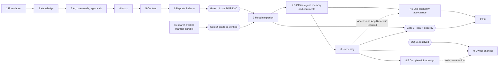

# Implementation Roadmap

**Purpose:** The order of implementation, its dependencies and gates, and how a coding agent (Claude Code) executes it phase by phase. Detailed phase plans are in [phases/](phases/). The task index is in [task-breakdown.md](task-breakdown.md).

## 1. Strategy

1. **Build a coherent end-to-end demo first** (Phases 1–6, all simulated), then connect real Instagram (Phase 7), deliver the conversational account agent (Phase 7.5), harden the expanded system for real customers (Phase 8), redesign the complete application experience (Phase 8.5), then add an owner messenger if evidence supports it (Phase 9).
2. **Every phase ends in a runnable, demoable state** with tests that prove its acceptance criteria.
3. **Safety mechanisms come before features that need them.** Approvals exist before replies are sent. The operations ledger exists before the first simulated send. Placeholders and the validator exist before the first AI reply.
4. **External uncertainty is retired in parallel**: a manual research track (R) runs alongside Phases 1–6 so that Phase 7 starts with verified facts.

## 2. Phases

**UI redesign plan (2026-10-30):** [Phase 8.5](phases/phase-8.5-ui-redesign.md) and its [28 sessions](phase-8.5-sessions/phase-8.5-sessions.md) plan the complete application redesign based on the [interactive concept](https://pivoris-style-preview.woollyhero2.chatgpt.site). The default presentation sequence is Phase 8 engineering, Phase 8.5, then Phase 9's web experience. Independent UI foundations can proceed against stable contracts when assigned; final redesign acceptance includes delivered Phase 8 security/privacy surfaces. Existing production, platform and owner-channel gates are unchanged. This is planning, not an implementation or release claim.

| Phase | Name | Objective | Depends on | Demo at end |
|---|---|---|---|---|
| 1 | [Foundation](phases/phase-01-foundation.md) | Repository, tooling, CI, config, DB, auth, tenancy, audit, job queue, frontend shell with i18n | — | Log in as demo owner on a phone viewport in Turkish; switch language and workspace; simulated banner visible |
| 2 | [Business knowledge](phases/phase-02-business-knowledge.md) | Typed, versioned facts, candidates, templates, readiness, knowledge UI, seed | 1 | Review and verify demo gym facts; readiness checklist turns `ready_for_drafts` |
| 3 | [AI runtime, commands and approvals core](phases/phase-03-command-system.md) | LLM abstraction (fake + OpenAI), agent runs, renderer and claim validator, approvals, notifications (basic), command system, fact update via NL, extraction, eval harness | 2 | "Aylık üyelik artık 7.000 TL" → confirmation → versioned update; paste-and-extract suggestions |
| 4 | [Inbox and reply approvals](phases/phase-04-inbox-and-approvals.md) | Mock Instagram, webhook pipeline, drafts with grounding, policy engine, reply approvals, operations ledger for sends, takeover, approved answers, dev simulator | 3 | Simulated DM → grounded draft → approve → simulated send; complaint escalates; price change alters the next draft |
| 5 | [Content and scheduling](phases/phase-05-content-and-scheduling.md) | Media, content items, AI content drafts, approval and scheduling, mock publish with containers, retries, reconciliation, fact-change holds | 4 | Story draft → upload → approve & schedule → simulated publish; failure injection; no duplicates |
| 6 | [Reports, activity and demo completion](phases/phase-06-reporting-and-demo.md) | Daily report, activity feed, Home dashboard, notification centre, integration-failure UX with mock, invites, demo reset, full E2E | 5 | **Local MVP Definition of Done** ([acceptance-criteria.md](../product/acceptance-criteria.md)) |
| 7 | [Meta Instagram integration](phases/phase-07-meta-integration.md) | Real Instagram Login, encrypted tokens, real webhooks, sends and image publishing, S3 media | 6 + Gate R | Founder's own professional account: real DM answered after approval; real image published at a scheduled time |
| 7.5 | [Autonomous Instagram account agent](phases/phase-7.5.md) | Central coordinator, tools, memory/personality, owner questions, DMs, comments/moderation/private replies and existing content tools | Phase 7 baseline; separate offline/model/platform gates in phase plan | Agent handles a multi-turn comment-to-DM conversation, remembers context, consults the owner and performs delegated account actions |
| 8 | [Production hardening and pilot readiness](phases/phase-08-hardening.md) | Deployment, backups, RLS, throttling, deletion and export, Meta callbacks, legal artifacts, security review, App Review preparation | Phase 7 baseline + stable Phase 7.5 offline surfaces; live pilot also needs agent/platform acceptance | Deployed instance passing a restore drill and security checklist; first pilot business onboarded |
| 8.5 | [Complete application UI and UX redesign](phases/phase-8.5-ui-redesign.md) | Warm workspace design system; all app routes, tabs, editors, states and public presentation; desktop/mobile layouts and accessibility | Stable Phase 7.5 frontend; integrate delivered Phase 8 UI contracts before final acceptance | Owner completes daily work across the redesigned app on Windows and a phone; all routes and critical states verified |
| 9 | [Owner messaging channel](phases/phase-09-owner-channel.md) | Telegram (provisional) via the channel abstraction | 8 + OQ-01; web presentation reuses Phase 8.5 | Owner receives an approval in Telegram and approves with a button |

**Feature phases (2026-11-15):** after the [pre-launch review](../review/pre-launch-feature-recommendations.md) the next product features are grouped into five feature phases that follow Phase 9 and sit outside the numbered phases above.

| Feature phase | Features | Status |
|---|---|---|
| [Feature Phase 1: before the first pilot](features-phase-1-before-first-pilot/sessions.md) | F-02 test chat, F-01 installable app and Web Push, D-01 visible "never invents a price" guarantee | **Implemented offline; stopped for review** (2026-11-16). Sessions 01 to 05 are done, see [the phase summary](phase-summaries/features-phase-1-summary.md) and the session reports ([s01](features-phase-1-before-first-pilot/s01-report.md), [s02](features-phase-1-before-first-pilot/s02-report.md), [s03](features-phase-1-before-first-pilot/s03-report.md), [s04](features-phase-1-before-first-pilot/s04-report.md), [s05](features-phase-1-before-first-pilot/s05-report.md)). Nothing is committed. Still open: real-device checks (push, maskable icon), the Telegram delivery wiring question, and the failures that were already in the tree before this phase. Next migration `0049` |
| [Feature Phase 2: during pilots](features-phase-2-during-pilots/sessions.md) | F-03 voice/images, F-04 stories, D-02 approval ladder, D-03 missed-customer report, D-05 learning, D-04 management by chat | **Implemented offline; stopped for review** (2026-11-17). All eight sessions are done: voice and image understanding (S01 to S03), story replies and mentions (S04), approval-ladder suggestions (S05), missed-customer report (S06), learning loop (S07), manage by chat and command box first on phones (S08). See the [phase summary](phase-summaries/features-phase-2-summary.md) and the session reports ([s01](features-phase-2-during-pilots/s01-report.md) to [s08](features-phase-2-during-pilots/s08-report.md), [merge](features-phase-2-during-pilots/merge-04-07-report.md)). Nothing is committed. Migration head `0056`, next `0057`. Still open: live checks of voice and image quality, real Instagram payloads, OpenAI speech-to-text and vision terms with the 30-day sub-processor notice, live evals, the D-03 conversion rate (5% placeholder), the D-02 thresholds, and the rest of P-13 (Today on phones). Two environment failures remain in the backend suite (CORS, invite URL), both from the local `.env`. |
| [Feature Phase 3: after App Review](features-phase-3-after-app-review/sessions.md) | F-05 comment-to-DM on real accounts (Track A), F-07 template images (Track B) | **Implemented offline; stopped for review** (2026-11-17). All four sessions are done: comment research and the comment permission request (S01), the real-account comment-to-DM path behind a default-off per-account flag with deterministic private-reply rules and a skipped-by-default live probe harness (S02), brand settings and the deterministic template renderer (S03), template images in the content flow with the price-change hold, re-render and the `make a price card` command (S04). See the [phase summary](phase-summaries/features-phase-3-summary.md), the session reports ([s01](features-phase-3-after-app-review/s01-report.md) to [s04](features-phase-3-after-app-review/s04-report.md)) and the [merge report](features-phase-3-after-app-review/merge-report.md). Nothing is committed. Migration head `0060`, next `0061` (`0057 -> 0058 template images -> 0059 comment automation -> 0060 price-card command`). Still open: all Meta comment live evidence (webhook delivery, `subscribed_apps` for `comments`, private-reply limits per comment versus per commenter), App Review for the comment permission, and a look at the template cards on a real phone. |
| [Feature Phase 4: before self-service](features-phase-4-before-self-service/sessions.md) | F-09 import facts from the Instagram profile and a website, D-06 local package on the landing page | **Implemented offline; stopped for review** (2026-11-17). All three sessions are done: Instagram profile import (S01), SSRF-safe website import and the onboarding and Knowledge-page import UI (S02), the landing-page local package section and the close-out (S03). See the [phase summary](phase-summaries/features-phase-4-summary.md) and the session reports ([s01](features-phase-4-before-self-service/s01-report.md), [s02](features-phase-4-before-self-service/s02-report.md), [s03](features-phase-4-before-self-service/s03-report.md), [s03 landing](features-phase-4-before-self-service/s03-landing-report.md)). Nothing is committed. Migration head `0061`, next `0062` (`source_detail` on `fact_candidates`). Still open: V-12 (a real Instagram profile and caption import), real website imports on 3 to 5 Turkish small-business sites, the settled package price (hidden on the landing page until `VITE_PACKAGE_PRICE` is set), `VITE_APP_URL` at deploy. Self-service launch also needs P-10 (done behind `SIGNUP_ENABLED`, flag off, legal text and SMTP open) and P-11 (partial: no payment, no per-plan limits beyond AI replies). |
| [Feature Phase 5: on demand](features-phase-5-on-demand/sessions.md) | F-06 WhatsApp (Track A), F-08 carousels and Reels (Track B), F-10 follow-up and late replies (Track C), F-11 more reply languages (Track D), F-12 lead list (Track E) | **Implemented offline; stopped for review** (2026-11-18). All twelve sessions across five tracks are implemented and verified offline: Track A (Sessions 01–03, migrations `0070`–`0071`, [summary](phase-summaries/features-phase-5-whatsapp-summary.md)), Track B (Sessions 04–07, migrations `0080`–`0083`, [summary](phase-summaries/features-phase-5-media-summary.md)), Track C (Sessions 08–09, migrations `0090`–`0091`, [summary](phase-summaries/features-phase-5-followup-summary.md)), Track D (Sessions 10–11, migration `0100`, [summary](phase-summaries/features-phase-5-languages-summary.md)), Track E (Session 12, no migration, [summary](phase-summaries/features-phase-5-leads-summary.md)). Nothing committed; live items pending (Meta WhatsApp number/templates, live carousel/Reel publishing with ffmpeg, Meta Human Agent feature and capability, live eval run for ru/de/ar, KVKK wording and trigger evidence for leads). Merged migration chain: `0061 → 0070 → 0071 → 0080 → 0081 → 0082 → 0083 → 0090 → 0091 → 0100` (head `0100`, next free `0101`). |
| [Account Agent Pilot Readiness](../../answeres2.md) | S00 Baseline, S01 Telegram delivery, S02 Channel choice, S03 Semi-automation policy, S04 5 languages, S05 Voice/image media, S06 Bookings & leads, S07 Practice chat parity, S08 Combined acceptance, S09 Onboarding & measurement alignment, S10 Release prep, S11 Live acceptance & close-out | **Implemented across Sessions 00–10; offline verification passed; live verification cataloged and pending owner live probe execution** (2026-11-19). Migration head `0101` (`channel_preferences`). Combined offline acceptance passed across all 6 required pilot feature areas; full regression, static analysis, type checks, and production builds clean; live acceptance matrix and exact live probe runbooks cataloged in Session 11. |

## 3. Gates

**Phase 9 status (2026-11-04):** [full plan](phases/phase-09-owner-channel.md), [session reports](phase-9-sessions/phase-09-sessions.md) and [phase summary](phase-summaries/phase-09-summary.md) record the complete offline engineering and acceptance across all 8 sequential sessions (P9-01 through P9-05). All four canonical acceptance criteria (AC-1 through AC-4) are verified with passing E2E tests (`test_owner_channel_acceptance.py`), dedicated security suite (12 tests in `test_owner_channel_security.py`), and architectural import linter isolation KEPT. Full backend (55 passed, 3 live skips) and frontend (597 passed across 45 suites) regressions pass cleanly. Optional live Telegram probe harness (`test_telegram_live.py`) is delivered.

**Phase 7.5 status (2026-10-30):** [full plan](phases/phase-7.5.md), [session reports](phase-7.5-sessions/phase-7.5-sessions.md) and [phase summary](phase-summaries/phase-7.5-summary.md) record the offline implementation. Session 17's full backend/frontend/browser regressions pass, and Session 18's offline rollback rehearsal and operating guide are complete. G7.5-A is accepted; G7.5-B still needs varied journey coverage, G7.5-C needs an authorized real-model quality run, and G7.5-D/E need authentic platform and founder/phone evidence. Real comment capabilities remain disabled. Phase 8 hardening and App Review preparation can proceed against the stable offline contracts, while real customer pilots still require the applicable platform and production/data gates.

**Gate 1 CLOSED (2026-10-25):** the owner authorized squash merge of [PR #1](https://github.com/Ernosto0/Pivoris/pull/1) into `main` as `dadf673`; [fresh main CI](https://github.com/Ernosto0/Pivoris/actions/runs/40133915582) passed all four jobs. Backend is 2,905 passed / four intentional live-only skips, frontend 497 passed and E2E 174/174 with zero retries. The [close-out record](phase-6-sessions/gate-1-closeout.md) includes owner-reported unassisted Windows/phone acceptance, accepted ADR-021/022, atomic media-deletion audits and independent Windows verification (full backend and 8/8 WebKit regressions). The [Phase 6 summary](phase-summaries/phase-06-summary.md) preserves the historical review.

**Phase 7 owner exception (2026-10-23):** offline Sessions 1-4 are complete and operator-accepted before gates pass; see [Phase 7 summary](phase-summaries/phase-07-summary.md). Required local checks pass (backend 2,904 passes / 4 intended manual skips, frontend 497 passes, fake eval 166/166 and statics). Gate 1 is now closed on main; Gate 2, P7-00's final research re-plan, authentic recordings and all founder/tester/Meta/S3 acceptance remain pending. No live calls, public tunnel, deployment, App Review or push were performed. Phase 8 remains pending.

| Gate | Condition | Evidence |
|---|---|---|
| **Gate 1: Local MVP (CLOSED)** | All AC-A…G and AC-X pass in CI. Manual walkthrough on Windows and on a phone. | [Main CI](https://github.com/Ernosto0/Pivoris/actions/runs/40133915582); [close-out](phase-6-sessions/gate-1-closeout.md); [main landing](https://github.com/Ernosto0/Pivoris/pull/1) |
| **Gate 2: Platform verified** | V-01, V-02, V-03, V-05, V-08, V-09 answered in [platform-capabilities.md](../research/platform-capabilities.md) | Updated doc with dates and fixtures |
| **Gate 3: Real customer data** | Phase 8 checklist complete; legal review of OQ-04, OQ-12, OQ-13 done; restore drill passed | Phase 8 summary; counsel notes |
| **Gate 4: Owner channel** | OQ-01 resolved from interviews | open-questions.md updated |

## 4. Research track R (manual, founder; runs in parallel with Phases 1–6)

| Step | Action | Resolves |
|---|---|---|
| R-1 | Create a Meta developer app with the Instagram product (Instagram Login). Convert the founder's own Instagram account to a professional account for testing. | prerequisite |
| R-2 | Generate a token via the dashboard. Call profile, send a DM to a test follower, and publish a test image and a test Story via Graph API Explorer or curl. Record responses. | V-03, V-04, V-05 |
| R-3 | Expose a temporary webhook endpoint (tunnel) and subscribe to `messages` and `message_echoes`. Capture payloads for text, attachments, story replies, echoes from the native app, reactions and deletions. | V-02, V-08 |
| R-4 | Ask one friendly business to become a tester. Document the steps and any feature failures under Standard Access. | V-01, OQ-03 |
| R-5 | Publish with a presigned S3 URL (TTL 1 h) to confirm fetch behaviour. | V-09 |
| R-6 | Start Business Verification and read the App Review requirements for the needed permissions. Collect the documents. | V-07, OQ-05 |
| R-7 | Pilot interviews (10–15 businesses): channel preference, comment-to-DM importance, price disclosure habits, approval habits. | OQ-01, OQ-07, OQ-08 |

Record results in [platform-capabilities.md](../research/platform-capabilities.md) and [open-questions.md](../research/open-questions.md), with dates. Save sanitised payload fixtures under `backend/tests/contract/fixtures/meta/` (no personal data).

## 5. Working agreement for Claude Code (per phase)

1. **Start of phase:** read [CLAUDE.md](../../CLAUDE.md), [invariants.md](../invariants.md), the phase document, and every document it links in "Read first". Confirm prerequisites are met (previous phase's acceptance criteria pass).
2. **Implement tasks in the listed order.** Keep each task's change focused. Run the task's tests before moving on.
3. **Do not expand scope.** If something seems missing or contradictory in the docs, stop and list it in the summary as a question instead of inventing architecture.
4. **Keep docs in sync.** If implementation requires a change to a contract (schema, endpoint, state), update the relevant document in the same change and mention it.
5. **End of phase:** run the full test suite (backend, frontend, E2E relevant to the phase). Then produce a **phase summary**: what changed (files and modules), how acceptance criteria are proven (test names), the demo steps, deviations from the docs and why, known limitations, and open questions. Then **stop and wait for review** before starting the next phase.
6. **Never** weaken an invariant, disable a failing test, or mark a criterion done without the proving test passing.

## 6. Risk register

| ID | Risk | Likelihood | Impact | Mitigation | Owner |
|---|---|---|---|---|---|
| RK-01 | App Review or Business Verification delayed or rejected | Medium | High (blocks self-service SaaS) | Start R-6 early; assisted pilots under Standard Access (if V-01 confirms); keep the product valuable in demo mode for sales | Founder |
| RK-02 | Instagram API behaviour differs from docs (stories, echoes, errors) | Medium | Medium | Research track; capability flags; contract tests with recorded fixtures | Engineer |
| RK-03 | Owners don't open the web app; approvals go stale | High | High | OQ-01; daily report; Phase 9 channel; Web Push option | Founder |
| RK-04 | LLM drafts in Turkish are unnatural or hallucinate non-numeric claims | Medium | High | Placeholders + validator; approval by default; eval sets with Turkish examples; owner edits feed approved answers | Engineer |
| RK-05 | KVKK cross-border transfer obligations not met | Medium | High | Gate 3 legal review; minimisation; region-agnostic deployment | Founder |
| RK-06 | Solo-founder bandwidth and scope creep | High | High | Strict phase scope; deferred list; gates; small tasks | Founder |
| RK-07 | In-house job queue bugs (double execution, stuck jobs) | Low–Medium | High | Focused test suite in Phase 1; idempotent handlers; ledger as second line | Engineer |
| RK-08 | LLM cost per workspace too high for TRY pricing | Medium | Medium | Measure in `agent_runs`; evaluate cheaper models (OQ-09); debounce; budget caps | Founder |
| RK-09 | Meta policy or API changes (deprecations, new review requirements) | Medium | Medium | Pinned API version; adapter isolation; watch the changelog | Engineer |
| RK-10 | Automation perceived as spam by Meta, leading to account restrictions | Low | High | Only reply to customer-initiated messages within the window; rate guard; no bulk messaging | Engineer |
| RK-11 | License indecision blocks community contributions | Medium | Low (now) | Repo private until OQ-02; decide before going public | Founder |
| RK-12 | Windows-specific setup friction (Docker, paths, line endings) | Medium | Low | Setup tested on Windows; `.gitattributes`; troubleshooting doc | Engineer |
