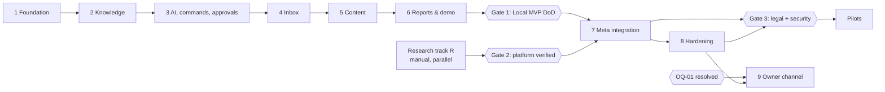

# Implementation Roadmap

**Purpose:** The order of implementation, its dependencies and gates, and how a coding agent (Claude Code) executes it phase by phase. Detailed phase plans are in [phases/](phases/). The task index is in [task-breakdown.md](task-breakdown.md).

## 1. Strategy

1. **Build a coherent end-to-end demo first** (Phases 1–6, all simulated), then connect real Instagram (Phase 7), then harden for real customers (Phase 8), then add an owner messenger if evidence supports it (Phase 9).
2. **Every phase ends in a runnable, demoable state** with tests that prove its acceptance criteria.
3. **Safety mechanisms come before features that need them.** Approvals exist before replies are sent. The operations ledger exists before the first simulated send. Placeholders and the validator exist before the first AI reply.
4. **External uncertainty is retired in parallel**: a manual research track (R) runs alongside Phases 1–6 so that Phase 7 starts with verified facts.

## 2. Phases

| Phase | Name | Objective | Depends on | Demo at end |
|---|---|---|---|---|
| 1 | [Foundation](phases/phase-01-foundation.md) | Repository, tooling, CI, config, DB, auth, tenancy, audit, job queue, frontend shell with i18n | — | Log in as demo owner on a phone viewport in Turkish; switch language and workspace; simulated banner visible |
| 2 | [Business knowledge](phases/phase-02-business-knowledge.md) | Typed, versioned facts, candidates, templates, readiness, knowledge UI, seed | 1 | Review and verify demo gym facts; readiness checklist turns `ready_for_drafts` |
| 3 | [AI runtime, commands and approvals core](phases/phase-03-command-system.md) | LLM abstraction (fake + OpenAI), agent runs, renderer and claim validator, approvals, notifications (basic), command system, fact update via NL, extraction, eval harness | 2 | "Aylık üyelik artık 7.000 TL" → confirmation → versioned update; paste-and-extract suggestions |
| 4 | [Inbox and reply approvals](phases/phase-04-inbox-and-approvals.md) | Mock Instagram, webhook pipeline, drafts with grounding, policy engine, reply approvals, operations ledger for sends, takeover, approved answers, dev simulator | 3 | Simulated DM → grounded draft → approve → simulated send; complaint escalates; price change alters the next draft |
| 5 | [Content and scheduling](phases/phase-05-content-and-scheduling.md) | Media, content items, AI content drafts, approval and scheduling, mock publish with containers, retries, reconciliation, fact-change holds | 4 | Story draft → upload → approve & schedule → simulated publish; failure injection; no duplicates |
| 6 | [Reports, activity and demo completion](phases/phase-06-reporting-and-demo.md) | Daily report, activity feed, Home dashboard, notification centre, integration-failure UX with mock, invites, demo reset, full E2E | 5 | **Local MVP Definition of Done** ([acceptance-criteria.md](../product/acceptance-criteria.md)) |
| 7 | [Meta Instagram integration](phases/phase-07-meta-integration.md) | Real Instagram Login, encrypted tokens, real webhooks, sends and image publishing, S3 media | 6 + Gate R | Founder's own professional account: real DM answered after approval; real image published at a scheduled time |
| 8 | [Production hardening and pilot readiness](phases/phase-08-hardening.md) | Deployment, backups, RLS, throttling, deletion and export, Meta callbacks, legal artifacts, security review, App Review preparation | 7 | Deployed instance passing a restore drill and security checklist; first pilot business onboarded |
| 9 | [Owner messaging channel](phases/phase-09-owner-channel.md) | Telegram (provisional) via the channel abstraction | 8 + OQ-01 | Owner receives an approval in Telegram and approves with a button |

## 3. Gates

**Gate 1 review (2026-10-25):** local MVP criteria verified for reviewed code `b47b019`: [complete CI](https://github.com/Ernosto0/AgentNest/actions/runs/40129750466), owner-reported unassisted Windows/phone acceptance, accepted ADR-021/022, atomic media-deletion audits and the [current close-out record](phase-6-sessions/gate-1-closeout.md). CI E2E is 174/174 with zero retries; independent Windows backend is 2,905 passed / four intentional live-only skips and WebKit regressions are 8/8. [PR #1](https://github.com/Ernosto0/AgentNest/pull/1) tracks main landing. The [Phase 6 summary](phase-summaries/phase-06-summary.md) preserves the historical review.

**Phase 7 owner exception (2026-10-23):** offline Sessions 1-4 are complete and operator-accepted before gates pass; see [Phase 7 summary](phase-summaries/phase-07-summary.md). Required local checks pass (backend 2,904 passes / 4 intended manual skips, frontend 497 passes, fake eval 166/166 and statics). Gate 1 criteria are now verified; Gate 2, P7-00's final research re-plan, authentic recordings and all founder/tester/Meta/S3 acceptance remain pending. No live calls, public tunnel, deployment, App Review or push were performed. Phase 8 remains pending.

| Gate | Condition | Evidence |
|---|---|---|
| **Gate 1: Local MVP** | All AC-A…G and AC-X pass in CI. Manual walkthrough on Windows and on a phone. | [Verified code CI](https://github.com/Ernosto0/AgentNest/actions/runs/40129750466); [close-out](phase-6-sessions/gate-1-closeout.md); [main landing](https://github.com/Ernosto0/AgentNest/pull/1) |
| **Gate 2: Platform verified** | V-01, V-02, V-03, V-05, V-08, V-09 answered in [platform-capabilities.md](../research/platform-capabilities.md) | Updated doc with dates and fixtures |
| **Gate 3: Real customer data** | Phase 8 checklist complete; legal review of OQ-04, OQ-12, OQ-13 done; restore drill passed | Phase 8 summary; counsel notes |
| **Gate 4: Owner channel** | OQ-01 resolved from interviews | open-questions.md updated |

## 4. Research track R (manual, founder; runs in parallel with Phases 1–6)

| Step | Action | Resolves |
|---|---|---|
| R-1 | Create a Meta developer app with the Instagram product (Instagram Login). Convert the founder's own Instagram account to a professional account for testing. | prerequisite |
| R-2 | Generate a token via the dashboard. Call profile, send a DM to a test follower, and publish a test image and a test Story via Graph API Explorer or curl. Record responses. | V-03, V-04, V-05 |
| R-3 | Expose a temporary webhook endpoint (tunnel) and subscribe to `messages` and `message_echoes`. Capture payloads for text, attachments, story replies, echoes from the native app, reactions and deletions. | V-02, V-08 |
| R-4 | Ask one friendly business to become a tester. Document the steps and any feature failures under Standard Access. | V-01, OQ-03 |
| R-5 | Publish with a presigned S3 URL (TTL 1 h) to confirm fetch behaviour. | V-09 |
| R-6 | Start Business Verification and read the App Review requirements for the needed permissions. Collect the documents. | V-07, OQ-05 |
| R-7 | Pilot interviews (10–15 businesses): channel preference, comment-to-DM importance, price disclosure habits, approval habits. | OQ-01, OQ-07, OQ-08 |

Record results in [platform-capabilities.md](../research/platform-capabilities.md) and [open-questions.md](../research/open-questions.md), with dates. Save sanitised payload fixtures under `backend/tests/contract/fixtures/meta/` (no personal data).

## 5. Working agreement for Claude Code (per phase)

1. **Start of phase:** read [CLAUDE.md](../../CLAUDE.md), [invariants.md](../invariants.md), the phase document, and every document it links in "Read first". Confirm prerequisites are met (previous phase's acceptance criteria pass).
2. **Implement tasks in the listed order.** Keep each task's change focused. Run the task's tests before moving on.
3. **Do not expand scope.** If something seems missing or contradictory in the docs, stop and list it in the summary as a question instead of inventing architecture.
4. **Keep docs in sync.** If implementation requires a change to a contract (schema, endpoint, state), update the relevant document in the same change and mention it.
5. **End of phase:** run the full test suite (backend, frontend, E2E relevant to the phase). Then produce a **phase summary**: what changed (files and modules), how acceptance criteria are proven (test names), the demo steps, deviations from the docs and why, known limitations, and open questions. Then **stop and wait for review** before starting the next phase.
6. **Never** weaken an invariant, disable a failing test, or mark a criterion done without the proving test passing.

## 6. Risk register

| ID | Risk | Likelihood | Impact | Mitigation | Owner |
|---|---|---|---|---|---|
| RK-01 | App Review or Business Verification delayed or rejected | Medium | High (blocks self-service SaaS) | Start R-6 early; assisted pilots under Standard Access (if V-01 confirms); keep the product valuable in demo mode for sales | Founder |
| RK-02 | Instagram API behaviour differs from docs (stories, echoes, errors) | Medium | Medium | Research track; capability flags; contract tests with recorded fixtures | Engineer |
| RK-03 | Owners don't open the web app; approvals go stale | High | High | OQ-01; daily report; Phase 9 channel; Web Push option | Founder |
| RK-04 | LLM drafts in Turkish are unnatural or hallucinate non-numeric claims | Medium | High | Placeholders + validator; approval by default; eval sets with Turkish examples; owner edits feed approved answers | Engineer |
| RK-05 | KVKK cross-border transfer obligations not met | Medium | High | Gate 3 legal review; minimisation; region-agnostic deployment | Founder |
| RK-06 | Solo-founder bandwidth and scope creep | High | High | Strict phase scope; deferred list; gates; small tasks | Founder |
| RK-07 | In-house job queue bugs (double execution, stuck jobs) | Low–Medium | High | Focused test suite in Phase 1; idempotent handlers; ledger as second line | Engineer |
| RK-08 | LLM cost per workspace too high for TRY pricing | Medium | Medium | Measure in `agent_runs`; evaluate cheaper models (OQ-09); debounce; budget caps | Founder |
| RK-09 | Meta policy or API changes (deprecations, new review requirements) | Medium | Medium | Pinned API version; adapter isolation; watch the changelog | Engineer |
| RK-10 | Automation perceived as spam by Meta, leading to account restrictions | Low | High | Only reply to customer-initiated messages within the window; rate guard; no bulk messaging | Engineer |
| RK-11 | License indecision blocks community contributions | Medium | Low (now) | Repo private until OQ-02; decide before going public | Founder |
| RK-12 | Windows-specific setup friction (Docker, paths, line endings) | Medium | Low | Setup tested on Windows; `.gitattributes`; troubleshooting doc | Engineer |
