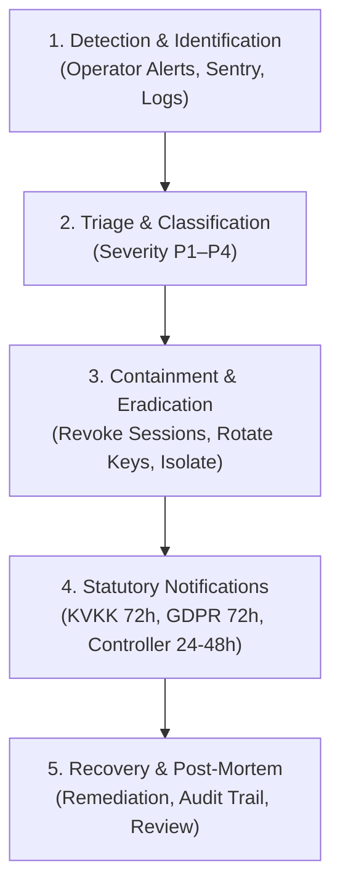

# Personal Data Breach Response Runbook / Veri İhlali Müdahale Rehberi

- **Document Code:** `RUNBOOK-DATA-BREACH-V1`
- **Scope:** Security incidents involving personal data, unauthorized access, credential leakage, or data loss across the AgentNest platform.
- **Audience:** Platform Operators, Security Leads, Infrastructure Administrators, and Legal Counsel.
- **Review Status:** `PENDING_COUNSEL_REVIEW` (Tracking under `OQ-04`, `OQ-12`, `OQ-13`; Gate 3 Pre-condition)

---

## 1. Statutory Context & Regulatory Deadlines

When an incident involves actual or suspected unauthorized access, alteration, destruction, or disclosure of personal data:

| Jurisdiction / Legal Framework | Notification Target | Statutory Deadline | Regulatory Basis |
|---|---|---|---|
| **Türkiye (KVKK)** | **Kişisel Verileri Koruma Kurulu (KVKK Kurumu)** | Within **72 hours** of becoming aware of the breach | 6698 sayılı Kanun m. 12/5, Kurulun 24.01.2019 tarihli ve 2019/10 sayılı Kararı |
| **Türkiye (KVKK)** | **İlgili Kişiler (Affected Data Subjects)** | As soon as reasonably possible after identification | KVKK m. 12/5; Tebliğ hükümleri |
| **European Union (GDPR)** | **Competent Supervisory Authority (DPA)** | Within **72 hours** of becoming aware | GDPR Article 33 |
| **European Union (GDPR)** | **Affected Data Subjects** | Without undue delay (if high risk to rights and freedoms) | GDPR Article 34 |
| **B2B Contractual (DPA)** | **Tenant Businesses (Data Controllers)** | Within **24 to 48 hours** of confirmed breach | [AgentNest DPA](dpa-template.md) Section 6 |

---

## 2. Incident Response Phases



---

## 3. Phase 1: Detection & Identification

Incidents may be detected via multiple automated and manual channels:
1. **Automated Operator Alerts:** Webhook signature failure bursts (`webhook:signature_failure_burst`), dead background jobs, or backup failures received via operator alerting (`scripts/evaluate_alerts.py`, `app.operations.operator_alerts`).
2. **Error Monitoring (Sentry):** Sudden bursts of authentication failures, database connection exceptions, or unexpected authorization errors.
3. **Immutable Audit Logs:** Anomaly detection in `audit_logs` (e.g., unexpected role changes, mass export requests, bulk key rotations).
4. **Third-Party / Customer Reports:** Reports submitted to `security@agentnest.io` or `privacy@agentnest.io`.

---

## 4. Phase 2: Triage & Classification

The Incident Commander immediately assesses severity using the following matrix:

| Severity | Criteria | Impact on Personal Data | Notification Requirement |
|---|---|---|---|
| **P1 - Critical** | Database breach, unauthorized token extraction, cross-tenant isolation compromise (`INV-01`), server root compromise. | High risk to rights/freedoms of many users; customer messages or credentials exposed. | Immediate executive escalation; **Mandatory 72h KVKK/GDPR notification**; Controller notice within 24h. |
| **P2 - High** | Single workspace compromised due to stolen user credential; isolated token decryption error; unauthorized export in one account. | Personal data of a single tenant's users or customers exposed. | Affected Controller notice within 24h; evaluate KVKK notification threshold. |
| **P3 - Medium** | Webhook signature attack prevented; brute force attempt throttled; brief unencrypted log trace sanitized immediately. | Minimal or no personal data exposed; threat contained by architecture. | Internal security report; Controller notice only if impact confirmed. |
| **P4 - Low / Informational** | Routine failed logins; scanner probing public endpoints; benign bug fixed with no data impact. | No personal data exposure. | Logged in internal audit. No external notification required. |

---

## 5. Phase 3: Containment & Immediate Mitigation

The operator executes containment actions immediately without destroying evidence:

### 5.1 Revoke Compromised Sessions
Revoke all active user sessions for the affected user or workspace:
```bash
# In backend CLI or direct administrative shell
python -m scripts.revoke_sessions --workspace-id <WS_ID> --all
```

### 5.2 Rotate Token Encryption Keys
If token encryption keys or database backups are suspected of being leaked:
1. Add a new `TOKEN_ENCRYPTION_ACTIVE_KEY_ID` and key into `.env` (preserving old keys in the keyring).
2. Execute immediate re-encryption:
   ```bash
   python scripts/rotate_token_keys.py --batch-size 100
   ```
3. Disconnect any compromised social accounts immediately via the administrative tool or API.

### 5.3 Fencing & Network Isolation
If a container or worker node is compromised:
```bash
# Stop background worker processing
docker compose -f compose.prod.yml stop worker

# Inspect Caddy reverse proxy blocks
caddy reload --config Caddyfile
```

---

## 6. Phase 4: Statutory Notification Procedures

### 6.1 Notification to Turkish KVKK Kurumu (Within 72 Hours)
- **Form:** Use the official KVKK Personal Data Breach Notification Form ("Kişisel Veri İhlali Bildirim Formu") available at [kvkk.gov.tr](https://www.kvkk.gov.tr).
- **Required Details:**
  1. Veri Sorumlusu bilgileri (veya Veri İşleyen adına bildirim);
  2. İhlalin başlama ve tespit edilme tarihi/saati;
  3. İhlalin nasıl gerçekleştiği ve kaynağı;
  4. İhlalden etkilenen kişisel veri kategorileri (örn. Instagram mesaj içerikleri, kullanıcı adları);
  5. İhlalden etkilenen tahmini kişi ve kayıt sayısı;
  6. İhlalin olası sonuçları ve etkileri;
  7. Alınan veya alınması önerilen teknik ve idari tedbirler;
  8. İrtibat kişisi unvan ve iletişim bilgileri.
- **Submission Channel:** Submit via KEP (Kayıtlı Elektronik Posta) or the official online KVKK notification portal (`ihbar.kvkk.gov.tr`).

### 6.2 Notification to Business Customers (Controllers) (Within 24–48 Hours)
Send a formal, confidential breach notification email to the primary Workspace Owner address:
- **Subject:** `[IMPORTANT] Security Incident Notification / Güvenlik Olayı Bildirimi - AgentNest`
- **Body:** Clear, factual description of the incident, affected workspaces, categories of data accessed, immediate mitigation taken, and actionable recommendations for the business (e.g., informing their customers or rotating Instagram account credentials).

---

## 7. Phase 5: Recovery, Remediation & Post-Mortem

1. **Root Cause Analysis (RCA):** Identify the exact vulnerability, defective configuration, or compromised secret that caused the incident.
2. **Patch & Verify:** Implement code or infrastructure remediation, add automated regression tests to the test suite (`tests/unit/...`), and verify via linters and vulnerability scanners.
3. **Audit Log Review:** Ensure all forensic evidence, audit log entries, and incident milestones are securely preserved.
4. **Post-Mortem Documentation:** Create an internal post-mortem report documenting:
   - Incident timeline (T0 detection, T1 containment, T2 notification, T3 resolution);
   - Preventative measures implemented;
   - Regulatory filing references and correspondence records.
