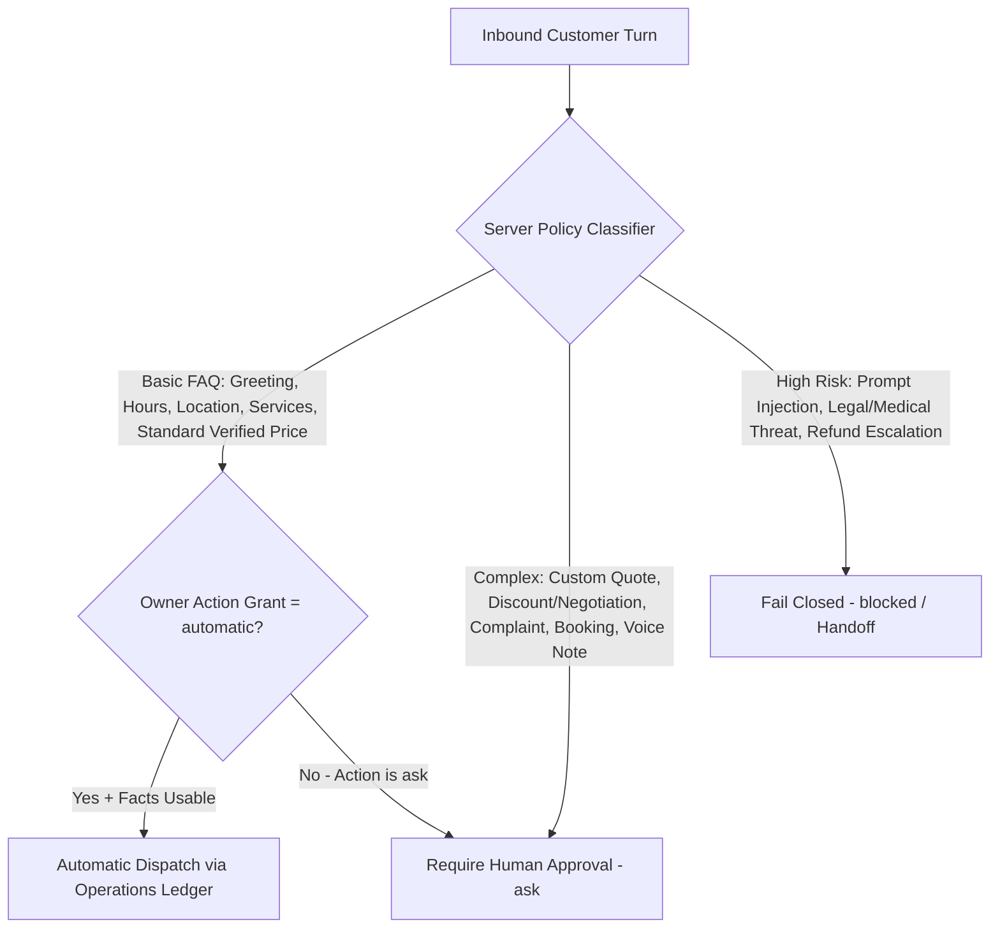

# Turnkey Pilot Assisted Onboarding Walkthrough & Runbook

- **Target Plan:** [Account Agent Pilot Readiness](../../answeres2.md) — Session 09 (`P-19`, `Gate 3`, `OQ-01`, `OQ-03`, `OQ-05`, `OQ-08`, `OQ-13`, [ADR-013](../architecture/decisions/ADR-013-authentication-and-tenancy.md), [ADR-024](../architecture/decisions/ADR-024-account-agent-and-delegated-autonomy.md))
- **Status:** Runbook verified against local codebase and combined offline acceptance suite (`test_account_agent_pilot_acceptance_unit.py`). Live Meta OAuth and Telegram/WhatsApp delivery are verified on controlled accounts before onboarding.
- **Target Workload:** First 10–15 Assisted Pilot Local Businesses within a week (e.g. Pilates Studio, Fitness Center, Beauty Salon, Wellness Clinic).
- **Execution Mode:** Assisted (Operator pair-onboarding with business owner in person or via video call).

---

## 1. Pre-Onboarding Eligibility & Prerequisites

Before initiating the onboarding session, the operator and business owner must verify the following prerequisites:

| Requirement | Turkish Description | Verification Method |
|---|---|---|
| **Instagram Account Type** | Instagram Profesyonel (İşletme veya İçerik Üretici) hesabı | In the Instagram app: `Settings and activity -> Account type and tools` must offer *Switch to personal account* (confirming it is already Professional). A personal account must first be switched to Professional (Business or Creator). |
| **Facebook Page** | **Gerekmez.** | Pivoris connects with *Instagram API with Instagram Login* (Business Login for Instagram). Meta does not require a Facebook Page to be linked to the Instagram professional account; the owner needs neither a linked Page nor Page admin rights. |
| **Meta App Tester Role** | Meta Geliştirici panelinde Instagram Test Kullanıcısı (OQ-03) | While the app is in development mode (before public App Review), the operator adds the owner's Instagram username in `Meta Developer Portal -> App roles -> Roles -> Instagram Testers`. The owner accepts the invitation in the Instagram app (`Settings -> Apps and websites -> Tester invites`). Until accepted, the OAuth consent screen fails. |
| **Business Facts Inventory** | Doğrulanmış işletme bilgileri (çalışma saatleri, fiyatlar, adres, hizmetler) | Owner prepares working hours, service pricing, address/directions, contact phone/WhatsApp, booking instructions, and cancellation policy. These are the verified facts the assistant may quote (§2.2). |
| **Legal Documentation** | KVKK Aydınlatma Metni ve Veri İşleme Sözleşmesi (DPA) | Operator delivers `docs/legal/kvkk-aydinlatma-metni-template.md` and `docs/legal/dpa-template.md` to owner for review and sign-off. |
| **Server Health (Operator Pre-Check)** | Sistem ve kuyruk çalışırlığı | Operator runs `curl https://<app-host>/readyz` (must return `{"status":"ok"}`); runs `python -m app.cli check-config` and `python -m app.cli migration-status` on the server. The background worker process must be active. |

---

## 2. Workspace Initialization & Fact Seeding (Operator Walkthrough)

There is no `create-workspace` or `seed-facts` CLI command. The workspace is created in the app using the same wizard an owner uses, keeping one tested path for operator-assisted and self-service setup.

### 2.1 Create the operator account and workspace

1. **Operator account (server-side, once):**
   ```bash
   python -m app.cli create-user --email operator@example.com --display-name "Operator" --locale tr
   ```
   Provide a secure password (minimum 10 characters) at the interactive prompt. Sign in at `https://<app-host>/login`.

2. **Create the workspace:**
   On the workspace list, tap **Çalışma alanı oluştur** (Create workspace) and complete the 3 steps:
   - Business name (e.g. `Gölkent Pilates & Wellness`).
   - Business category (e.g. Pilates & Fitness Studio, Salon, Clinic).
   - Market, business language (`Türkçe` or `English`), time zone (`Europe/Istanbul` by default for Türkiye), and currency (`TRY`).
   The wizard completes and navigates to **İşletme bilgileri** (Business knowledge) of the new workspace. The operator is the initial owner.

### 2.2 Enter and verify business facts

Open **Daha fazla -> İşletme bilgileri** (Business knowledge). Fill facts using both extraction and direct entry:

- **Paste to extract:** Tap **Metinden öneri al**, paste the owner's Instagram bio, price list, or website text, and tap **Önerileri bul**. Candidates appear under **Öneriler** (Suggestions). **Nothing is usable until an owner explicitly reviews and accepts each candidate** (INV-02).
- **Add by hand:** Under **İlginizi bekleyenler**, tap **Ekle** (Add) for missing items.

Minimum required verified facts before activating Account Agent automation:

| Fact Key | Label (TR) | Value Format & Constraints | Purpose |
|---|---|---|---|
| `identity.business_name` | İşletme adı | Text string matching Instagram handle / legal name | Core identity |
| `contact.phone` or `contact.whatsapp` | İletişim yolu | E.164 phone (`+905550000000`) or email | Customer escalation |
| `location.address` | Adres | Street address, district, city (or `location.online_only=true`) | Directions & visits |
| `hours.weekly` | Çalışma saatleri | Weekday ranges (e.g. `Mo-Fr 08:00-21:00; Sa 09:00-18:00; Su closed`) | Booking & visit hours |
| `booking.instructions` | Rezervasyon talimatı | Clear customer instructions (e.g. DM, phone, or appointment link) | Booking routing |
| `policy.price_disclosure` | Fiyat politikası | `share` (quote verified prices) or `do_not_share` | Price guardrail |
| `service.<name>` | Hizmetler (en az 1) | Service name, short description, target group | Service enquiries |
| `pricing.<item>` | Fiyatlar (ayrı kartlar) | Explicit amount, currency (`TRY`), unit (e.g. `10 seanslık paket: 4.800 ₺`) | Standard price quotes |

> [!IMPORTANT]
> **INV-02 Invariant:** Prices and commercial promises are **never** invented. The assistant may quote a price **only** if backed by an active, usable `pricing.*` fact. Unverified or missing prices always trigger clarification or human approval.

---

## 3. Account Agent Activation & Semi-Automation Delegation

The pilot uses the **Account Agent** (ADR-024) rather than legacy topic policies.

### 3.1 Activating Account Agent Mode

1. Navigate to **Daha fazla -> Asistan** (More -> Assistant).
2. Tap **Hesap asistanını etkinleştir** (Enable account assistant).
3. The app presents the controller cutover confirmation dialog. Tap **Kontrol değişikliğini onayla** (Confirm control change).
   - This executes `POST /api/v1/workspaces/{ws}/accounts/{account_id}/agent/activate` with `mode="agent"` and the current `expected_config_version`.
   - The account state transitions from `inactive` to `active`, incrementing `controller_epoch`.

### 3.2 Configuring Semi-Automation Delegation

Navigate to **Daha fazla -> Asistan -> Yetkilendirme** (More -> Assistant -> What the assistant may do).
Configure the three primary action delegates:

| Action Delegate | Recommended Pilot Setting | Behavior Description |
|---|---|---|
| `dm.send` (Direct Messages) | `automatic` (with semi-automation policy) | Automatically answers verified basic questions; routes complex questions to human approval. |
| `comment.reply` (Public Comments) | `ask` (pilot recommendation) | Drafts public reply; requires owner approval before publishing. |
| `comment.private_reply` (Comment-to-DM) | `automatic` or `ask` | Sends private reply to comment question (one-shot per commenter); requires verified facts. |

### 3.3 Semi-Automation Policy Matrix (How Basic vs Complex is Enforced)

Under the Account Agent semi-automation architecture (INV-04, Session 03), setting an action to `automatic` does **NOT** grant unrestricted autonomy. The server-side broker and policy evaluator classify every inbound turn deterministically:



- **Automatically Answered (Basic Verified Questions):**
  - Standard greetings and polite acknowledgments.
  - Business hours, opening/closing times, holiday schedules (`hours.weekly`).
  - Studio/clinic location, directions, parking, contact phone (`location.address`, `contact.phone`).
  - Standard service descriptions and category explanations (`service.*`).
  - Standard verified prices **only** when `policy.price_disclosure = 'share'` and an exact `pricing.*` fact matches.
- **Requiring Human Approval (`ask` — Never Auto-Sent):**
  - Custom quotes, package deals, discounts, bargaining, or price exceptions.
  - Complaints, dissatisfaction, negative feedback, or cancellation disputes.
  - Appointments, reschedulings, or cancellations (pilot safety floor).
  - Inbound voice notes (transcript approval floor is strictly enforced).
  - Mixed questions (e.g. asking for hours AND a customized discount).
  - Missing, stale, or conflicting fact context.
- **Fail Closed (`blocked` / Human Handoff):**
  - Suspected prompt injection or jailbreak attempts.
  - Legal, medical, or emergency claims.
  - Immediate handoff to owner via notification alert.

---

## 4. Channel Choice & Notification Setup (Bilingual Walkthrough)

Pivoris provides explicit **Channel Choice** (Session 02). Business owners choose how they receive notifications and approve actions.

### 4.1 Prioritized Day-One Channel: Telegram

Telegram is the recommended and primary day-one channel for instant alerts and one-tap approval buttons (`act:<token>`).

1. Navigate to **Ayarlar -> Bildirim kanalları** (Settings -> Notification channels).
2. Under **Telegram**, tap **Telegram'a Bağla** (Link Telegram).
3. The app generates a single-use deep link: `https://t.me/<BotUsername>?start=<token>`.
4. The owner taps the link on their mobile device, opening the Telegram app.
5. In Telegram, the owner taps **Start**. The bot confirms: *"Pivoris hesabınız bağlandı!"*
6. The operator sends a test notification from the app to verify delivery. When an approval alert arrives, the owner taps **Onayla** (Approve) or **Reddet** (Reject) directly within Telegram.

### 4.2 First-Class Alternative: WhatsApp Owner Channel

Owners who prefer not to install or use Telegram can opt for WhatsApp notifications:

1. In **Ayarlar -> Bildirim kanalları**, select **WhatsApp**.
2. Enter the owner's WhatsApp mobile number in E.164 format (`+905550000000`).
3. Complete the verification prompt.
4. Notifications and approval cards are delivered via Meta WhatsApp Cloud API utility templates. The 24-hour customer service window is refreshed when the owner taps approval buttons or sends a command.

### 4.3 In-App Only Mode (No External Messenger)

Owners may choose **App-Only** notification delivery:
- Toggle off external notification channels in **Ayarlar -> Bildirim kanalları**.
- All approval requests and customer events appear in **Gelen kutusu** (Inbox) and the in-app **Bildirimler** (Notification Center).
- Unlinked external channels immediately cease dispatch; existing pending queue deliveries are cancelled cleanly.

### 4.4 Web Push Device Opt-In

Web Push notifications operate independently as a browser-level device opt-in:
- In the mobile browser (Chrome/Safari), tap **Web Push bildirimlerini aç** (Enable Push Notifications).
- Accept the browser permission prompt.
- Push alerts notify the owner of incoming drafts even when the browser tab is closed.

---

## 5. Multilingual Customer Reply Configuration

While the **App UI is strictly bilingual in Turkish and English (`tr` and `en`)**, the Account Agent supports customer-facing replies in **5 languages**:

1. **Turkish (`tr`)** — Native primary language.
2. **English (`en`)** — International visitors and tourists.
3. **Russian (`ru`)** — Antalya / Mediterranean expat and tourism market.
4. **German (`de`)** — European tourists and expats.
5. **Arabic (`ar`)** — Middle Eastern visitors and medical/wellness tourism (with full RTL support within the 1000-byte platform limit).

### Configuration & Behavior:
- **Automatic Language Detection:** When a customer sends a message in any of the 5 supported languages, the Agent detects the language and responds in the customer's language.
- **Fact Grounding & Localization:** Fact placeholders (`{{fact:hours.weekly}}`, `{{fact:pricing.reformer}}`) are localized into the customer's language using registered translations.
- **Calendar & Availability Confirmation:** Appointment confirmations and availability prompts are generated in the customer's language.
- **Unsupported Languages:** Messages in languages outside the supported 5 fail closed to human approval (`ask`), preventing model hallucinations.

---

## 6. Meta Instagram OAuth Authorization Walkthrough

Connect the business Instagram account to Pivoris. The owner signs in with their **Instagram** credentials; no Facebook account or Page is involved.

### 🇹🇷 Instagram Bağlantısı (Türkçe)
1. **Bağlantılar Ekranına Gitme:** **Daha fazla -> Instagram bağlantısı** (ya da **Ayarlar -> Bağlantılar**) bölümüne dokunun.
2. **Instagram ile Bağlan:** **Instagram ile bağlan** butonuna dokunun. Resmi Instagram giriş ve izin ekranı açılır.
3. **İzinleri Onaylama:**
   - Profil bilgilerinizi görme (`instagram_business_basic`)
   - Mesajları yönetme ve yanıtlama (`instagram_business_manage_messages`)
   - Gönderi ve hikâye paylaşma (`instagram_business_content_publish`)
   - Hesap istatistiklerini görme (`instagram_business_manage_insights`)
   - Yorumları yönetme (`instagram_business_manage_comments`)
4. **Onay:** **İzin Ver (Allow)** butonuna dokunun. Ekran Pivoris'e döner; durum **bağlı** olarak güncellenir.
5. **Yorumdan DM (Private Reply):** Bağlantılar ekranında **Yorumdan DM’ye yanıt (özel yanıtlar)** ayarının açık olduğunu doğrulayın.

### 🇬🇧 Instagram Connection (English)
1. **Navigate to Connections:** Go to **More -> Instagram connection** (or **Settings -> Connections**).
2. **Connect Button:** Tap **Connect with Instagram**. The official Instagram sign-in screen opens.
3. **Permissions Review:** Allow profile info, message management, content publishing, insights, and comment management.
4. **Confirmation:** Tap **Allow**. Return to Pivoris; status displays **connected**.
5. **Comment-to-DM:** Verify **Comment-to-DM (private replies)** toggle is active in settings.

---

## 7. Supervised Live Test & First Message Walkthrough

Conduct a pair live test with the business owner using a separate test Instagram account:

| Step | Action | Description | Expected Outcome |
|---|---|---|---|
| **1. Basic FAQ Test (DM)** | Customer sends: *"Merhaba, çalışma saatleriniz nedir?"* | Basic question covered by verified facts. | If `dm.send` is `automatic`, Agent answers automatically within seconds with verified hours. Single customer effect. |
| **2. Complex Price Quote Test (DM)** | Customer sends: *"Öğrenciye özel indiriminiz var mı, 3 kişi gelirsek ne olur?"* | Complex custom quote / discount negotiation. | Agent does NOT auto-send. It classifies as complex, drafts a proposed answer, and sends an approval request to the owner's chosen channel (Telegram / WhatsApp / App). |
| **3. Approval Decision** | Owner inspects alert on phone and taps **Onayla** (Approve). | Decision binds exact version and hash (INV-16). | Message sends immediately; draft marked *Gönderildi*; Telegram button updates to *Onaylandı*. |
| **4. Voice Note Test (Optional)** | Customer sends an audio note asking about services. | Inbound voice note transcription. | Audio is transcribed; transcript approval floor enforces human approval (`ask`). Draft presents transcript to owner. |
| **5. Comment-to-DM Test** | Test account comments: *"Fiyat alabilir miyim?"* under a post. | Private reply to public comment. | Agent drafts or sends private DM quoting verified price; comment marked as replied (one-shot rule enforced). |

---

## 8. Structured Credentials-Free Onboarding Record Template

Every assisted pilot onboarding must be formally documented using the template below. Store the completed record in the operations vault (`docs/operations/pilots/records/` or internal tracking sheet). **Never store user passwords, API tokens, or customer phone numbers in this file.**

```markdown
# Pilot Onboarding Record — [Business Name]

### 1. Business Profile
- **Workspace ID:** `00000000-0000-0000-0000-000000000000`
- **Business Name:** [e.g. Lotus Reformer Pilates]
- **Category:** [e.g. Pilates Studio / Beauty Salon / Dental Clinic]
- **Location / City:** [e.g. Muratpaşa, Antalya]
- **Public Contact Phone:** [+90 5XX XXX XX XX]
- **Connected Instagram Handle:** [@business_handle]
- **Instagram Account ID:** `17841400000000000`

### 2. Verified Facts Inventory Checklist
- [x] `identity.business_name`: Verified matching brand name
- [x] `contact.phone` / `contact.whatsapp`: Verified phone number
- [x] `location.address`: Verified physical studio/office address
- [x] `hours.weekly`: Verified weekly operating hours
- [x] `booking.instructions`: Verified booking policy & steps
- [x] `policy.price_disclosure`: `share` / `do_not_share` confirmed
- [x] `service.*`: At least 2 active services verified
- [x] `pricing.*`: At least 2 standard pricing facts verified with TRY currency
- [x] `policy.cancellation`: Verified cancellation & reschedule window

### 3. Customer Reply Language Configuration
- **App UI Language:** [x] Türkçe (`tr`)  [ ] English (`en`)
- **Customer Reply Languages Enabled:**
  - [x] Türkçe (`tr`)
  - [x] English (`en`)
  - [x] Russian (`ru`)
  - [x] German (`de`)
  - [x] Arabic (`ar`)

### 4. Selected Owner Notification Channels
- [ ] **Telegram** (Primary Recommended):
  - Bot Linked: [Yes / No]
  - Telegram Chat ID: [Obfuscated / Internal ID]
  - Approval Button Test Passed: [Yes / No]
- [ ] **WhatsApp** (Alternative):
  - Phone Number Linked: [+90 5XX XXX XX XX]
  - Verification & Template Test Passed: [Yes / No]
- [ ] **App-Only** (Web Interface Only):
  - Confirmed owner preference: [Yes / No]
- [x] **Web Push Opt-In:** Enabled on owner mobile browser: [Yes / No]

### 5. Agreed Pilot Terms & Commercial Agreement
- **Agreed Free Trial Duration:** [ ] 7 Days   [x] 30 Days
- **Trial Start Date:** 2026-11-20
- **Trial End Date:** 2026-12-20
- **Post-Trial Package:** Kurucu İşletme Paketi (Founder Package)
- **Agreed Post-Trial Price:** 990 TRY / ay + KDV (Locked for 12 months)
- **Billing Method:** Manual Billing (Havale/EFT Invoice via E-Arşiv / Paraşüt)
- **Automated Charge Notice:** Confirmed NO credit card required and NO automated charges at trial end.

### 6. Acceptance & Sign-off
- **Operator Name:** [Operator Full Name]
- **Owner / Manager Name:** [Owner Full Name]
- **Onboarding Date:** 2026-11-20
- **Sign-off Status:** [x] Complete & Live Active
```

---

## 9. Persisted Metric Measurements for Pilot Success

Per **INV-08**, all pilot reporting and success evaluations derive strictly from **persisted database records**, never from model-hallucinated numbers or subjective claims.

### 9.1 Exact SQL Definitions for Pilot Metrics

Operators execute the following reporting queries against the production PostgreSQL database to evaluate pilot performance:

#### Metric 1: First-Response Time
Measures elapsed seconds from customer inbound message arrival to the first outbound reply or write-ahead operation creation:
```sql
-- First-Response Time (Inbound Customer Message to First Outbound Sent Reply)
SELECT
    inbound.id AS inbound_message_id,
    inbound.conversation_id,
    inbound.provider_timestamp AS customer_sent_at,
    MIN(outbound.provider_timestamp) AS first_reply_sent_at,
    EXTRACT(EPOCH FROM (MIN(outbound.provider_timestamp) - inbound.provider_timestamp)) AS response_time_seconds
FROM messages inbound
JOIN messages outbound
    ON outbound.workspace_id = inbound.workspace_id
    AND outbound.conversation_id = inbound.conversation_id
    AND outbound.direction = 'outbound'
    AND outbound.provider_timestamp > inbound.provider_timestamp
WHERE inbound.workspace_id = :workspace_id
  AND inbound.direction = 'inbound'
  AND inbound.is_deleted = FALSE
  AND inbound.is_simulated = FALSE
  AND inbound.provider_timestamp >= :period_start
  AND inbound.provider_timestamp < :period_end
GROUP BY inbound.id, inbound.conversation_id, inbound.provider_timestamp;
```

#### Metric 2: Reply & Approval Workload
Measures auto-sent replies vs approval-requested actions, and tracks approval resolution states:
```sql
-- Auto-Sent vs Approval-Requested Actions (Account Agent Semi-Automation)
SELECT
    COUNT(*) FILTER (WHERE policy_grant IS NOT NULL AND approval_id IS NULL) AS auto_sent_count,
    COUNT(*) FILTER (WHERE approval_id IS NOT NULL) AS approval_requested_count,
    COUNT(*) FILTER (WHERE status = 'succeeded') AS succeeded_count,
    COUNT(*) FILTER (WHERE status = 'authorized') AS authorized_count
FROM agent_actions
WHERE workspace_id = :workspace_id
  AND action_type IN ('dm.send', 'comment.reply', 'comment.private_reply')
  AND status IN ('authorized', 'succeeded')
  AND created_at >= :period_start
  AND created_at < :period_end;

-- Approval Decisions Breakdown (Approved vs Rejected vs Expired)
SELECT
    status,
    decision_channel,
    COUNT(*) AS decision_count
FROM approvals
WHERE workspace_id = :workspace_id
  AND created_at >= :period_start
  AND created_at < :period_end
GROUP BY status, decision_channel;
```

#### Metric 3: Linked Appointments & Conversions
Counts genuine verified appointments linked to conversations:
```sql
-- Linked Appointments & Conversions (Excluding Cancelled)
SELECT
    COUNT(*) AS total_linked_appointments,
    COUNT(*) FILTER (WHERE status = 'confirmed') AS confirmed_count,
    COUNT(*) FILTER (WHERE status = 'completed') AS completed_count,
    COUNT(*) FILTER (WHERE status = 'scheduled') AS scheduled_count
FROM calendar_appointments
WHERE workspace_id = :workspace_id
  AND conversation_id IS NOT NULL
  AND status != 'cancelled'
  AND created_at >= :period_start
  AND created_at < :period_end;
```

#### Metric 4: Failures & Unknown Outcomes
Tracks system reliability and integration exceptions:
```sql
-- Operations Failures and Ambiguities
SELECT
    operation_type,
    status,
    last_error_code,
    COUNT(*) AS error_count
FROM operations
WHERE workspace_id = :workspace_id
  AND status IN ('failed', 'outcome_unknown')
  AND created_at >= :period_start
  AND created_at < :period_end
GROUP BY operation_type, status, last_error_code;

-- Notification Delivery Failures
SELECT
    channel,
    status,
    last_error,
    COUNT(*) AS delivery_error_count
FROM notification_deliveries
WHERE workspace_id = :workspace_id
  AND status IN ('failed', 'undeliverable')
  AND created_at >= :period_start
  AND created_at < :period_end
GROUP BY channel, status, last_error;
```

### 9.2 Separation of Quantitative Metrics vs Qualitative Owner Feedback

- **Computed System Metrics (Strictly SQL Persisted):** Response time medians, reply volume, automated vs human-approved split, calendar bookings, and error counts.
- **Qualitative Owner Feedback (Survey / Interview):** Owner-reported hours saved per week, evening peace of mind, subjective customer feedback, and satisfaction ratings.
- **Financial Estimates Disclosure:** The 5% missed-customer revenue estimate in reports (Feature Phase 2 / D-03) is **explicitly illustrative modeling** based on industry benchmarks; it is **never presented to owners as audited or realized revenue**.
- **Target Tracking Agreement:** Specific numeric success thresholds (e.g. median response time < 2 minutes, > 80% customer enquiry coverage) and review dates are agreed collaboratively with each owner at onboarding before conducting post-pilot evaluations.

---

## 10. Emergency Rollback & Contingency Runbooks

The business owner must know how to pause, override, or immediately disconnect Pivoris at any time.

### Contingency Runbook A: Immediate Emergency Disconnect (Tek Tıkla Bağlantı Kesme)
- **In-App Action:**
  1. Go to **Daha fazla -> Instagram bağlantısı** (More -> Instagram connection).
  2. Tap **Bağlantıyı kes** (Disconnect).
  3. Confirm dialog: tap **Evet, bağlantıyı kes**. Pivoris revokes stored tokens, invalidates pending operations, and ceases all sends.
- **Instagram Native Action:**
  1. Open Instagram -> `Settings -> Apps and websites`.
  2. Select `Pivoris` and tap **Remove**. Meta sends deauthorization webhook; Pivoris immediately disables the account.

### Contingency Runbook B: Pause Account Agent (Asistanı Duraklatma)
- **When to use:** If the owner wishes to handle all DMs personally or take full manual control during an event.
- **In-App Action:**
  1. Go to **Daha fazla -> Asistan** (More -> Assistant).
  2. Tap **Asistanı duraklat** (Pause assistant).
  3. New customer messages still arrive in the Inbox, but the Agent stops autonomous drafting and actions until **Asistanı sürdür** (Resume assistant) is tapped.

### Contingency Runbook C: Emergency Operator Escalation
- **Emergency Contact:** `ops@pivoris.com` / WhatsApp Destek: `+90 (5XX) XXX XX XX`.
- **Pilot SLA:** 15-minute response time during business hours (08:00 – 22:00 TRT).
- **Incident Inspection:** Check **Daha fazla -> Sistem durumu** first. On the server, run `python -m app.cli check-config` and `python -m app.cli migration-status`.
